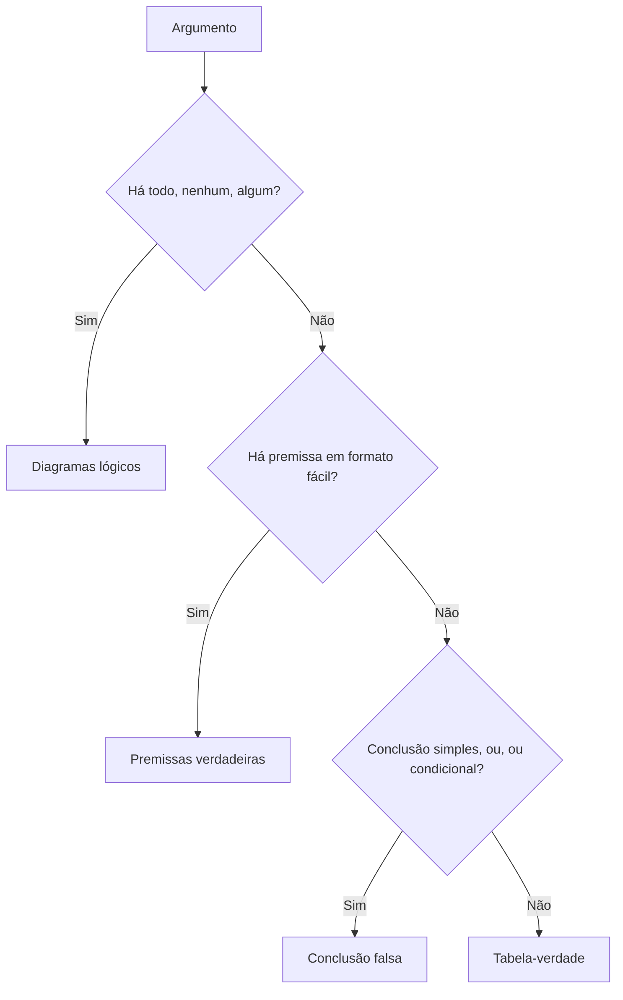
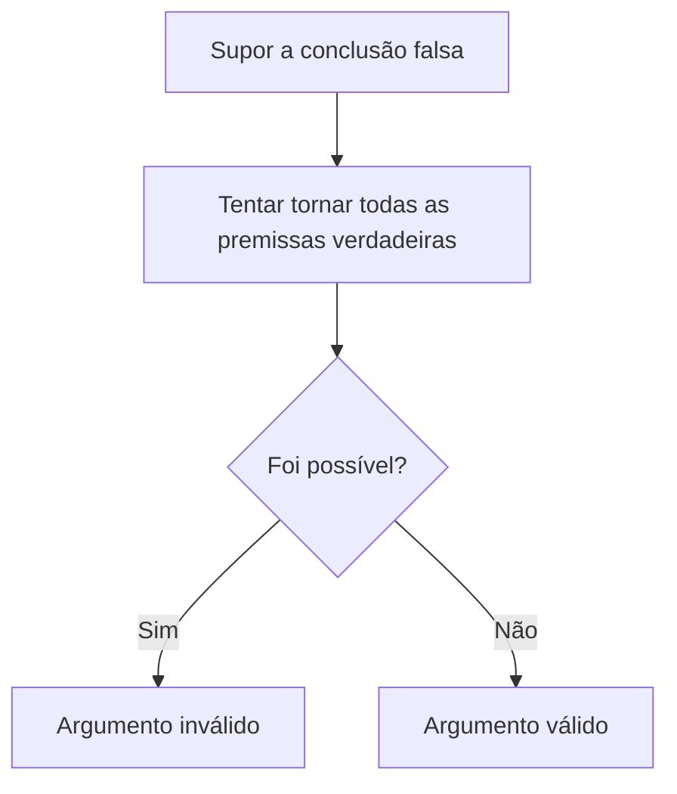

Chegamos ao coração do assunto. Sabemos o que é um argumento e o que é validade; agora é preciso **decidir**, diante de um argumento concreto, se ele é válido ou inválido. Não existe um único caminho: a escolha do método depende do tipo de argumento e do tipo de questão. Este capítulo apresenta quatro métodos principais, o dos **diagramas lógicos**, o das **premissas verdadeiras**, o da **tabela-verdade** e o da **conclusão falsa**, e ensina a escolher o melhor para cada caso. Dominar essa escolha é o que separa quem resolve a questão em dois minutos de quem gasta dez.

> [!objetivos]
> - Escolher o método mais adequado ao tipo de argumento e de questão.
> - Verificar a validade de argumentos categóricos por diagramas.
> - Aplicar o método das premissas verdadeiras e o da tabela-verdade.
> - Usar o método da conclusão falsa com premissas condicionais e disjuntivas.

## Visão geral dos métodos

| Método | Argumento adequado | Vantagem | Limite |
| --- | --- | --- | --- |
| Diagramas lógicos | Categóricos (todo, nenhum, algum) | Visual e intuitivo | Só para categóricos |
| Premissas verdadeiras | Hipotéticos com premissa em formato fácil | Rápido | Exige simples ou conjunção verdadeira |
| Tabela-verdade | Hipotéticos com poucas proposições | Sempre funciona | Lento: 2ⁿ linhas |
| Conclusão falsa | Conclusão simples, disjunção ou condicional | Muito rápido em itens de certo ou errado | Exige conclusão nesses formatos |

## Método dos diagramas lógicos

Quando o argumento é **categórico**, desenham-se os conjuntos das premissas. Se a conclusão for verdadeira em **todos** os desenhos possíveis, o argumento é válido. Se existir ao menos um desenho compatível com as premissas em que a conclusão falha, é inválido.

**Exemplo 1.** "Todo soldado é treinado. Quem é aprendiz é treinado. Logo, todo aprendiz é soldado." Desenha-se o círculo dos soldados dentro do círculo dos treinados. O círculo dos aprendizes também fica dentro dos treinados, mas pode estar separado dos soldados, cruzado com eles ou até dentro deles. Em alguns desenhos, há aprendizes que não são soldados; portanto, a conclusão não é obrigatória, e o argumento é **inválido**.

**Exemplo 2.** "Todo soldado é treinado. Nenhum treinado é leigo. Logo, nenhum soldado é leigo." O círculo dos soldados está dentro do dos treinados, e o dos leigos está fora do dos treinados, sem interseção. Logo, nenhum soldado está entre os leigos: a conclusão vale em todos os desenhos, e o argumento é **válido**.

> [!atencao] Mais de um desenho possível
> Premissas como "todo A é B" admitem vários desenhos (A igual a B, A dentro de B). Teste a conclusão em todos. É nessa variedade de desenhos que aparecem as armadilhas: a conclusão pode ser verdadeira em alguns e falhar em outros.

## Método das premissas verdadeiras

É o método das questões clássicas, aplicado à validade. **Considera-se cada premissa verdadeira** e examina-se se a conclusão é necessariamente verdadeira. Funciona bem quando alguma premissa está em formato fácil: proposição simples verdadeira ou conjunção verdadeira (as premissas são sempre tratadas como verdadeiras, então não aparecem disjunção falsa nem condicional falsa).

As quatro etapas são as já conhecidas: identificar a premissa em formato fácil, passar para símbolos, obter os valores e verificar a conclusão. A etapa 4, aqui, é exatamente o teste de validade: a conclusão é verdadeira, uma vez consideradas as premissas?

**Exemplo 3.** Premissas: (I) "Se Lúcio estudou, então foi aprovado"; (II) "Se Marta não estudou, então não foi aprovada"; (III) "Marta estudou e Lúcio não foi aprovado". Qual conclusão é válida: "Marta não foi aprovada ou Lúcio não estudou"?

- A premissa III é uma conjunção verdadeira: Marta estudou (me = V) e Lúcio não foi aprovado (la = F).
- Em I, com consequente la falso, o antecedente é falso: Lúcio não estudou (le = F).
- Em II, o antecedente "Marta não estudou" é falso (porque Marta estudou); a condicional é verdadeira e nada se sabe sobre ma (Marta foi aprovada?).
- Conclusão proposta: ~ma ∨ ~le. Como ~le é V (Lúcio não estudou), a disjunção é verdadeira qualquer que seja ma. A conclusão é válida.

As demais alternativas típicas dependem de ma, que é indeterminado, e por isso não são válidas.

## Método da tabela-verdade

Este método é o mais geral, e por isso o mais lento. Constrói-se a tabela-verdade da condicional associada ao argumento,

**(P1 ∧ P2 ∧ ... ∧ Pn) → C**

e examina-se: se for uma **tautologia**, o argumento é válido; se não for, é inválido. Como a tabela tem 2ⁿ linhas (n é o número de proposições simples), ela só compensa com duas ou três proposições.

### Versão rápida para múltipla escolha

Em questões de múltipla escolha, não é preciso montar uma tabela para cada alternativa. Use três etapas:

1. passar as premissas para símbolos;
2. montar uma só tabela e marcar as **linhas em que todas as premissas são verdadeiras**;
3. escolher a alternativa que seja verdadeira em **todas** essas linhas.

**Exemplo 4.** As três sentenças a seguir são verdadeiras: (I) "Se a rede cai, o servidor reinicia"; (II) "Se o técnico chega, o servidor não reinicia"; (III) "A rede cai ou o técnico chega". Sejam r: "a rede cai"; s: "o servidor reinicia"; t: "o técnico chega". As sentenças são r → s, t → ~s e r ∨ t. Observe as oito linhas.

| Linha | r | s | t | r → s | t → ~s | r ∨ t | Todas verdadeiras? |
| --- | --- | --- | --- | --- | --- | --- | --- |
| 1 | V | V | V | V | F | V | Não |
| 2 | V | V | F | V | V | V | **Sim** |
| 3 | V | F | V | F | V | V | Não |
| 4 | V | F | F | F | V | V | Não |
| 5 | F | V | V | V | F | V | Não |
| 6 | F | V | F | V | V | F | Não |
| 7 | F | F | V | V | V | V | **Sim** |
| 8 | F | F | F | V | V | F | Não |

Só as linhas 2 e 7 têm as três premissas verdadeiras. Nas duas, s tem o mesmo valor de r (V e V na linha 2; F e F na linha 7), e t tem o valor contrário. Conclusões necessárias:

- "O servidor reinicia se, e somente se, a rede cai" (s ⟷ r): verdadeira nas duas linhas.
- "O servidor reinicia ou o técnico chega" (s ∨ t): verdadeira nas duas linhas.
- "A rede cai" (r): falsa na linha 7; **não** é conclusão necessária.
- "O técnico chega" (t): falsa na linha 2; não é necessária.

> [!bizu] Uma alternativa só vale se for verdadeira em todas as linhas
> Se a alternativa é verdadeira em uma linha e falsa em outra, ela é uma possibilidade, não uma conclusão. O argumento só valida o que é verdadeiro em todas as linhas em que as premissas são verdadeiras.

### Quando o enunciado manda considerar afirmações falsas

Às vezes o enunciado não tem nenhum formato fácil e ainda declara que algumas afirmações são falsas e outras verdadeiras. Aí a tabela é indispensável. Exemplo: "Considere falsa a afirmação I e verdadeira a afirmação II. I: Camila é auditora e Jorge é auditor. II: Se Camila é auditora, então Jorge é auditor." Sejam c e j as proposições. A afirmação I é c ∧ j (falsa), e a II é c → j (verdadeira).

| Linha | c | j | c ∧ j | c → j | I falsa e II verdadeira? |
| --- | --- | --- | --- | --- | --- |
| 1 | V | V | V | V | Não |
| 2 | V | F | F | F | Não |
| 3 | F | V | F | V | **Sim** |
| 4 | F | F | F | V | **Sim** |

As linhas 3 e 4 satisfazem as condições. Nelas, c é falso: é necessariamente falso que Camila seja auditora. Já j pode ser V ou F, então nada se afirma sobre Jorge.

## Método da conclusão falsa

O método da conclusão falsa é o mais rápido para itens de certo ou errado. Ele exige que a conclusão seja uma **proposição simples**, uma **disjunção inclusiva** ou uma **condicional**, porque são os formatos em que se sabe exatamente o que torna a conclusão falsa. O raciocínio por trás é simples: um argumento só é inválido se existir um caso em que as premissas são todas verdadeiras e a conclusão é falsa; basta procurar esse caso e, se ele não existir, o argumento é válido. A ideia é um teste de invalidade:

1. passar as premissas para símbolos;
2. **supor que a conclusão é falsa**;
3. tentar tornar todas as premissas verdadeiras com a conclusão falsa.

Se for possível, o argumento é **inválido** (existe um caso de premissas verdadeiras e conclusão falsa). Se for impossível, o argumento é **válido**.

**Exemplo 5 (válido).** Premissas: P1: p → q; P2: q → r; P3: ~r. Conclusão: ~p. Suponha a conclusão falsa: ~p é F, então p é V. De P1, com p V, q é V. De P2, com q V, r é V. Mas P3 exige ~r verdadeiro, ou seja, r falso. Contradição: não há como ter as premissas verdadeiras com a conclusão falsa. O argumento é **válido**.

**Exemplo 6 (inválido).** Premissas: P1: p → q; P2: ~q ∨ r. Conclusão: r. Suponha a conclusão falsa: r é F. De P2, ~q ∨ r é V com r falso, então ~q é V, logo q é F. De P1, p → q com q falso exige p falso. Então p é F, q é F, r é F: P1 é V, P2 é V e a conclusão é F. Existe um caso com premissas verdadeiras e conclusão falsa; o argumento é **inválido**.

| Valores | P1 (p → q) | P2 (~q ∨ r) | Conclusão (r) | Leitura |
| --- | --- | --- | --- | --- |
| p = F, q = F, r = F | V | V | F | Premissas verdadeiras e conclusão falsa: inválido |

> [!pegadinha] Conclusão em outro formato
> O método da conclusão falsa é prático quando a conclusão é simples, uma disjunção inclusiva ou uma condicional. Se a conclusão for uma conjunção, ou uma bicondicional, a hipótese "conclusão falsa" deixa muitos casos abertos e o método perde força. Nesses casos, prefira a tabela-verdade ou as premissas verdadeiras.

> [!resolvido] Questão comentada: certo ou errado
> Premissas: P1: "Se houver aglomeração ou conflito, a polícia agirá". P2: "Se a polícia agir, a ambulância será necessária". P3: "Não houve conflito, mas a ambulância foi necessária". Conclusão: "Houve aglomeração". O argumento é válido?
>
> **Resolução.** Sejam a: aglomeração; c: conflito; p: polícia age; m: ambulância necessária. P1: (a ∨ c) → p; P2: p → m; P3: ~c ∧ m; C: a. Suponha a conclusão falsa: a é F. De P3 (conjunção verdadeira), c é F e m é V. Em P2, com consequente m verdadeiro, a condicional é verdadeira qualquer que seja p. Em P1, o antecedente a ∨ c é F ∨ F = F, então P1 é verdadeira qualquer que seja p. Assim, é possível ter todas as premissas verdadeiras (por exemplo, com p falso) e a conclusão falsa. O argumento é **inválido**.

## Mais exemplos resolvidos

### Exemplo 7: diagramas com preferências

Considere dois argumentos. No primeiro: "Todos os atletas gostam de pizza. Quem gosta de refrigerante gosta de pizza. Logo, todos os atletas gostam de refrigerante." No segundo: "Todos os atletas gostam de pizza. Quem gosta de refrigerante **não** gosta de pizza. Logo, nenhum atleta gosta de refrigerante."

No primeiro, desenha-se o círculo dos atletas dentro do círculo dos que gostam de pizza. O círculo dos que gostam de refrigerante também fica dentro do círculo dos que gostam de pizza, mas não precisa conter os atletas: há desenhos em que existem atletas fora dele. Logo, a conclusão não é obrigatória, e o argumento é **inválido**.

No segundo, o círculo dos que gostam de refrigerante não pode ter interseção com o círculo dos que gostam de pizza. Como os atletas estão inteiramente dentro deste último, também não têm interseção com o primeiro. A conclusão vale em todos os desenhos, e o argumento é **válido**.

> [!resolvido] Exemplo 8: premissas com gentílicos
> Considere: (I) "Se Ana é capixaba, então Bruno é carioca"; (II) "Se Carla é paulista, então Bruno não é carioca"; (III) "Ana é capixaba ou Carla é paulista"; (IV) "Se Ana não é capixaba, então Carla não é paulista". Qual conclusão é segura?
>
> **Resolução.** Sejam a: Ana é capixaba; b: Bruno é carioca; c: Carla é paulista. As premissas são a → b, c → ~b, a ∨ c e ~a → ~c. Pelo método da tabela-verdade, buscam-se as linhas em que as quatro são verdadeiras. Se a fosse F, a premissa III exigiria c V, mas a premissa IV (com ~a V) exigiria ~c V: contradição. Logo, a é V. Então, por I, b é V. Por II, como b é V, ~b é F, e a condicional c → ~b só é verdadeira se c for F. A única linha possível é a V, b V, c F: "Ana é capixaba, Bruno é carioca e Carla não é paulista".

A tabela confirma o raciocínio: das oito linhas, só a segunda deixa as quatro premissas verdadeiras.

| Linha | a | b | c | a → b | c → ~b | a ∨ c | ~a → ~c | Todas verdadeiras? |
| --- | --- | --- | --- | --- | --- | --- | --- | --- |
| 1 | V | V | V | V | F | V | V | Não |
| 2 | V | V | F | V | V | V | V | **Sim** |
| 3 | V | F | V | F | V | V | V | Não |
| 4 | V | F | F | F | V | V | V | Não |
| 5 | F | V | V | V | F | V | F | Não |
| 6 | F | V | F | V | V | F | V | Não |
| 7 | F | F | V | V | V | V | F | Não |
| 8 | F | F | F | V | V | F | V | Não |

### Exemplo 9: premissas verdadeiras com nomes genéricos

Premissas: (I) "Se Fulano estudou, então foi aprovado"; (II) "Se Cicrano não estudou, então não foi aprovado"; (III) "Cicrano estudou e Fulano não foi aprovado". A conclusão "Cicrano não foi aprovado ou Fulano não estudou" é válida?

A premissa III é conjunção verdadeira: Cicrano estudou (ce V) e Fulano não foi aprovado (fa F). Em I, com consequente fa falso, o antecedente é falso: Fulano não estudou (fe F). Em II, o antecedente "Cicrano não estudou" é falso, então a condicional é verdadeira e nada se sabe sobre a aprovação de Cicrano. Na conclusão ~ca ∨ ~fe, a parcela ~fe é V, então a disjunção é verdadeira de qualquer forma. A conclusão é válida. Já as alternativas que dependem de ca, como "Cicrano foi aprovado e Fulano não estudou", ficam sem determinação e não são válidas.

### Exemplo 10: afirmações com tabela e o contexto de controle externo

Num concurso de auditoria de controle externo, afirma-se: "Considere falsa a afirmação I e verdadeira a II. I: Camila é auditora de ciências contábeis e Jorge é auditor de ciências jurídicas. II: Se Camila é auditora de ciências contábeis, então Jorge é auditor de ciências jurídicas." É necessariamente verdadeiro que Jorge é auditor de ciências jurídicas?

Com c e j, I é c ∧ j (falsa) e II é c → j (verdadeira). Na tabela do exemplo anterior, as linhas que satisfazem os valores são F-V e F-F. Nelas, c é F; j pode ser V ou F. Portanto, é necessariamente falso que Camila seja auditora de ciências contábeis, mas **nada se pode afirmar** sobre Jorge.

> [!bizu] Gentílicos e nomes não importam
> Capixaba, carioca, paulista, Fulano e Cicrano são apenas rótulos de proposições. O contexto não entra no raciocínio: por isso, a etapa 1 de todos os métodos é "desconsiderar o contexto".

## Possível não é necessário

Vale encerrar com um quadro que organiza a ideia que une todos os métodos. Diante de uma alternativa, a pergunta é sempre a mesma: ela é verdadeira em **todos** os casos em que as premissas são verdadeiras? Três respostas são possíveis.

| Situação da alternativa | Em todos os casos | Em alguns casos | Em nenhum caso |
| --- | --- | --- | --- |
| Nome técnico | Conclusão necessária | Possibilidade | Contradição com as premissas |
| É resposta de "o que se conclui"? | Sim | Não | Não |
| É resposta de "o que é possível"? | Sim | Sim | Não |
| Exemplo (Exemplo 4, rede e servidor) | s ∨ t | r | r ∧ t |

Em quase toda questão errada, a alternativa é só uma **possibilidade** disfarçada de conclusão. Treine esse olhar em cada exercício. Antes de marcar, pergunte: existe algum caso compatível com as premissas em que esta alternativa falhe? Se existir, ela não é conclusão. Esse é, em essência, o método da conclusão falsa aplicado a cada alternativa.

## Como a banca cobra este assunto

Este é o tópico mais importante do assunto, porque concentra as questões de lógica de argumentação: inferências, deduções e conclusões a partir de premissas dadas. Nos itens de certo ou errado, a conclusão costuma ser simples, uma disjunção ou uma condicional, e o método da conclusão falsa resolve em minutos. Nas questões de múltipla escolha, as alternativas são conjunções de proposições simples e a tabela-verdade (ou o método das premissas verdadeiras, quando há formato fácil) identifica a que decorre das premissas. Há também as questões com afirmações declaradas falsas, em que a tabela é inevitável, e as questões categóricas, em que os diagramas são a ferramenta. Em todos os casos, a banca explora a mesma confusão: tratar como conclusão válida uma alternativa que só é **possível**, e não **necessária**.

## Mapa do capítulo

| Tema | Ideia central | Armadilha |
| --- | --- | --- |
| Diagramas | Testar a conclusão em todos os desenhos possíveis | Parar no primeiro desenho |
| Premissas verdadeiras | Premissas tratadas como verdadeiras; formato fácil | Usá-lo sem premissa em formato fácil |
| Tabela-verdade | Condicional associada tautológica = válido | Esquecer que são 2ⁿ linhas |
| Múltipla escolha | Linhas com todas as premissas V; alternativa V em todas elas | Aceitar alternativa só possível |
| Afirmações falsas | Marcar na tabela as linhas pedidas (V ou F) | Ignorar a indicação de falsidade |
| Conclusão falsa | Impossível manter premissas V com C falsa = válido | Aplicar a conclusões em outros formatos |

### Para fixar

1. Argumentos categóricos se verificam por diagramas; vale a conclusão que se mantém em todos os desenhos.
2. O método das premissas verdadeiras exige premissas em formato fácil (simples ou conjunção verdadeira).
3. O argumento é válido se, e somente se, (P1 ∧ ... ∧ Pn) → C é tautologia.
4. A tabela-verdade tem 2ⁿ linhas, em que n é o número de proposições simples.
5. Em múltipla escolha, marcam-se as linhas em que todas as premissas são verdadeiras.
6. A alternativa correta é a que é verdadeira em todas as linhas marcadas.
7. Quando o enunciado declara afirmações falsas, marcam-se as linhas que satisfazem esses valores.
8. O método da conclusão falsa serve a conclusões simples, em disjunção inclusiva ou condicionais.
9. Se for possível manter premissas verdadeiras e conclusão falsa, o argumento é inválido.
10. Se for impossível, o argumento é válido.
