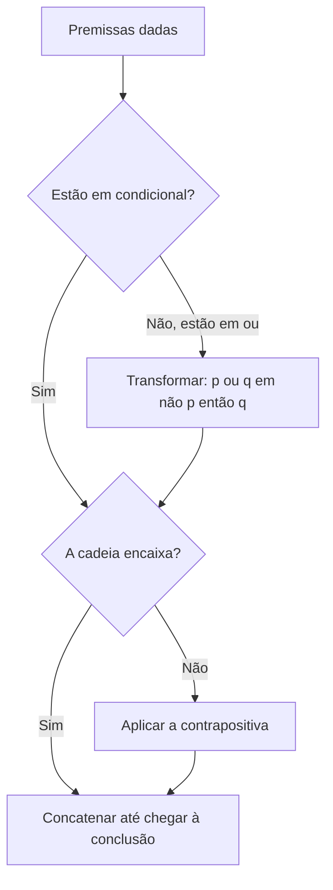
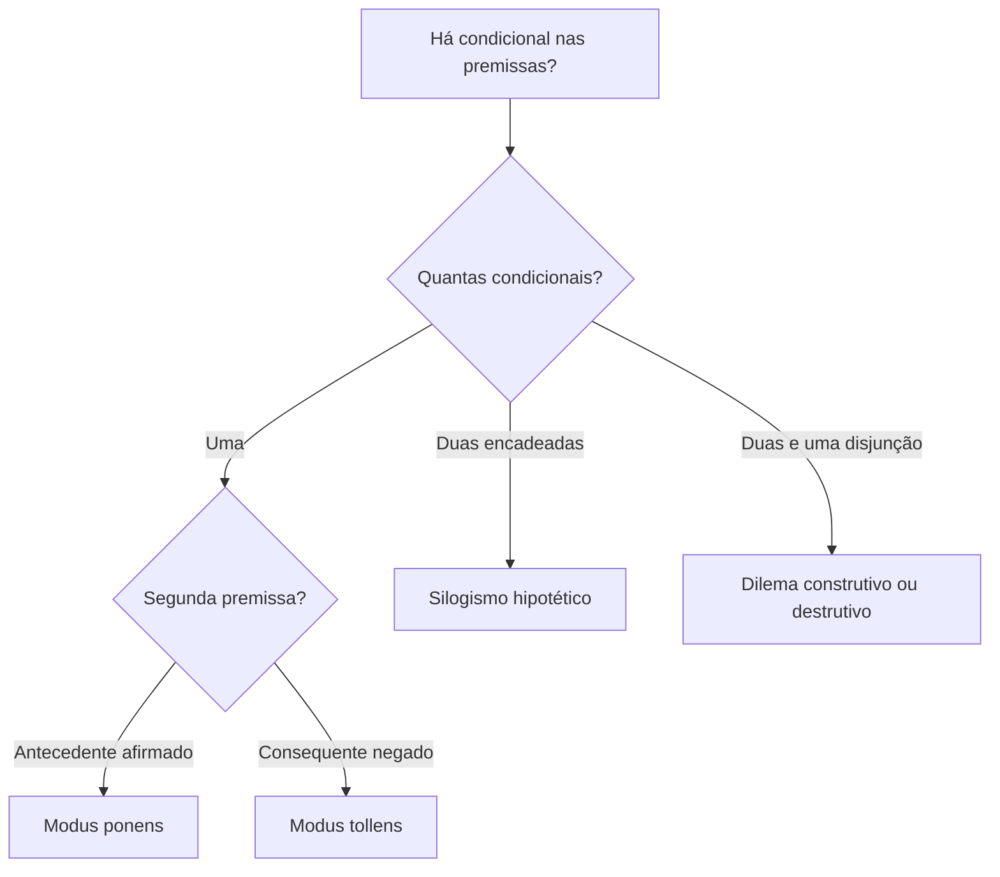

Fechamos o volume com os dois métodos mais elegantes de verificar a validade de um argumento hipotético: a **transitividade da condicional**, que encadeia condicionais como elos de uma corrente, e as **regras de inferência**, que são argumentos válidos já prontos, verdadeiros "de bolso". Quem conhece essas regras reconhece a forma do argumento em segundos, sem tabela-verdade e sem hipóteses. Este capítulo mostra como usar a transitividade quando as premissas são condicionais ou disjunções, como extrair uma conclusão simples de uma cadeia e quais são as regras de inferência que mais aparecem nas provas.

> [!objetivos]
> - Aplicar a transitividade da condicional, com o uso da contrapositiva e da transformação de "ou" em "se... então".
> - Concluir o valor de uma proposição simples a partir de uma cadeia (~p → p ou p → ~p).
> - Reconhecer e aplicar o modus ponens, o modus tollens, o silogismo hipotético e os dilemas construtivo e destrutivo.
> - Evitar as falácias da afirmação do consequente e da negação do antecedente.

## Transitividade da condicional

Imagine um argumento cujas premissas são condicionais em fila: o consequente de cada uma é o antecedente da seguinte. A conclusão é uma condicional que liga o antecedente da primeira ao consequente da última. Esse argumento é **sempre válido**, qualquer que seja o número de premissas.

*Premissa 1: Se o boletim é lavrado, então o delegado é avisado.*
*Premissa 2: Se o delegado é avisado, então o inquérito é aberto.*
*Premissa 3: Se o inquérito é aberto, então o plantão é encerrado mais tarde.*
*Conclusão: Se o boletim é lavrado, então o plantão é encerrado mais tarde.*

Em símbolos: p → q, q → r, r → s, logo p → s. A cadeia é uma corrente: o fim de um elo encaixa no começo do outro. Essa propriedade se chama **transitividade da condicional**.

O **método da transitividade** consiste em concatenar, de forma conveniente, algumas ou todas as premissas condicionais até obter a conclusão proposta. Se a conclusão for obtida, o argumento é válido.

### Quando a cadeia não aparece de primeira

Muitas vezes é preciso adaptar as premissas para encaixá-las. Três ferramentas ajudam:

| Ferramenta | O que faz | Exemplo |
| --- | --- | --- |
| Contrapositiva | Inverte e nega a condicional | p → q vira ~q → ~p |
| Ou em condicional | Transforma uma disjunção em condicional | p ∨ q vira ~p → q |
| De Morgan | Reescreve a negação de e/ou | ~(p ∧ q) vira ~p ∨ ~q |

**Exemplo 1 (contrapositiva).** Sobre um recruta chamado Zeca, sabe-se: "Se Zeca é atirador, então não é motorista" (a → ~m) e "Se Zeca não é atirador, então é radiotelegrafista" (~a → r). Que conclusão se tira? As duas não encaixam diretamente, mas a contrapositiva da primeira é m → ~a. Agora a corrente fecha: m → ~a, ~a → r, logo **m → r**: "Se Zeca é motorista, então é radiotelegrafista".

**Exemplo 2 (ou em condicional).** "Marta vai à inauguração ou Pedro não vai" (m ∨ ~p) e "Se Lauro vai, Marta não vai" (l → ~m). Transforme a disjunção: m ∨ ~p ≡ ~m → ~p. Agora há ~m → ~p e l → ~m. A cadeia l → ~m, ~m → ~p fecha em **l → ~p**: "Se Lauro vai, Pedro não vai". Repare que, aqui, bastou concatenar na ordem em que as premissas já estavam, depois da transformação da disjunção.

> [!bizu] Procure o fio da meada
> Em uma cadeia, o antecedente de uma premissa deve ser o consequente de outra. Procure primeiro o termo que aparece uma vez como antecedente e outra como consequente. Se não aparecer, aplique a contrapositiva em uma das premissas.

## Conclusão simples a partir da cadeia: ~p → p e p → ~p

Há questões em que as premissas são condicionais e a conclusão a ser buscada é uma proposição **simples**. O truque é conseguir uma condicional da forma **~p → p** ou **p → ~p**.

- Se a cadeia leva a **~p → p**, então **p é verdadeiro**. Caso p fosse falso, ~p seria V e p seria F, e a condicional V → F seria falsa; como a conclusão é consequência verdadeira, p precisa ser V.
- Se a cadeia leva a **p → ~p**, então **p é falso**. Se p fosse verdadeiro, ocorreria V → F.

| Conclusão da cadeia | O que significa |
| --- | --- |
| ~p → p | p é verdadeiro |
| p → ~p | p é falso |
| p → q (em geral) | Só liga p a q, nada se afirma sobre p isolado |
| q → p com q verdadeiro | p é verdadeiro (modus ponens) |

**Exemplo 3.** São verdadeiras: (I) "Se Rita é paranaense, então Davi é gaúcho"; (II) "Se Elisa não é mineira, então Davi não é gaúcho"; (III) "Se Elisa é mineira, então Rita não é paranaense". O que se deduz?

Sejam r: Rita é paranaense; d: Davi é gaúcho; e: Elisa é mineira. As premissas são r → d, ~e → ~d e e → ~r. A contrapositiva da segunda é d → e. A cadeia fica: r → d, d → e, e → ~r. Concatenando: **r → ~r**. Logo, r é falso: Rita **não** é paranaense.

> [!resolvido] Exemplo 4: afirmações com conjunção falsa
> Considere falsa a afirmação I ("Camila é auditora e Jorge é auditor") e verdadeira a II ("Se Camila é auditora, então Jorge é auditor"). O que se conclui sobre Camila?
>
> **Resolução.** Sejam c e j. A afirmação I é c ∧ j (falsa); logo, sua negação ~(c ∧ j) é verdadeira e, por De Morgan, equivale a ~c ∨ ~j. Transformando em condicional: c → ~j. A afirmação II é c → j, cuja contrapositiva é ~j → ~c. Concatenando c → ~j com ~j → ~c, obtém-se **c → ~c**. Logo, c é falso: é necessariamente falso que Camila é auditora.

> [!atencao] Não confunda p → q com p
> A cadeia só informa o valor de uma proposição simples quando termina em ~p → p ou p → ~p. Conclusões do tipo p → q apenas relacionam as duas proposições.

## Regras de inferência

**Regras de inferência** são atalhos: formas de argumento que são **sempre válidas** e que dispensam a verificação a cada questão. Existem incontáveis regras; as que aparecem em provas são cinco.

### Modus ponens (afirmação do antecedente)

*Premissa 1: Se p, então q.*
*Premissa 2: p.*
*Conclusão: q.*

Condicional mais a afirmação do antecedente: conclui-se o consequente. Exemplo: "Se a sirene toca, o pelotão sai. A sirene tocou. Logo, o pelotão saiu."

### Modus tollens (negação do consequente)

*Premissa 1: Se p, então q.*
*Premissa 2: ~q.*
*Conclusão: ~p.*

Condicional mais a negação do consequente: conclui-se a negação do antecedente. Exemplo: "Se hoje é feriado, amanhã eu trabalho. Amanhã eu não trabalho. Logo, hoje não é feriado." O modus tollens é, na verdade, o modus ponens aplicado à contrapositiva (~q → ~p).

Quando o antecedente é uma conjunção, a negação do antecedente exige De Morgan. Se a premissa é "Se o desperdício é evitado e as pessoas são conscientes, o lixo diminui" ((d ∧ p) → l) e o lixo não diminuiu (~l), conclui-se ~(d ∧ p), ou seja, ~d ∨ ~p: "O desperdício não foi evitado ou as pessoas não foram conscientes".

### Silogismo hipotético

*Premissa 1: Se p, então q.*
*Premissa 2: Se q, então r.*
*Conclusão: Se p, então r.*

É a transitividade com duas premissas. Exemplo: "Se o plantonista chega cedo, a vistoria começa. Se a vistoria começa, o relatório sai no horário. Logo, se o plantonista chega cedo, o relatório sai no horário."

### Dilema construtivo

*Premissa 1: Se p, então q.*
*Premissa 2: Se r, então s.*
*Premissa 3: p ou r.*
*Conclusão: q ou s.*

Duas condicionais e a disjunção dos antecedentes: conclui-se a disjunção dos consequentes. Exemplo: "Se a ronda é diurna e a viatura está livre, o policial sai de moto. Se a ronda é noturna, o policial sai de carro. A ronda é diurna e a viatura está livre, ou é noturna. Logo, o policial sai de moto ou sai de carro."

### Dilema destrutivo

*Premissa 1: Se p, então q.*
*Premissa 2: Se r, então s.*
*Premissa 3: ~q ou ~s.*
*Conclusão: ~p ou ~r.*

Duas condicionais e a disjunção das **negações** dos consequentes: conclui-se a disjunção das **negações** dos antecedentes. Exemplo: "Se o depoente A compareceu ao plantão, seu boletim foi lavrado. Se o depoente B compareceu, seu boletim foi lavrado. O boletim de A não foi lavrado ou o de B não foi lavrado. Logo, A não compareceu ou B não compareceu."

| Regra | Premissas | Conclusão |
| --- | --- | --- |
| Modus ponens | p → q; p | q |
| Modus tollens | p → q; ~q | ~p |
| Silogismo hipotético | p → q; q → r | p → r |
| Dilema construtivo | p → q; r → s; p ∨ r | q ∨ s |
| Dilema destrutivo | p → q; r → s; ~q ∨ ~s | ~p ∨ ~r |

> [!pegadinha] Nome do dilema construtivo
> Em provas, o dilema construtivo também aparece como "silogismo disjuntivo". Em tratados de lógica, porém, o silogismo disjuntivo costuma ser outro: "p ou q; não p; logo, q". Quando a questão trouxer uma estrutura de duas condicionais mais uma disjunção dos antecedentes, trata-se do dilema construtivo, qualquer que seja o rótulo.

### O que NÃO é regra: as duas falácias clássicas

Duas formas parecem modus ponens e modus tollens, mas são **inválidas**.

| Falácia | Forma | Por que falha |
| --- | --- | --- |
| Afirmação do consequente | p → q; q; logo p | O consequente pode ser V com antecedente F |
| Negação do antecedente | p → q; ~p; logo ~q | O consequente pode ser V com antecedente F |

Se "Se choveu, a rua molhou" e "a rua molhou", não se segue que choveu: um caminhão-pipa também molha a rua. E, se "não choveu", não se segue que a rua não molhou.

> [!resolvido] Questão comentada: qual regra se usa?
> Considere P1: [(~A) ∧ (~G)] → (~P); P2: P; conclusão: A ∨ G. Qual regra explica a validade?
>
> **Resolução.** P2 afirma P, isto é, nega o consequente ~P da premissa P1 (a dupla negação de ~P é P). Pelo modus tollens, conclui-se a negação do antecedente: ~[(~A) ∧ (~G)]. Por De Morgan, isso é A ∨ G. A validade vem do modus tollens com a lei de De Morgan.

> [!resolvido] Questão comentada: reconhecer o silogismo hipotético
> "Se Ana é mais velha que João, Ana cuida de João. Se Ana cuida de João, os pais de João viajam. Logo, se Ana é mais velha que João, os pais de João viajam." Qual é o nome do argumento?
>
> **Resolução.** Duas condicionais encadeadas e uma conclusão que liga o primeiro antecedente ao último consequente: é o **silogismo hipotético**.

## Por que as regras são válidas

Nenhuma regra é dogma: todas se provam pela condicional associada. Para o modus ponens, a condicional é [(p → q) ∧ p] → q. Há apenas uma linha da tabela em que as duas premissas são verdadeiras (p V e q V), e nela a conclusão q é V. Logo, a condicional é tautologia.

| p | q | p → q | (p → q) ∧ p | [(p → q) ∧ p] → q |
| --- | --- | --- | --- | --- |
| V | V | V | V | V |
| V | F | F | F | V |
| F | V | V | F | V |
| F | F | V | F | V |

A última coluna é toda verdadeira. O mesmo teste mostra que as falácias não são regras. Para a afirmação do consequente, [(p → q) ∧ q] → p, a linha p F e q V torna as premissas verdadeiras (p → q é V e q é V) e a conclusão falsa (p é F). Basta essa linha para provar a invalidade.

## Treino de reconhecimento

Para cada estrutura, diga o nome da regra ou se é uma falácia.

| Estrutura | Resposta | Motivo |
| --- | --- | --- |
| Se chove, a feira fecha. Chove. Logo, a feira fecha | Modus ponens | Antecedente afirmado |
| Se chove, a feira fecha. A feira não fechou. Logo, não choveu | Modus tollens | Consequente negado |
| Se chove, a feira fecha. A feira fechou. Logo, choveu | Falácia | Afirma o consequente |
| Se chove, a feira fecha. Não choveu. Logo, a feira não fechou | Falácia | Nega o antecedente |
| Se chove, a feira fecha. Se a feira fecha, o preço sobe. Logo, se chove, o preço sobe | Silogismo hipotético | Transitividade |
| Se chove, a feira fecha. Se faz sol, o parque lota. Chove ou faz sol. Logo, a feira fecha ou o parque lota | Dilema construtivo | Disjunção dos antecedentes |

Perceba que o silogismo hipotético e os dilemas dependem de mais de uma condicional, enquanto o modus ponens e o modus tollens trabalham com uma só. Esse critério de contagem acelera o reconhecimento.

> [!bizu] Duas perguntas resolvem o reconhecimento
> Primeira: quantas condicionais há? Segunda: o que a outra premissa faz com a condicional (afirma o antecedente, nega o consequente, encadeia, ou une por disjunção)? Com essas duas respostas, a regra se revela.

## Ligação com os diagramas lógicos

As regras deste capítulo também resolvem argumentos categóricos, desde que se traduza cada proposição "todo A é B" na condicional "se é A, então é B". Veja: "Todo cabo é treinado. Mário é cabo. Logo, Mário é treinado." Traduzindo, a primeira premissa vira "se Mário é cabo, então é treinado" e a segunda afirma o antecedente. É um modus ponens. Já "Todo cabo é treinado. Rita não é treinada. Logo, Rita não é cabo" é um modus tollens: nega-se o consequente e conclui-se a negação do antecedente.

Isso mostra que os diagramas lógicos e as regras de inferência não são mundos separados: dois caminhos para o mesmo resultado. Se o diagrama o convence mais, use-o; se a regra vem mais rápido, use a regra. A conferência cruzada, desenhando o diagrama depois de aplicar a regra, é um bom hábito para provas em que o tempo permite.

### Exemplo 5: dilema destrutivo com letras

Premissas: (I) r ∧ s → t; (II) s → t ∧ u; (III) ~t ∨ ~(t ∧ u). Qual conclusão segue pelo dilema destrutivo? Compare com o modelo: p = r ∧ s, q = t; r' = s, s' = t ∧ u; e a terceira premissa é ~q ∨ ~s', isto é, ~t ∨ ~(t ∧ u). A conclusão do modelo é ~p ∨ ~r', ou seja, **~(r ∧ s) ∨ ~s**. É a disjunção das negações dos antecedentes das duas condicionais. A dica é anotar, ao lado de cada premissa, qual é o seu antecedente e qual é o seu consequente, para não trocá-los na hora de formar a conclusão.

### Exemplo 6: encadeando cinco condicionais

Se Lia canta, então Marcos fecha a porta; se Marcos fecha a porta, então Nina assiste televisão; se Nina assiste televisão, então Otto cozinha; se Otto cozinha, então Paula estuda. Sabe-se que Paula não estuda. Pelo modus tollens aplicado em cadeia, Otto não cozinha; de novo, Nina não assiste televisão; Marcos não fecha a porta; e Lia não canta. A cadeia inteira equivale a uma única condicional "se Lia canta, então Paula estuda" (silogismo hipotético repetido), e a negação do último consequente derruba todo o resto, de trás para frente.

## Como a banca cobra este assunto

A banca cobra o método da transitividade em questões de múltipla escolha em que as alternativas são condicionais ("se Biba é bola, então é babalu") e em itens de certo ou errado em que a conclusão proposta é uma condicional obtida por concatenação. Cobra também o raciocínio ~p → p e p → ~p nas questões em que as alternativas são proposições simples. Quanto às regras de inferência, as questões pedem o nome da regra aplicada, a conclusão correta de uma estrutura dada ou a notação simbólica (por exemplo, p, p → q ⊢ q para o modus ponens). Os itens de certo ou errado costumam afirmar que "qualquer argumento nas formas modus ponens ou modus tollens é válido, independentemente do valor de verdade das proposições", o que é correto, porque a validade depende só da forma.

## Mapa do capítulo

| Tema | Ideia central | Armadilha |
| --- | --- | --- |
| Transitividade | Cadeia p → q, q → r, logo p → r | Esquecer a contrapositiva para encaixar |
| Ou em condicional | p ∨ q ≡ ~p → q | Esquecer de negar o primeiro termo |
| ~p → p | p é verdadeiro | Inverter o resultado |
| p → ~p | p é falso | Inverter o resultado |
| Modus ponens | Condicional e antecedente afirmado | Confundir com afirmação do consequente |
| Modus tollens | Condicional e consequente negado | Confundir com negação do antecedente |
| Silogismo hipotético | Transitividade em duas premissas | Trocar a ordem |
| Dilemas | Disjunção dos antecedentes ou dos consequentes negados | Misturar construtivo e destrutivo |
| Falácias | Afirmar o consequente, negar o antecedente | Tomá-las por regras |

### Para fixar

1. A transitividade da condicional torna válido todo argumento em cadeia p → q, q → r, ..., logo p → último.
2. A contrapositiva e a transformação de "ou" em condicional servem para encaixar as premissas.
3. Uma cadeia que termina em ~p → p mostra que p é verdadeiro.
4. Uma cadeia que termina em p → ~p mostra que p é falso.
5. O modus ponens conclui o consequente a partir do antecedente afirmado.
6. O modus tollens conclui a negação do antecedente a partir da negação do consequente.
7. O silogismo hipotético é a transitividade com duas premissas.
8. O dilema construtivo conclui a disjunção dos consequentes, a partir da disjunção dos antecedentes.
9. O dilema destrutivo conclui a disjunção das negações dos antecedentes, a partir da disjunção das negações dos consequentes.
10. Afirmar o consequente e negar o antecedente são falácias, e não regras de inferência.
