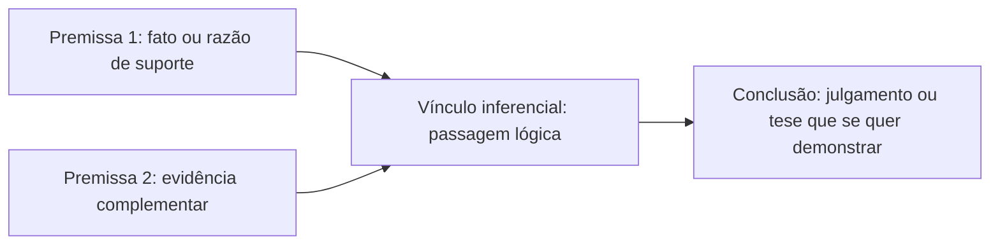
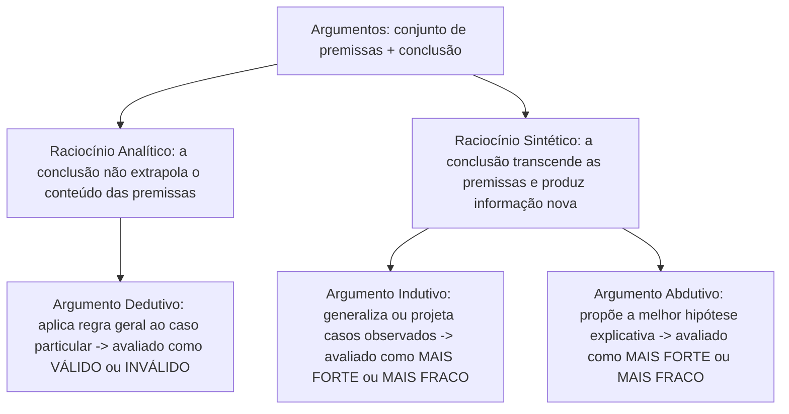

Na lógica proposicional formal, os argumentos costumam aparecer arrumados em linhas numeradas. As premissas ficam no topo e a conclusão vem separada por um traço. Nos textos reais — relatórios de inteligência, pareceres administrativos, artigos de opinião e enunciados de concurso público —, o raciocínio aparece fluido em parágrafos comuns. A tese defendida pode surgir logo na abertura, no meio ou apenas no desfecho. Dominar o **raciocínio crítico** começa por enxergar a estrutura básica de qualquer argumento no meio do texto. É preciso distinguir quando o autor está defendendo uma conclusão ou apenas explicando um fato já aceito, além de classificar o tipo de inferência empregada entre **dedução**, **indução** e **abdução**.

> [!objetivos]
> - Identificar a estrutura básica de um argumento (premissas, conclusão e vínculo inferencial) e diferenciá-la de frases isoladas ou meras explicações.
> - Reconhecer a posição da conclusão (no início, no meio ou no fim do texto) por meio de indicadores linguísticos e marcadores de probabilidade.
> - Classificar os argumentos em dedutivos (analíticos), indutivos e abdutivos (sintéticos), aplicando a cada classe o critério adequado de avaliação (validade versus força).
> - Avaliar os fatores que tornam um argumento indutivo mais forte ou mais fraco, inclusive em premissas estatísticas e na comparação de intervalos numéricos.

## Estrutura básica dos argumentos

No estudo do raciocínio crítico, a palavra **argumento** não significa bate-boca nem discussão acalorada. Trata-se de um conjunto estruturado de declarações em que uma ou mais afirmações oferecem suporte racional para outra. Todo argumento compõe-se de três elementos essenciais:

1. **Premissa**: é a declaração, afirmação ou fato apresentado como razão, evidência ou fundamento a partir do qual o raciocínio é construído. Ela responde às perguntas: *"Por que devo aceitar essa tese?"* ou *"Qual é a evidência disponível?"*.
2. **Conclusão**: é o julgamento resultante das razões apresentadas. Corresponde à tese central que o argumentador quer demonstrar ou fazer o leitor aceitar.
3. **Inferência (vínculo lógico)**: é o processo mental e discursivo que conecta o conjunto de premissas à conclusão. Esse elo permite passar das evidências ao julgamento final.

Para que exista um argumento, é indispensável haver **pelo menos uma premissa e uma conclusão** unidas por uma pretensão de suporte. Uma declaração solta, meramente informativa, exclamativa ou descritiva — desacompanhada de razões que pretendam prová-la ou de uma tese que dela decorra — **não constitui um argumento**. Se não há argumento, tampouco faz sentido classificá-lo como válido ou inválido.

Considere a afirmação isolada: *"O time conquistou o campeonato brasileiro de futebol porque teve o melhor ataque, a defesa menos vazada e a maior pontuação acumulada"*. Quando o autor encadeia os fatos do desempenho esportivo para sustentar o julgamento de mérito da equipe, há relação de suporte entre razões e tese. Já se um texto apenas lista dados desconexos de uma tabela sem extrair deles nenhum julgamento, temos simples relato informativo, e não argumentação.

### Diferença entre argumento e explicação

Uma distinção fundamental cobrada em raciocínio crítico opõe **argumento** a **explicação**, pois ambos usam conectivos parecidos (*porque*, *pois*, *em razão de*), mas cumprem funções lógicas diferentes:

- No **argumento**, a conclusão é uma tese **controversa ou ainda não aceita** de antemão pelo interlocutor, e as premissas fornecem evidências para **convencer** de que essa conclusão é verdadeira.
- Na **explicação**, o fato central já é tomado como **incontroverso, conhecido e aceito** por todos, e o restante do enunciado apenas esclarece **como ou por que causas** aquele fenômeno ocorreu.

| Critério | Argumento | Explicação |
| --- | --- | --- |
| **Status do ponto central** | Tese em disputa ou que precisa ser provada | Fato já aceito como verdadeiro por ambos os lados |
| **Função das razões (*porque...*)** | Premissas que dão evidência para convencer | Causas ou antecedentes que elucidam o fato consumado |
| **Pergunta respondida** | *"Como você prova que isso é verdade?"* | *"Por que razão esse fato conhecido aconteceu?"* |
| **Exemplo típico** | *"O investigado esteve na cena do crime, pois sua digital estava na fechadura."* | *"A ponte metálica dilatou ao meio-dia porque o calor expande os metais."* |

## Reconhecimento da estrutura básica nos textos

Em questões de concurso, o passo mais importante consiste em separar qual oração exerce o papel de **conclusão** e quais orações funcionam como **premissas**. Ao contrário dos exercícios formais de lógica proposicional, nos textos cotidianos a conclusão **não tem posição fixa**: ela pode aparecer **no final**, **no início** ou **no meio** do período.

### Posições da conclusão no discurso

Veja três exemplos práticos que ilustram como a tese pode deslocar-se pelo enunciado:

1. **Conclusão no início**: *"Não foi uma boa compra adquirir este ventilador. O último produto que comprei desta mesma marca quebrou em um mês, e dois amigos meus também tiveram problemas graves quando compraram aparelhos desse fabricante."*
   - **Conclusão** (1ª frase): comprar este ventilador não foi uma boa escolha.
   - **Premissas** (frases seguintes): o produto anterior da mesma marca deu defeito rápido e dois amigos tiveram problemas com o fabricante.
2. **Conclusão no meio**: *"Os gatos não precisam ser levados para passear na rua; por conseguinte, dão menos trabalho aos seus donos comparativamente aos cães. Além disso, eles não necessitam de banho semanal."*
   - **Conclusão** (oração intermediária): gatos dão menos trabalho aos donos do que cães.
   - **Premissas** (1ª e 3ª frases): gatos dispensam passeios na rua e não exigem banho semanal.
3. **Conclusão no final**: *"Ouvi um barulho forte na cozinha e a cozinheira havia deixado o pote de ração aberto no chão; logo, deve haver um gambá revirando a cozinha."*
   - **Premissas** (primeiras orações): barulho ouvido na cozinha e pote de ração deixado no chão.
   - **Conclusão** (última oração): a presença provável de um gambá na cozinha.

### Indicadores de conclusão e indicadores de premissa

Para localizar rapidamente cada parte, apoie-se nos **indicadores linguísticos** (conjunções e locuções) que anunciam se a oração seguinte é a tese resultante ou a razão de suporte:

| Indicadores típicos de CONCLUSÃO (introduzem a tese) | Indicadores típicos de PREMISSA (introduzem a razão/fato) |
| --- | --- |
| *logo*, *portanto*, *então*, *por isso*, *assim*, *deste modo*, *desta forma* | *pois*, *porque*, *já que*, *visto que*, *dado que*, *uma vez que* |
| *por conseguinte*, *consequentemente*, *pode-se inferir que*, *conclui-se que*, *daí decorre* | *tanto que*, *devido a*, *em razão de*, *admitindo que*, *assumindo que*, *como* (causal) |

> [!bizu] Marcadores de probabilidade e julgamento apontam para a conclusão
> Mesmo quando o texto não traz *logo* ou *portanto*, verbos e advérbios que exprimem **julgamento, estimativa ou probabilidade** — como **deve**, **talvez**, **possivelmente** e **provavelmente** — costumam marcar a **conclusão** do argumento. Por exemplo:
> - *"Eles já devem ter chegado à festa, visto que ninguém telefonou reclamando de atraso."* → **Conclusão**: eles já devem ter chegado à festa; **Premissa**: ninguém telefonou reclamando.
> - *"Possivelmente eles serão aprovados no concurso público, pois estudaram durante bastante tempo."* → **Conclusão**: possivelmente serão aprovados; **Premissa**: estudaram por bastante tempo.
> - *"Talvez as encomendas não cheguem hoje; portanto, só partiremos amanhã."* → Aqui o *portanto* decide: a dúvida sobre a entrega funciona como premissa para a decisão final de só partir amanhã (conclusão).
> - *"O lixeiro deve estar passando diante da nossa porta, porque senti um forte odor de coisa podre."* → **Conclusão**: o lixeiro deve estar passando; **Premissa**: o fato sensorial de ter sentido o odor.

> [!pegadinha] Ordem física das frases versus ordem lógica (premissa antes da conclusão)
> Uma cobrança recorrente pede ao candidato que assinale a alternativa em que a **premissa vem enunciada antes da conclusão**. Cuidado com frases como: *"A saúde é fonte de riqueza, pois as pessoas saudáveis são mais trabalhadoras e enriquecem"*. Nela, a primeira oração é a **conclusão**, porque a conjunção *pois* introduz a premissa na segunda metade! Para que a premissa venha **antes** da conclusão, procure estruturas em que o fato é narrado primeiro e o julgamento vem depois, como em: *"Senti forte odor lá fora; o caminhão de lixo deve estar passando"*.

> [!resolvido] Questão resolvida — Reconhecimento de premissas e conclusão
> **Enunciado**: Considere os três enunciados abaixo:
> I. *"Como os mercados não abrem aos domingos naquela vila, deixarei para comprar os mantimentos na segunda-feira."*
> II. *"Os candidatos serão aprovados, visto que resolveram todas as provas anteriores da banca."*
> III. *"Sempre que chove no inverno a estrada de terra alaga; além disso, nevou ontem na serra e as pistas ficaram intransitáveis."*
> Assinale a análise estrutural correta sobre a posição da premissa e da conclusão nos itens I e II.
>
> **Resolução passo a passo**:
> 1. **Análise do item I**: O conectivo inicial *"Como"* tem valor causal (equivale a *já que* / *visto que*), introduzindo a **premissa** (*"os mercados não abrem aos domingos naquela vila"*). A segunda oração (*"deixarei para comprar os mantimentos na segunda-feira"*) é a decisão resultante, ou seja, a **conclusão**. Logo, em I, a premissa antecede a conclusão.
> 2. **Análise do item II**: A locução *"visto que"* é indicador clássico de **premissa**. Assim, a oração subordinada (*"resolveram todas as provas anteriores"*) é a premissa, ao passo que a primeira oração (*"Os candidatos serão aprovados"*) é a **conclusão**. Logo, em II, a conclusão veio no início e a premissa no fim.
> 3. **Resposta**: No item I, a ordem é **premissa → conclusão**; no item II, a ordem é **conclusão → premissa**.

## Classificação dos argumentos: dedução, indução e abdução

Inferir significa extrair uma conclusão a partir de um conjunto de premissas. Conforme a relação estabelecida entre o conteúdo das premissas e o conteúdo da conclusão, a lógica classifica os raciocínios em dois grandes grupos — **analíticos** e **sintéticos** — e em **três classes de argumentos**: **dedutivos**, **indutivos** e **abdutivos**.

### Argumentos dedutivos (raciocínio analítico)

Os **argumentos dedutivos** são o objeto central da lógica formal e proposicional. Neles, o raciocínio é chamado de **analítico** porque a conclusão **não produz conhecimento novo** em relação ao que já estava contido (explícita ou implicitamente) nas premissas. Ela apenas extrai e explicita uma informação que as premissas já encerravam. Em regra, a dedução parte de uma **lei ou regra geral** para aplicá-la a um **caso particular**.

Exemplos clássicos de dedução:
- *"Todos os funcionários públicos daquele setor folgam aos sábados. Meu marido é funcionário público daquele setor. Logo, meu marido ficará em casa neste sábado."* (Regra geral aplicada ao caso concreto).
- *"Todo mamífero é um animal vertebrado, e todo homem é mamífero. Portanto, todo homem é vertebrado."* Nos diagramas lógicos, o conjunto dos homens está inteiramente contido no conjunto dos mamíferos. Este, por sua vez, está dentro do conjunto dos vertebrados. A conclusão já estava integralmente desenhada nas premissas.

A propriedade exclusiva dos argumentos dedutivos é que **somente eles podem ser classificados como válidos ou inválidos**:
- **Argumento dedutivo válido**: é aquele cuja estrutura formal garante a conclusão. **Se as premissas forem todas verdadeiras, a conclusão será necessariamente verdadeira**. É impossível ter premissas verdadeiras e conclusão falsa.
- **Argumento dedutivo inválido**: é aquele em que a verdade das premissas **não garante** a verdade da conclusão. Mesmo admitindo premissas verdadeiras, a conclusão **não é necessariamente verdadeira**. Ela pode ser verdadeira ou falsa conforme o caso.

> [!atencao] Rigor conceitual na definição de argumento dedutivo inválido
> Alguns textos introdutórios escorregam ao dizer que, num argumento dedutivo inválido com premissas verdadeiras, *"a conclusão obtida é falsa"*. Corrija esse ponto para a prova: na dedução inválida, a conclusão **não é necessariamente verdadeira**. Ela deixa de ser garantida pelas premissas, embora possa coincidir com um fato verdadeiro no mundo real. Além disso, lembre-se de que **argumentos indutivos e abdutivos jamais são chamados de válidos ou inválidos**.

### Argumentos indutivos e abdutivos (raciocínios sintéticos)

Ao contrário da dedução, os argumentos **indutivos** e **abdutivos** são raciocínios **sintéticos** (ou ampliativos). Neles, a conclusão **transcende** o conteúdo das premissas. Ela traz uma informação **nova** que não estava presente nas razões iniciais, nem sequer de forma implícita.

1. **Argumento indutivo**: parte da observação de **casos particulares** ou de uma amostra da realidade. A partir daí, estende essa conclusão a um **novo caso particular** ou a **toda uma categoria**, por meio de **generalização** ou de **analogia**.
   - *Exemplo de generalização*: *"O ferro conduz eletricidade, o cobre conduz eletricidade e a prata conduz eletricidade. Ora, ferro, cobre e prata são metais. Logo, todos os metais conduzem eletricidade."*
   - *Exemplo de observação repetida*: *"Observei centenas de corvos em diferentes regiões e todos eram negros. Portanto, todo corvo é negro."*
   - *Exemplo de projeção para novo caso*: *"Sempre que choveu forte neste inverno, o trânsito parou e precisei de guarda-chuva. Como hoje está chovendo forte, o trânsito vai parar."*
2. **Argumento abdutivo**: parte de fatos ou resultados observados. Propõe na conclusão a **melhor hipótese explicativa** disponível para dar conta daquelas evidências (estudaremos a abdução em detalhe no próximo capítulo).

| Característica | Argumento Dedutivo | Argumento Indutivo | Argumento Abdutivo |
| --- | --- | --- | --- |
| **Natureza da inferência** | Analítica (explicita o que já estava nas premissas) | Sintética (amplia os dados por generalização ou projeção) | Sintética (formula a melhor hipótese explicativa) |
| **Direção típica** | Da regra geral para o caso particular | Dos casos particulares para a regra geral ou novo caso | Do efeito/fato observado para a causa ou hipótese |
| **Produz informação nova?** | Não (a conclusão já está contida nas premissas) | Sim (a conclusão vai além do que foi observado) | Sim (a hipótese extrapola os fatos narrados) |
| **Vínculo com a conclusão** | Necessidade lógica (se válido) | Probabilidade (maior ou menor verossimilhança) | Plausibilidade explicativa (melhor explicação) |
| **Critério de avaliação** | **Válido** ou **Inválido** | **Mais forte** ou **Mais fraco** | **Mais forte** ou **Mais fraco** |

## Aprofundando os argumentos indutivos e a sua força

Como a conclusão de um argumento indutivo vai além das evidências contidas nas premissas, ela **nunca é 100% garantida**. Por isso, a avaliação de uma indução envolve um juízo comparativo de probabilidade: dizemos que o argumento indutivo é **forte** (quando as premissas tornam a conclusão bastante provável) ou **fraco** (quando as premissas oferecem suporte escasso à conclusão). Mesmo diante de um argumento indutivo muito forte, não podemos afirmar nem negar sua conclusão com certeza absoluta.

> [!esquema] Fatores que alteram a força de um argumento indutivo
> - **Tamanho e representatividade da amostra (número de observações)**: quanto maior e mais variado o número de casos observados a favor da tese, **mais forte** fica o argumento; observar apenas um ou dois casos gera indução fraca.
> - **Surgimento de contraexemplo**: a inclusão de uma informação contrária (um caso que foge ao padrão) **enfraquece** o argumento indutivo.
> - **Modéstia (alcance) da conclusão**: mantidas as mesmas premissas, quanto **mais cautelosa ou restrita** for a conclusão, **mais forte** será o argumento; conclusões radicais ou abrangentes demais tornam o argumento mais fraco.
> - **Percentual na premissa estatística**: quando a premissa informa que X% de um grupo possui certa característica, quanto **maior for o percentual X%** (mais próximo de 100%), **mais forte** é a inferência para um indivíduo do grupo.

### Aplicação prática: modéstia da conclusão e premissas estatísticas

Imagine que você visitou uma feira agropecuária e viu um cachorro comendo brócolis com apetite. Compare três argumentos construídos a partir de observações desse tipo:
- **Argumento 1**: *"Vi um cachorro comendo brócolis; logo, todos os cachorros comem brócolis."* → Indução **muito fraca** (amostra mínima e conclusão universal extrema).
- **Argumento 2**: *"Observei 50 cachorros de raças distintas e 45 comeram brócolis; logo, a maioria dos cachorros come brócolis."* → Indução **mais forte** que a anterior, pois ampliou a amostra e moderou a conclusão para *"a maioria"*.
- **Argumento 3**: *"Observei 50 cachorros de raças distintas e 45 comeram brócolis; logo, mais de 20% dos cachorros comem brócolis."* → Ainda **mais forte** que o Argumento 2! Como é mais fácil e provável que pelo menos 20% tenham esse hábito do que mais de 50% (*"a maioria"*), a **conclusão mais modesta** torna o argumento indutivo mais forte.

O mesmo raciocínio vale para a **indução estatística** (silogismo estatístico):
- *"80% dos docentes do Instituto de Arapongas possuem título de mestres em tricô. Fulano é docente desse Instituto. Logo, Fulano possui mestrado em tricô."*
Trata-se de um argumento **indutivo**. Não é dedutivo, porque os 20% restantes impedem certeza absoluta. Ele é **relativamente forte**, pois há 80% de probabilidade a favor da conclusão. Se alterássemos a premissa de **80% para 20%**, o argumento continuaria sendo indutivo, mas passaria a ser **fraco**.

> [!exemplo] Comparação de força indutiva com intervalos numéricos
> As bancas adoram cobrar a força comparativa de argumentos indutivos que envolvem **faixas de preços ou medidas**. Suponha a seguinte premissa base:
> - **Premissa**: *"Todos os livros em oferta naquela livraria custam entre 10 reais e 50 reais."* (O intervalo total da premissa tem amplitude de 50 menos 10, igual a **40 unidades**).
>
> Agora compare a força de dois argumentos que extraem conclusões sobre um livro específico da oferta:
> - **Argumento A**: *"Logo, este livro da oferta custa entre 10 reais e 40 reais."* → O intervalo da conclusão vai de 10 a 40 (amplitude de **30 unidades**). Ele cobre **30/40 = 75%** da faixa total da premissa.
> - **Argumento B**: *"Logo, este livro da oferta custa entre 15 reais e 30 reais."* → O intervalo da conclusão vai de 15 a 30 (amplitude de **15 unidades**). Ele cobre apenas **15/40 = 37,5%** da faixa total da premissa.
>
> **Conclusão**: O **Argumento A é mais forte** do que o Argumento B, porque sua conclusão abrange uma fração maior (75%) do intervalo estabelecido na premissa, sendo mais provável de acertar. Se as alternativas trouxerem premissas com intervalos diferentes (por exemplo, uma premissa de 10 a 50 e outra de 0 a 100), calcule sempre a **fração (razão)** entre a largura do intervalo da conclusão e a largura do intervalo da premissa correspondente: vence o argumento que tiver a **maior fração coberta**!

## Mapa do capítulo

| Elemento / Classe | Definição essencial | Palavras-chave / Critério de prova |
| --- | --- | --- |
| **Premissa** | Fato, evidência ou razão apresentada para sustentar a tese | *pois*, *porque*, *visto que*, *dado que*, *uma vez que*, *admitindo que* |
| **Conclusão** | Julgamento ou tese que se pretende demonstrar pelas premissas | *logo*, *portanto*, *por conseguinte*, *assim*, *deve*, *talvez*, *possivelmente* |
| **Argumento × Explicação** | Argumento prova tese controversa; explicação dá a causa de fato já aceito | Frase isolada sem relação de suporte não é argumento |
| **Argumento Dedutivo** | Analítico: extrai das premissas o que já estava contido nelas (geral → particular) | Único avaliado como **válido** (conclusão necessária) ou **inválido** |
| **Argumento Indutivo** | Sintético: generaliza ou projeta casos observados produzindo informação nova | Avaliado como **mais forte** ou **mais fraco** (nunca válido/inválido) |
| **Força da Indução** | Grau de probabilidade conferido pelas premissas à conclusão | Fortalece com mais casos, maior % na premissa e conclusão mais modesta (maior faixa) |

### Para fixar

- Um **argumento** exige ao menos uma premissa e uma conclusão ligadas por vínculo inferencial; uma frase isolada não é argumento nem pode ser chamada de válida.
- Enquanto o **argumento** busca convencer da verdade de uma tese em disputa, a **explicação** expõe como ou por que ocorreu um fato já tomado como incontroverso.
- A **conclusão** pode aparecer no início, no meio ou no fim do texto; conectivos como *pois*, *porque*, *visto que* e *dado que* introduzem **premissas**, ao passo que *logo*, *portanto* e *por conseguinte* introduzem a **conclusão**.
- Expressões de probabilidade ou estimativa (*deve*, *talvez*, *possivelmente*) costumam sinalizar a **conclusão**, mesmo quando ela vem na primeira oração do período.
- Somente o argumento **dedutivo** (analítico, que não produz conhecimento novo) é classificado como **válido** ou **inválido**; num dedutivo inválido com premissas verdadeiras, a conclusão não é necessariamente verdadeira.
- Os argumentos **indutivos** e **abdutivos** são sintéticos (a conclusão extrapola as premissas com informação nova) e só podem ser avaliados como **mais fortes** ou **mais fracos**.
- Uma indução torna-se **mais forte** quando aumenta o número de observações, quando o percentual da premissa estatística sobe ou quando a conclusão é **mais modesta** (mais restrita ou com maior fração do intervalo da premissa).
