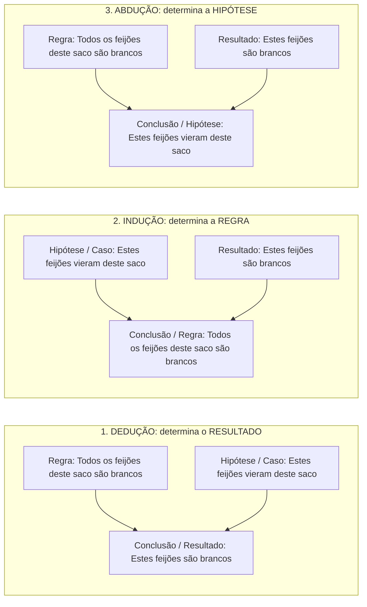

No capítulo anterior, vimos que o raciocínio indutivo amplia o conhecimento ao projetar padrões observados para casos novos ou para toda uma classe. Neste capítulo, damos mais três passos decisivos no raciocínio crítico. Primeiro, examinamos como a indução opera nas **ciências experimentais** e nos **argumentos por analogia**, identificando os cinco fatores que fortalecem ou enfraquecem uma comparação. Em seguida, estudamos o **argumento abdutivo** — a busca da melhor explicação para os fatos — e o esquema clássico de **Charles Sanders Peirce** que distingue dedução, indução e abdução. Por fim, iniciamos o estudo das **falácias** pelas **falácias formais ou dedutivas**: a *afirmação do consequente* e a *negação do antecedente*.

> [!objetivos]
> - Distinguir a indução nas ciências experimentais e nos raciocínios estatísticos da dedução matemática canônica.
> - Avaliar a força de argumentos por analogia segundo a relevância das características, a modéstia da conclusão, o número de casos, as semelhanças e as desanalogias.
> - Compreender o argumento abdutivo como hipótese explicativa e aplicar a tríade de C. S. Peirce (regra, caso/hipótese e resultado) para diferenciar dedução, indução e abdução.
> - Reconhecer as falácias formais (afirmação do consequente e negação do antecedente) e contrastá-las com o *modus ponens* e o *modus tollens*.

## Indução nas ciências experimentais e raciocínio por analogia

As **ciências experimentais** — como a Física, a Química e a Biologia — apoiam-se fortemente no raciocínio **indutivo**. Elas formulam leis universais a partir de medições particulares repetidas. Imagine que um físico meça centenas de experimentos. Ele observa que pares de corpos se atraem com força diretamente proporcional ao produto de suas massas e inversamente proporcional ao quadrado da distância entre eles. Quando ele conclui que **quaisquer corpos do universo** se atraem segundo essa mesma lei da gravitação, realiza uma **generalização indutiva**. A conclusão transcende os pares de corpos efetivamente medidos no laboratório.

As bancas costumam contrastar esse raciocínio experimental ou estatístico com a **dedução matemática**. Compare três exemplos clássicos de prova:

1. **Propriedade transitiva na Matemática**: *"Sejam a, b e c números naturais quaisquer. Sabendo que a = b e que b = c, conclui-se que a = c."* → Trata-se de um **argumento dedutivo válido** (canônico). A conclusão decorre necessariamente dos axiomas de igualdade e não extrapola as premissas.
2. **Lei física experimental**: *"Os corpos medidos no laboratório atraíram-se na razão direta do produto das massas e inversa do quadrado da distância. Logo, todos os corpos atraem-se segundo essa relação."* → Trata-se de um **argumento indutivo** por generalização.
3. **Proporção em grupo funcional**: *"Em determinado escritório, quatro quintos (4/5) dos funcionários possuem nível superior. José é funcionário desse escritório. Portanto, José possui nível superior."* → Trata-se de um **argumento indutivo**, e **não** dedutivo! Embora seja provável que José tenha nível superior (80% de chance), um quinto dos funcionários não tem. Por ser indutivo, esse argumento **não pode ser classificado como válido**.

### O argumento por analogia

A **analogia** é uma modalidade específica e muito frequente de argumento **indutivo**. Ela não generaliza uma propriedade para todos os membros de uma classe. Em vez disso, a analogia compara dois ou mais casos particulares que partilham diversas características conhecidas. A partir daí, infere que eles também partilham uma **característica adicional**, presente nos primeiros e investigada no último.

O esquema básico da analogia funciona assim:
- Os casos **A, B e C** possuem as características **p, q, r** e também a característica **z**.
- O novo caso **D** possui as características **p, q e r**.
- **Logo**, é provável que o caso **D** também possua a característica **z**.

Um exemplo clássico de prova ilustra bem essa estrutura: *"Eu não nasci rico e hoje desfruto de excelente padrão de vida trabalhando duro. Você também não nasceu rico. Portanto, trabalhando duro, você conseguirá alcançar o mesmo padrão de vida."* O autor apoia-se em uma característica comum (não ter nascido rico e trabalhar duro) para projetar no interlocutor o mesmo resultado. Trata-se de um raciocínio por **analogia**.

### Os cinco fatores que determinam a força de uma analogia

Como toda analogia é um argumento indutivo, ela nunca é válida nem inválida. Ela é avaliada apenas como **mais forte** ou **mais fraca**. Cinco critérios determinam se uma comparação analógica tem alta ou baixa força persuasiva:

| Fator de avaliação da analogia | Como afeta a força do argumento | Exemplo prático de aplicação |
| --- | --- | --- |
| **1. Relevância das características comparadas** | Quanto maior a conexão causal ou lógica entre as semelhanças listadas e a conclusão pretendida, **mais forte** é a analogia. | Para concluir que Joaquim é acionista majoritário de companhia lucrativa, saber que ele **trabalha no setor de tecnologia e lidera equipes** é muito relevante. Já saber que ele **acorda cedo, faz atividade física regularmente e tem sessões mensais com coach empresarial** tem baixa relevância. |
| **2. Modéstia da conclusão** | Mantidas as mesmas premissas, uma conclusão **mais modesta (menos ambiciosa)** torna a analogia **mais forte**. | Concluir que Joaquim *"não é pobre"* é bastante provável (argumento mais forte). Já concluir que Joaquim *"é bilionário"* é uma conclusão extrema e fraca. |
| **3. Número de casos comparados** | Quanto **mais casos semelhantes** sustentarem o padrão nas premissas, **mais forte** fica a analogia. | *"Comprei um carro deste fabricante há cinco anos e nunca tive problemas de manutenção; logo, o novo modelo não dará problema"*. Esse argumento fica **mais forte** se dez amigos meus também tiverem carros desse fabricante sem problemas. |
| **4. Número de características em comum** | Quanto **mais pontos de semelhança relevantes** existirem entre os casos comparados, **mais forte** é o argumento. | O argumento do automóvel fica **mais forte** se acrescentarmos que o novo carro foi comprado na **mesma concessionária** e usa a **mesma família de motor** dos veículos anteriores. |
| **5. Presença de desanalogias (diferenças) ou contraexemplos** | Diferenças relevantes entre os casos comparados (**desanalogias**) ou casos contrários **enfraquecem** o argumento. | Se uma pessoa tiver os mesmos hábitos de Joaquim e estiver falida, surge um contraexemplo. Do mesmo modo, se o novo modelo de automóvel for de uma categoria mecânica diversa dos carros dos amigos, a analogia torna-se **mais fraca**. |

> [!bizu] Como resolver questões de fortalecimento ou enfraquecimento de analogia
> Quando a banca apresentar um argumento por analogia e perguntar qual nova informação **fortalece** ou **enfraquece** o raciocínio, aplique o teste rápido:
> - **Fortalece**: aumenta a amostra de casos favoráveis, adiciona semelhanças relevantes para o efeito ou reduz a ambição da conclusão.
> - **Enfraquece**: introduz um contraexemplo (mesmas características, resultado oposto), aponta uma diferença relevante (**desanalogia**) entre os objetos comparados ou torna a conclusão exagerada.

## Argumentos abdutivos: a busca da melhor explicação

O **argumento abdutivo** (ou inferência para a melhor explicação) é o segundo tipo de raciocínio sintético. Nele, o ponto de partida é um conjunto de fatos, vestígios ou resultados surpreendentes observados na realidade. A **conclusão** apresenta a **hipótese explicativa** que melhor dá conta daqueles fatos.

Veja dois exemplos típicos de abdução:
1. **Caso clínico**: *"Pedro foi encontrado sem vida em seu quarto. Sabemos que ele sofria de grave doença cardíaca e havia uma caixa de medicamentos cardiológicos aberta ao lado da cama. Logo, é razoável supor que Pedro morreu em decorrência de um ataque cardíaco."*
   - Os fatos observados (óbito, histórico cardíaco, remédios ao lado) estão nas premissas. A conclusão (*"morreu de ataque cardíaco"*) não é uma generalização indutiva nem uma dedução necessária. É a **melhor explicação (hipótese)** para o cenário encontrado.
2. **Investigação criminal**: *"Uma senhora de cinquenta e nove anos foi assassinada dentro de sua casa sem sinais de arrombamento. Entre as pessoas que frequentavam a residência naquele momento, apenas duas tinham desavenças financeiras graves com a vítima. Portanto, essas duas pessoas são as principais suspeitas do crime."*
   - O investigador formula uma **hipótese explicativa** a partir dos indícios: isso é **abdução**.

Assim como ocorre na indução, o argumento abdutivo **não é classificado como válido ou inválido**, mas como **mais forte** ou **mais fraco**. Além disso, a chegada de **novas informações** altera diretamente a força da hipótese abdutiva:
- Se o laudo necroscópico de Pedro revelar uma obstrução coronariana aguda, a abdução do infarto torna-se **muito mais forte**.
- Se, ao contrário, o exame toxicológico apontar envenenamento e marcas de violência externa, a hipótese do infarto natural torna-se **fraca**. Ela cede lugar a uma nova melhor explicação (homicídio).

## A tríade de C. S. Peirce: dedução, indução e abdução

O filósofo e lógico norte-americano **Charles Sanders Peirce** (1839–1914) criou um modelo clássico para distinguir com exatidão a **dedução**, a **indução** e a **abdução**. Peirce utiliza três proposições sobre um saco de feijões, denominadas **Regra**, **Caso (ou Hipótese)** e **Resultado**:

- **Regra** (afirmação geral): *"Todos os feijões deste saco são brancos."*
- **Caso / Hipótese** (vínculo de origem ou enquadramento): *"Estes feijões que estão sobre a mesa vieram deste saco."*
- **Resultado** (fato observável concreto): *"Estes feijões que estão sobre a mesa são brancos."*

Conforme a combinação de duas dessas proposições nas premissas para determinar a terceira na conclusão, temos cada um dos três tipos de raciocínio:

Compare lado a lado a estrutura e o comportamento lógico das três inferências no esquema de Peirce:

| Tipo de Raciocínio | Premissa 1 | Premissa 2 | Conclusão obtida | Avaliação lógica |
| --- | --- | --- | --- | --- |
| **Dedução** | **Regra** (*Todos os feijões deste saco são brancos*) | **Caso / Hipótese** (*Estes feijões vieram deste saco*) | **Resultado** (*Logo, estes feijões são brancos*) | **Válido** (se as premissas forem V, a conclusão é necessariamente V) |
| **Indução** | **Caso / Hipótese** (*Estes feijões vieram deste saco*) | **Resultado** (*Estes feijões são brancos*) | **Regra** (*Logo, todos os feijões deste saco são brancos*) | **Mais forte ou mais fraco** (generalização ampliativa) |
| **Abdução** | **Regra** (*Todos os feijões deste saco são brancos*) | **Resultado** (*Estes feijões sobre a mesa são brancos*) | **Caso / Hipótese** (*Logo, estes feijões vieram deste saco*) | **Mais forte ou mais fraco** (hipótese explicativa) |

> [!esquema] Resumo mnemônico da tríade de Peirce para a prova
> - **Dedução** (`Regra + Hipótese ⊢ Resultado`): aplica a lei geral ao caso e determina a **conclusão (resultado)** com certeza lógica.
> - **Indução** (`Hipótese + Resultado ⊢ Regra`): observa os casos e resultados particulares e determina a **regra geral** por generalização.
> - **Abdução** (`Regra + Resultado ⊢ Hipótese`): conhece a regra geral e vê o resultado consumado, determinando a **premissa explicativa (hipótese)**.

> [!pegadinha] Como não confundir Indução com Abdução na prova
> Muitas questões descrevem um fato observado e uma conclusão provável e afirmam que se trata de "indução porque é a melhor explicação para o fato". **Errado!** Sempre que o enunciado disser que a conclusão é a **melhor explicação** para um resultado observado, o raciocínio é **abdutivo**, e não indutivo! Isso também vale quando o texto parte da *Regra + Resultado* para supor a *Hipótese* que antecedeu o evento. Por exemplo: *"Quando trabalho pela manhã, ganho folga vespertina. Hoje tive folga vespertina; logo, é possível que eu tenha trabalhado pela manhã"*. Aqui temos **abdução**, pois concluiu-se a hipótese explicativa para a folga observada.

## Introdução às falácias e as falácias formais ou dedutivas

No vocabulário da lógica, uma **falácia** (também chamada de **sofisma**) é um **erro de raciocínio** que aparenta ser correto. Justamente por essa aparência enganosa, ela mostra-se **persuasiva** ou apelativa. Alguns autores reservam a palavra *sofisma* para a investida fraudulenta feita deliberadamente com a intenção de enganar o interlocutor. Porém, em provas de concurso, os termos **falácia** e **sofisma** são cobrados como sinônimos.

As falácias dividem-se em duas grandes famílias:
1. **Falácias formais (ou dedutivas)**: o defeito reside na **estrutura lógica (forma)** do argumento. Toda falácia formal nada mais é do que um **argumento dedutivo inválido**.
2. **Falácias informais**: o defeito não está na forma simbólica, mas no **conteúdo**, na manipulação psicológica, na irrelevância das premissas ou na ambiguidade da linguagem. Exemplos incluem o ataque pessoal *ad hominem*, o apelo à autoridade, o apelo à piedade, a pergunta complexa, a falsa causa, o acidente e o equívoco (temas dos Capítulos 3 e 4).

> [!atencao] Premissa falsa não é sinônimo de falácia!
> Não confunda a **falsidade material de uma premissa** com a ocorrência de uma **falácia**. Um argumento dedutivo pode ter premissas falsas no mundo real e, ainda assim, possuir uma estrutura perfeitamente **válida**. Nesse caso, ele **não é uma falácia**. Por exemplo: *"Todos os peixes voam; ora, o tubarão é um peixe; logo, o tubarão voa"*. A primeira premissa é empiricamente falsa, mas a forma lógica do silogismo é **válida**, de modo que não há falácia formal. A falácia formal ocorre exclusivamente quando a **passagem inferencial é inválida**.

### Afirmação do consequente e negação do antecedente

Na lógica proposicional, uma condicional **p → q** (*"Se p, então q"*) possui duas partes: **p** é o **antecedente** (condição suficiente) e **q** é o **consequente** (condição necessária). A partir de uma condicional **p → q**, existem duas regras de inferência dedutiva **válidas** e duas imitações defeituosas que constituem as **falácias formais** mais cobradas em concursos:

| Nome da estrutura | Forma simbólica (2 premissas) | Forma de premissa única | Status lógico |
| --- | --- | --- | --- |
| **Modus ponens** (afirmação do antecedente) | `p → q` e `p` ⊢ **q** | De `p → q` extrair `p → q` | **VÁLIDO** (dedução correta) |
| **Modus tollens** (negação do consequente) | `p → q` e `~q` ⊢ **~p** | De `p → q` extrair `~q → ~p` (contrapositiva) | **VÁLIDO** (dedução correta) |
| **Falácia da afirmação do consequente** | `p → q` e `q` ⊢ **p** | De `p → q` concluir `q → p` (recíproca) | **INVÁLIDO (Falácia formal)** |
| **Falácia da negação do antecedente** | `p → q` e `~p` ⊢ **~q** | De `p → q` concluir `~p → ~q` (inversa) | **INVÁLIDO (Falácia formal)** |

Vamos examinar por que essas duas formas são falaciosas com exemplos claros:

### Falácia da afirmação do consequente (`p → q; q ⊢ p`)

Considere a condicional verdadeira: *"Se João for decapitado (p), então João morre (q)"*.
- Se soubermos que *"João morreu (q)"*, podemos concluir dedutivamente com certeza que *"João foi decapitado (p)"*? **Evidentemente não!** João pode ter morrido de infarto, de velhice ou em um acidente de trânsito.
- Ao afirmar o consequente (**q**) para tentar concluir o antecedente (**p**), comete-se a **falácia da afirmação do consequente**. Na versão de premissa única, esse mesmo erro aparece quando alguém parte de *"Se p, então q"* e conclui diretamente a recíproca *"Logo, se q, então p"*.

> [!exemplo] Distinção entre abdução plausível e dedução falaciosa
> Sob a ótica da abdução (vista acima), olhar para o resultado (*q*) e levantar *p* apenas como uma hipótese possível (*"pode ter sido p"*) é um raciocínio abdutivo legítimo. Porém, quando o autor apresenta `p → q; q; logo, certamente p` como uma dedução necessária, trata-se de um **argumento dedutivo inválido**: a **falácia da afirmação do consequente**.

### Falácia da negação do antecedente (`p → q; ~p ⊢ ~q`)

Voltemos à mesma condicional: *"Se João for decapitado (p), então João morre (q)"*.
- Se soubermos que *"João não foi decapitado (~p)"*, podemos concluir que *"João não morreu (~q)"*? **De modo algum!** Mesmo sem ter sido decapitado, ele pode ter falecido por qualquer outra causa.
- Ao negar o antecedente (**~p**) para concluir a negação do consequente (**~q**), comete-se a **falácia da negação do antecedente**. Na versão de premissa única, esse erro consiste em partir de *"Se p, então q"* e concluir a inversa *"Logo, se não p, então não q"*.

> [!resolvido] Questão resolvida — Identificação de falácia formal com proposições negadas
> **Enunciado**: Analise o seguinte argumento: *"Devido ao meu trabalho pesado no quartel, se eu não durmo bem à noite, não consigo fazer exercícios na academia pela manhã. Hoje não consegui fazer exercícios na academia pela manhã. Logo, não dormi bem à noite."* Assinale a classificação lógica correta desse raciocínio.
>
> **Resolução passo a passo**:
> 1. **Simbolização da condicional**: Cuidado para não se deixar enganar pela presença da palavra *"não"* nas duas partes da frase! Defina o antecedente inteiro como **P** = *"não durmo bem à noite"* (ou `~d`) e o consequente inteiro como **Q** = *"não consigo fazer exercícios na academia"* (ou `~e`). A premissa condicional é **P → Q** (`~d → ~e`).
> 2. **Identificação da segunda premissa**: O texto afirma *"Hoje não consegui fazer exercícios na academia"*. Isso corresponde exatamente ao **consequente Q** (`~e`).
> 3. **Identificação da conclusão**: O texto conclui *"Logo, não dormi bem à noite"*, que é o **antecedente P** (`~d`).
> 4. **Diagnóstico da forma**: O argumento tem a estrutura `P → Q; Q ⊢ P` (ou `~d → ~e; ~e ⊢ ~d`). O autor **afirmou o consequente** da condicional para extrair o antecedente!
> 5. **Resposta**: Trata-se de um **argumento dedutivo inválido**, classificado como **falácia da afirmação do consequente** (e não negação do antecedente, pois a proposição negada já fazia parte do próprio consequente original).

## Mapa do capítulo

| Conceito / Estrutura | Ponto de partida (Premissas) | O que conclui | Critério / Classificação em prova |
| --- | --- | --- | --- |
| **Indução científica / estatística** | Casos medidos no laboratório ou fração (ex.: 4/5) de um grupo | Lei geral física ou atributo provável de um indivíduo | **Argumento indutivo** (forte ou fraco; nunca válido) |
| **Argumento por Analogia** | Casos A e B têm características comuns `p, q, r`; A tem `z` | Caso B provavelmente também tem `z` | **Indutivo**: fortalece com mais casos/semelhanças e conclusão modesta; enfraquece com desanalogias |
| **Argumento Abdutivo** | Fatos surpreendentes observados + regra conhecida | A **melhor explicação (hipótese)** para aqueles fatos | **Sintético**: avaliado como mais forte ou mais fraco conforme novas evidências |
| **Tríade de Peirce** | Combina 2 dentre: **Regra**, **Hipótese (Caso)** e **Resultado** | Dedução → **Resultado**; Indução → **Regra**; Abdução → **Hipótese** | Diferenciação clássica entre os 3 tipos de inferência |
| **Falácia da Afirmação do Consequente** | `p → q` e `q` (ou apenas `p → q`) | Conclui `p` (ou conclui `q → p`) | **Falácia formal** (argumento dedutivo inválido) |
| **Falácia da Negação do Antecedente** | `p → q` e `~p` (ou apenas `p → q`) | Conclui `~q` (ou conclui `~p → ~q`) | **Falácia formal** (argumento dedutivo inválido) |

### Para fixar

- A formulação de leis gerais nas **ciências experimentais** e a aplicação de uma fração estatística (como 4/5 dos servidores) a um indivíduo são **argumentos indutivos**, não podendo ser chamados de válidos.
- O **argumento por analogia** é um raciocínio indutivo baseado em semelhanças entre casos particulares; sua força cresce com a **relevância** das características, com **mais casos**, com **mais pontos comuns** e com uma **conclusão mais modesta**, mas cai diante de **desanalogias** ou contraexemplos.
- O **argumento abdutivo** propõe na conclusão a **melhor explicação (hipótese)** para os fatos narrados nas premissas, tornando-se mais forte ou mais fraco quando surgem dados novos.
- Na classificação de **C. S. Peirce**, a **dedução** parte da regra e da hipótese para determinar o **resultado**; a **indução** parte da hipótese e do resultado para determinar a **regra**; e a **abdução** parte da regra e do resultado para determinar a **hipótese**.
- **Falácia** (ou **sofisma**) é um erro de raciocínio com aparência persuasiva de correção; divide-se em **falácia formal** (argumento dedutivo inválido) e **falácia informal** (erro de conteúdo ou linguagem).
- Um argumento dedutivo válido com premissas materialmente falsas **não é uma falácia**, pois a validade e a falácia formal dependem exclusivamente da forma lógica.
- A partir de `p → q`, concluir `p` porque ocorreu `q` (ou concluir `q → p`) é a **falácia da afirmação do consequente**; concluir `~q` porque ocorreu `~p` (ou concluir `~p → ~q`) é a **falácia da negação do antecedente**.
