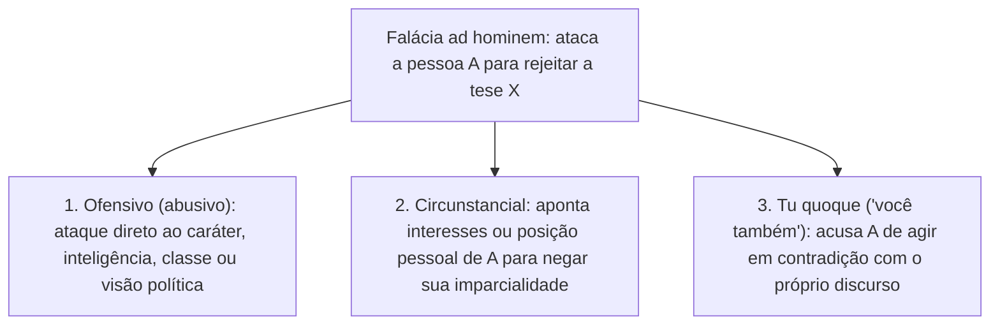
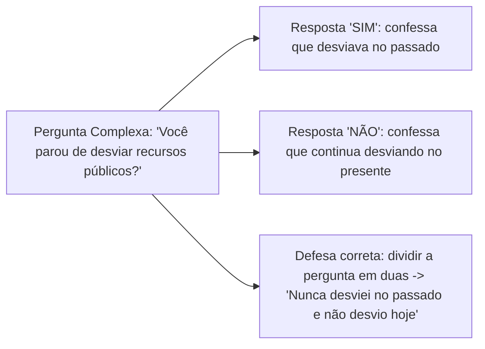

Enquanto as falácias formais decorrem de uma estrutura simbólica inválida, as **falácias informais** ocorrem quando o erro está no **conteúdo**, na relevância das premissas ou na manipulação retórica do discurso. Elas não podem ser descobertas apenas montando uma tabela-verdade ou aplicando regras de inferência proposicional. É preciso analisar o sentido das afirmações e o contexto em que foram proferidas. Nas provas de concurso público, as falácias informais constituem a maior parte das questões de raciocínio crítico. O objetivo da banca é quase sempre prático: apresentar um pequeno diálogo ou trecho opinativo e pedir que o candidato reconheça qual armadilha argumentativa foi utilizada.

> [!objetivos]
> - Compreender o conceito de falácia informal e distinguir as três modalidades do argumento contra a pessoa (*ad hominem* ofensivo, circunstancial e *tu quoque*).
> - Diferenciar o apelo falacioso à autoridade do uso legítimo do testemunho de especialistas na argumentação.
> - Identificar o apelo à ignorância, o falso dilema (falsa dicotomia) e a pergunta complexa (bem como a forma correta de desarmá-la).
> - Reconhecer a falácia do espantalho (homem de palha), a petição de princípio (raciocínio circular) e a conclusão irrelevante (*ignoratio elenchi*).

## Argumentos contra a pessoa (*argumentum ad hominem*)

A família dos argumentos **contra a pessoa** (conhecida pela expressão latina ***ad hominem***) reúne as falácias em que o debatedor desvia o foco da tese. Em vez de examinar e refutar o **teor racional da ideia** apresentada pelo interlocutor, ele tenta rejeitar a afirmação por meio da **desqualificação pessoal de quem a proferiu**. O debate sai da ideia discutida e recai sobre a figura do oponente.

O esquema geral do argumento *ad hominem* segue três passos:
1. A pessoa **A** defende uma afirmação ou proposta **X**.
2. O interlocutor **B** faz um ataque contra a pessoa **A** (seu caráter, suas circunstâncias ou sua conduta passada).
3. **Logo**, pretende-se concluir que a afirmação **X** é falsa ou deve ser descartada.

A doutrina e as bancas organizam o argumento *ad hominem* em **três espécies principais**: **ofensivo (abusivo)**, **circunstancial** e **você também (*tu quoque*)**.

### Ad hominem ofensivo (ou abusivo)

No ***ad hominem* ofensivo**, o ataque é direto contra traços de personalidade, moralidade, inteligência, aparência, profissão, religião ou preferência política e social do autor da tese. Procura-se desacreditar a ideia colando marcas negativas de reprovação na pessoa que falou.

Exemplos clássicos de prova:
- *"Você não pode levar a sério o projeto de mobilidade urbana apresentado por aquele vereador. Ele é um sujeito teimoso, limitado e de extrema mediocridade intelectual."*
- Em crônicas históricas e políticas (como nos textos clássicos de Rubem Braga sobre o regente Feijó), esse recurso aparece com clareza. Quando um adversário desqualifica as propostas de um estadista chamando-o de *"homem de couro duro, incoerente e intolerante"*, sem rebater o mérito administrativo da medida, configura-se o ataque pessoal.
- Desqualificar alguém apenas por sua condição ou vivência prévia também entra aqui. Veja os exemplos: *"Quem nunca trabalhou em banco não tem direito de opinar sobre juros bancários"* ou *"Ele mudou de partido político no ano passado; portanto, qualquer análise econômica que fizer hoje está errada"*.

### Ad hominem circunstancial

No ***ad hominem* circunstancial**, não há necessariamente um xingamento moral direto. Em vez disso, o debatedor aponta **circunstâncias individuais, profissionais, religiosas ou financeiras** de quem fez a declaração. O objetivo é **colocar em dúvida a sua imparcialidade**, sugerindo que a pessoa só defende aquela tese por interesse próprio ou dever de ofício.

Veja três exemplos típicos:
- *"É claro que aquele orador argumenta contra a legalização do aborto; afinal, ele é padre e precisa repetir a posição da Igreja."* As razões filosóficas ou jurídicas apresentadas pelo padre são ignoradas apenas por causa de sua batina.
- *"As considerações desse candidato contra as regras do edital não merecem análise. Ele foi reprovado na prova objetiva e está falando por interesse próprio."*
- *"Você só defende a redução da alíquota de importação de aço porque é acionista de uma montadora de veículos."* Mesmo que o interlocutor tenha interesse econômico, seus dados técnicos sobre o comércio exterior podem ser verdadeiros. Eles precisam ser avaliados pelo mérito, e não descartados de antemão.

### Ad hominem "você também" (*tu quoque*)

A variante ***tu quoque*** (expressão latina para *"você também"*) ocorre quando alguém rejeita um argumento ou conselho apontando uma **incompatibilidade ou contradição**. Confronta-se o discurso atual do interlocutor com o **comportamento dele próprio**, seja no presente, seja no passado.

Exemplos práticos:
- *"Você vive dizendo que fumar faz mal à saúde e que eu deveria largar o cigarro. Mas você mesmo fumou dois maços por dia durante vinte anos!"* A hipocrisia ou o passado do conselheiro não altera o fato científico de que o tabagismo causa doenças pulmonares e cardíacas.
- *"Como esse parlamentar ousa apresentar um relatório propondo corte de gastos com passagens aéreas? Na legislatura passada, o gabinete dele gastou toda a cota de viagens!"*

| Modalidade de *ad hominem* | Alvo do ataque | Exemplo característico |
| --- | --- | --- |
| **Ofensivo (abusivo)** | Caráter, inteligência, personalidade ou filiação social/política | *"Não ouça a proposta tributária dele; é um indivíduo medíocre e mal-intencionado."* |
| **Circunstancial** | Imparcialidade (interesses pessoais, cargo ou condição de quem fala) | *"É óbvio que você elogia o estatuto; você é servidor público e será beneficiado."* |
| **Tu quoque (você também)** | Coerência entre o discurso e a prática pessoal (passada ou atual) | *"Você critica o uso do celular ao volante, mas ontem mesmo respondeu mensagens dirigindo!"* |

## Apelo à autoridade (*argumentum ad verecundiam*)

O **apelo à autoridade** consiste em defender que uma afirmação **X** é verdadeira simplesmente porque uma pessoa famosa, prestigiosa ou supostamente especialista (**A**) disse que **X** é verdade. O esquema básico é:
- **A** é uma autoridade (ou figura de destaque);
- **A** afirmou **X**;
- **Logo**, **X** é verdadeiro.

Essa tática retórica é onipresente em peças publicitárias: *"O cantor famoso usa esta marca de xampu; portanto, este xampu é o melhor para tratar a queda capilar"*. Na conversa cotidiana, aparece assim: *"Arnaldo disse que a economia da sociedade vai colapsar no próximo trimestre. Como eu acredito nele, isso certamente acontecerá"*.

### Quando citar uma autoridade é legítimo e quando vira falácia?

Muita atenção neste ponto: **nem toda citação de especialista constitui falácia!** No raciocínio crítico, invocar o parecer de um perito ou cientista é um recurso argumentativo **legítimo** (fortalece a indução) desde que atenda simultaneamente a **quatro condições**:

1. **Competência na área específica**: a autoridade citada deve possuir qualificação real **no exato assunto** em discussão.
2. **Consenso entre os pares**: a opinião citada deve refletir um entendimento consolidado ou amplamente aceito entre os especialistas daquele campo.
3. **Existência de outras evidências**: a citação funciona como reforço a dados e provas verificáveis, e não como substituto absoluto da investigação.
4. **Identificação clara da fonte**: a autoridade precisa ser nominalmente identificada para permitir conferência.

> [!bizu] As três armadilhas clássicas do apelo falacioso à autoridade
> O argumento de autoridade degenera em **falácia do apelo à autoridade** principalmente em três situações cobradas em prova:
> 1. **Autoridade fora da sua área de competência**: citar um prêmio Nobel de Literatura para validar uma tese de engenharia genética, ou um jogador de futebol para atestar a eficácia de um medicamento.
> 2. **Autoridade anônima ou não identificada**: usar expressões vagas como *"Especialistas afirmam que..."*, *"Cientistas descobriram que..."* ou *"Estudos mostram que..."* sem indicar quem são os autores nem qual instituição produziu os dados.
> 3. **Uso descontextualizado ou dogmático**: imagine que alguém afirme *"Corpos de massa nula atraem-se com força gravitacional infinita, porque isso está escrito no livro de Isaac Newton"*. Além de distorcer a física, invocar o nome de um cientista célebre entre pesquisadores para encerrar um debate técnico sem provas empíricas é falacioso. Já citar Isaac Newton numa conversa didática entre leigos para lembrar um princípio clássico bem estabelecido da mecânica apenas ilustra e reforça legitimamente a explicação.

## Apelo à ignorância (*argumentum ad ignorantiam*)

A falácia do **apelo à ignorância** ocorre quando alguém sustenta que uma proposição é **verdadeira** apenas porque **ainda não se provou que ela é falsa**, ou, inversamente, sustenta que uma proposição é **falsa** apenas porque **ninguém conseguiu provar que ela é verdadeira**.

Em outras palavras, toma-se a **ausência de evidência** como se fosse **evidência da ausência** (ou da presença). Veja os dois sentidos dessa falácia:

- **Da falta de prova contrária para a verdade**: *"Ninguém jamais conseguiu provar que Papai Noel não existe (ou que não há vida inteligente em outra galáxia); portanto, Papai Noel existe (ou há vida inteligente lá fora)."*
- **Da falta de prova favorável para a falsidade**: *"João nunca fez sessões de terapia com um terapeuta profissional, e ninguém até hoje mostrou provas de que ele tenha algum transtorno; logo, está provado que a saúde emocional de João é perfeita."*

> [!atencao] A exceção jurídica: presunção de inocência não é falácia!
> No Direito Penal e Processual Penal, vigora a regra do *in dubio pro reo* (presunção de inocência): se a acusação não produzir provas suficientes da culpa do réu, o juiz deve absolvê-lo. Nesse contexto estritamente jurídico, absolver por falta de provas decorre de uma garantia constitucional de distribuição do ônus da prova, e não de uma falácia lógica. Fora de regras formais de ônus probatório, porém, concluir a verdade ou a falsidade real de um fato pela simples ignorância sobre ele é sempre **falácia do apelo à ignorância**.

## Falso dilema (ou falsa dicotomia)

O **falso dilema** (também chamado de **falsa dicotomia** ou pensamento em preto e branco) consiste em reduzir artificialmente um problema complexo a **apenas duas opções extremas**. Ocultam-se todas as possibilidades intermediárias para forçar o interlocutor a aceitar a opção desejada pelo argumentador.

O formato clássico do falso dilema apoia-se na disjunção (`Ou X ou Y`):
1. Ou escolhemos a opção **X**, ou escolhemos a opção **Y** (escondendo que existem as opções Z, W, ou mesmo a combinação de X e Y).
2. Ora, a opção **Y** é inaceitável ou terrível.
3. **Logo**, somos obrigados a escolher **X**.

Exemplos muito cobrados em provas:
- *"Ou você vota no candidato A nesta eleição, ou você odeia os pobres e quer a miséria do país. Como você não odeia os pobres, tem de votar no candidato A."* Ignora-se que o eleitor pode preocupar-se com os pobres e preferir o programa social de outro candidato.
- Em debates legislativos sobre redução da maioridade penal na Comissão de Constituição e Justiça da Câmara dos Deputados ou do Congresso Nacional, esse erro é frequente. Um articulista escreve: *"O país precisa escolher: ou colocamos a juventude na escola, ou transformamos os jovens em réus no banco dos tribunais"*. Instala-se uma oposição excludente, como se educação e responsabilização não pudessem coexistir. As bancas apontam aí o emprego de **falsa dicotomia**, muitas vezes combinada com intimidação do leitor ao antecipar perigos sociais.

## Pergunta complexa (ou falácia da pressuposição)

A **falácia da pergunta complexa** ocorre quando o interlocutor formula uma única interrogação que **embute um pressuposto oculto (não comprovado)**. Ela une dois temas distintos numa única frase. Desse modo, qualquer resposta direta (*"sim"* ou *"não"*) obriga o interrogado a confessar e validar a acusação implícita.

Veja os exemplos clássicos:
- *"Deputado, Vossa Excelência já deixou de desviar recursos públicos das obras de pavimentação?"*
  - Se o deputado responder **"Sim"**, estará admitindo que **desviava** recursos públicos no passado e parou agora.
  - Se responder **"Não"**, estará admitindo que **continua desviando** recursos públicos no presente.
- *"O investigado parou de furtar celulares e carteiras no terminal rodoviário?"* ou *"Você ainda rouba dinheiro da carteira dos seus pais?"*

> [!pegadinha] O que a pergunta complexa pressupõe sobre o passado e sobre o presente?
> Questões de alto nível (como as cobradas em concursos federais) perguntam exatamente **o que está pressuposto** na pergunta *"O interrogado parou de furtar celulares?"*. Preste muita atenção:
> - A pergunta **pressupõe apenas o fato passado** (isto é, toma como certo que ele **furtava** celulares antes).
> - Sobre o **presente** (se ele furta atualmente ou não), a pergunta **não pressupõe**: ela justamente pergunta se o hábito continua ou cessou!
> - **Como corrigir / desarmar**: a pergunta complexa deve ser **quebrada em duas perguntas independentes**: 1ª) *"Você furtava celulares no passado?"*; e 2ª) Caso positivo, *"Você continua furtando hoje?"*.

## Espantalho, petição de princípio e conclusão irrelevante

Fechando este primeiro bloco de falácias informais, temos três distorções argumentativas que caem lado a lado nas alternativas de múltipla escolha:

### Falácia do espantalho (ou do homem de palha)

Comete a **falácia do espantalho** quem **distorce, exagera ou caricatura** a tese do adversário. Substitui-se o argumento real dele por um boneco de palha muito mais frágil e extremo. Em seguida, refuta-se facilmente essa versão inventada, fingindo que a posição original foi derrotada.

- **Esquema**: A pessoa **A** defende a tese **X**. O oponente **B** apresenta a tese **Y** (uma distorção exagerada de **X**) como se fosse a ideia de **A**, ataca **Y** e conclui que **X** está errada.
- **Exemplo**: Um jurista apresenta razões técnicas em favor do **devido processo legal** e do direito de defesa nas audiências de custódia (**tese X**). Seu adversário responde: *"Meu oponente quer abrir as portas dos presídios e deixar todos os criminosos violentos soltos nas ruas sem punição!"* (**espantalho Y**).

### Petição de princípio (*petitio principii* ou raciocínio circular)

Na **petição de princípio**, o argumentador tenta demonstrar uma conclusão utilizando como premissa a **própria conclusão** (frequentemente disfarçada com palavras sinônimas). Assim, a premissa só pode ser aceita por quem já aceita previamente a tese final. O raciocínio gira em círculo sem provar nada.

- **Exemplo 1 (círculo explícito)**: *"Tudo o que está escrito neste livro antigo é absolutamente verdadeiro, porque foi inspirado por uma entidade infalível. E sabemos que essa entidade é infalível porque o próprio livro afirma isso no capítulo terceiro."*
- **Exemplo 2 (repetição por sinônimos)**: Em um diálogo acadêmico, alguém pergunta por que determinado livro didático é ruim. O crítico responde: *"Concluo que esta obra é **superficial** acerca do tema porque ela aborda os conceitos de maneira **pouco aprofundada** e traz **informações rasas**."* Note que *"ser superficial"* e *"trazer informações pouco aprofundadas"* dizem exatamente a mesma coisa! Não confunda isso com apelo à autoridade: trata-se de **petição de princípio (argumento circular)**.

### Conclusão irrelevante (*ignoratio elenchi*)

Na falácia da **conclusão irrelevante** (cujo nome clássico em latim é ***ignoratio elenchi*** — às vezes grafado com erro tipográfico como *ignoratio elechi* em apostilas), o autor desvia do ponto em debate. Ele apresenta premissas que até podem ser verdadeiras, mas que sustentam uma conclusão **diferente** daquela que precisava ser provada. Falta relação lógica relevante com a tese específica em disputa.

- **Exemplo**: Durante a votação de um projeto de lei específico sobre incentivos fiscais a uma fábrica, o relator discursa durante meia hora. Ele prova que *"o crescimento econômico e a geração de emprego e renda são fundamentais para reduzir a pobreza das famílias brasileiras; portanto, este projeto específico deve ser aprovado imediatamente"*. Ninguém duvida da importância da geração de renda. O que o relator precisava provar — e desviou — era se **aquele projeto concreto** realmente gera renda sem lesar o erário.

> [!esquema] Contraste rápido entre as três falácias de desvio e circularidade
> - **Espantalho (homem de palha)**: troca a tese real do oponente por uma **versão caricatural exagerada** para atacá-la com facilidade.
> - **Petição de princípio (circular)**: repete a **própria conclusão dentro da premissa** (com palavras equivalentes), andando em círculo.
> - **Conclusão irrelevante (*ignoratio elenchi*)**: usa premissas verdadeiras sobre um **tema geral consensual** para tentar provar uma **conclusão específica desconectada**.

> [!resolvido] Questão resolvida — Diferenciação entre falácias informais em debate
> **Enunciado**: Durante uma reunião deliberativa sobre segurança viária, a engenheira Marina propôs reduzir a velocidade máxima de uma avenida escolar de 60 km/h para 40 km/h nos horários de entrada e saída das crianças. Três conselheiros reagiram da seguinte forma:
> - **Conselheiro 1**: *"Marina quer paralisar o trânsito da cidade inteira e proibir os trabalhadores de chegarem ao serviço de carro!"*
> - **Conselheiro 2**: *"Não devemos dar ouvidos à proposta de Marina, pois ela nem sequer possui automóvel próprio e vem trabalhar de metrô."*
> - **Conselheiro 3**: *"Ou mantemos a velocidade de 60 km/h em toda a avenida, ou o comércio local irá à falência total."*
> Assinale a classificação correta das falácias cometidas pelos Conselheiros 1, 2 e 3, respectivamente.
>
> **Resolução passo a passo**:
> 1. **Conselheiro 1**: Marina propôs apenas reduzir o limite de 60 km/h para 40 km/h em horários escolares. O Conselheiro 1 transformou essa proposta moderada num exagero caricatural (*"paralisar a cidade inteira e proibir carros"*) para atacá-la facilmente. Cometeu a **falácia do espantalho (homem de palha)**.
> 2. **Conselheiro 2**: Em vez de discutir os dados de acidentes na avenida, atacou uma circunstância pessoal de Marina (não ter carro próprio e usar metrô) para desqualificar sua proposta. Cometeu a **falácia *ad hominem* (circunstancial)**.
> 3. **Conselheiro 3**: Reduziu o problema a duas alternativas extremas e excludentes (manter 60 km/h ou falência total do comércio), ignorando soluções intermediárias. Cometeu a **falácia do falso dilema (falsa dicotomia)**.
> 4. **Resposta**: **Espantalho**, ***ad hominem*** e **falso dilema**, respectivamente.

## Mapa do capítulo

| Falácia Informal | Onde está a armadilha de conteúdo | Exemplo-chave para reconhecimento imediato |
| --- | --- | --- |
| **Ad hominem ofensivo** | Ataque direto ao caráter, inteligência ou grupo de quem fala | *"A tese dele não vale nada porque ele é medíocre e teimoso."* |
| **Ad hominem circunstancial** | Suspeita sobre a imparcialidade pelas circunstâncias do autor | *"Claro que o padre é contra o projeto; sua religião exige isso."* |
| **Ad hominem tu quoque** | Acusação de incoerência entre o discurso e a prática pessoal | *"Você me manda economizar, mas gasta todo o seu salário!"* |
| **Apelo à autoridade** | Cita autoridade fora da área, não identificada ou sem respaldo | *"Especialistas dizem..."* / *"O ator famoso recomendou este remédio."* |
| **Apelo à ignorância** | Toma a falta de prova contrária como prova de verdade (ou vice-versa) | *"Ninguém provou que fantasmas não existem; logo, eles existem."* |
| **Falso dilema** | Restringe artificialmente as opções a dois extremos (*ou X ou Y*) | *"Ou você aprova este pacote fiscal, ou quer a destruição do país."* |
| **Pergunta complexa** | Pergunta única que pressupõe um fato passado incriminador | *"Você parou de desviar verbas?"* (Tanto *sim* quanto *não* incriminam) |
| **Espantalho (homem de palha)** | Distorce ou exagera a tese do oponente para refutá-la facilmente | *"Você defende o devido processo legal? Então quer soltar todos os bandidos!"* |
| **Petição de princípio** | A premissa já pressupõe a conclusão (raciocínio circular) | *"O livro é superficial porque apresenta informações pouco aprofundadas."* |
| **Conclusão irrelevante** | Premissas verdadeiras em tese, mas sem nexo com a conclusão específica | *"Todos querem emprego e renda; logo, aprovem este meu projeto."* |

### Para fixar

- As **falácias informais** são erros no conteúdo, na relevância ou na linguagem do argumento, não detectáveis apenas pela forma simbólica proposicional.
- O argumento ***ad hominem*** rejeita uma tese atacando quem a formula: divide-se em **ofensivo** (insulto pessoal direto), **circunstancial** (questiona a imparcialidade por interesses ou posição do autor) e ***tu quoque*** (aponta contradição entre o dizer e o agir).
- Citar um especialista só é **legítimo** quando ele é identificado, tem competência na área específica, reflete consenso técnico e soma-se a outras evidências; usar celebridades fora da área ou fontes vagas (*"especialistas afirmam"*) configura **falácia do apelo à autoridade**.
- No **apelo à ignorância**, conclui-se que algo é verdadeiro porque não foi provado falso, ou que é falso porque não foi provado verdadeiro.
- O **falso dilema (falsa dicotomia)** esconde as alternativas intermediárias para forçar uma escolha binária (*ou isto ou aquilo*).
- A **pergunta complexa** une dois temas numa só pergunta, pressupondo o fato passado para que tanto o *"sim"* quanto o *"não"* prejudiquem o interrogado; corrige-se dividindo-a em duas perguntas.
- O **espantalho** rebate uma caricatura distorcida da tese adversária; a **petição de princípio** repete a conclusão na premissa (círculo vicioso); e a **conclusão irrelevante (*ignoratio elenchi*)** desvia das premissas para uma tese que elas não provam.
