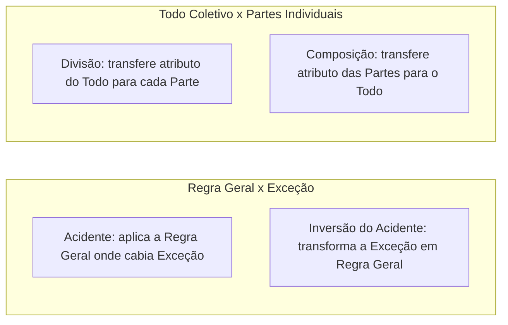

Concluímos neste capítulo o estudo sistemático das **falácias informais** e do raciocínio crítico. No capítulo anterior, examinamos os ataques pessoais, os apelos à autoridade e à ignorância e as distorções de tese. Agora estudaremos oito grupos de armadilhas retóricas. Eles exploram a psicologia do auditório, a confusão entre regras e exceções, o salto entre partes e todo, a fraqueza de amostras indutivas, as cadeias de consequências extremas, os erros de causalidade e os duplos sentidos da linguagem. Em provas de concurso, dominar os exemplos-padrão de cada grupo permite identificar o erro lógico em segundos.

> [!objetivos]
> - Reconhecer a falácia do falso escocês e as quatro falácias que apelam às emoções (apelo ao povo, à piedade, à força e às consequências).
> - Diferenciar acidente e inversão do acidente, bem como as falácias de divisão e de composição.
> - Identificar as falácias indutivas (generalização apressada, falsa analogia e falácia do jogador) e a falácia da derrapagem (bola de neve).
> - Aplicar os três requisitos da relação causal genuína para diagnosticar as cinco espécies de falácias causais e distinguir as três falácias de ambiguidade (equívoco, anfibologia e ênfase).

## Falácia do falso escocês e falácias que apelam às emoções

Começamos pela manobra retórica de proteção arbitrária de uma tese diante de um contraexemplo. Na sequência, examinamos os quatro apelos emocionais clássicos.

### Falácia do falso escocês (ou apelo à pureza)

A **falácia do falso escocês** ocorre quando alguém faz uma afirmação universal sobre um grupo e recebe um **contraexemplo** concreto que refuta aquela generalização. Em vez de abandonar ou corrigir a afirmação inicial, o falante **restringe arbitrariamente o conceito** (*"não é um verdadeiro..."*) apenas para excluir o contraexemplo incômodo.

O esquema clássico funciona em três tempos:
1. **A** afirma uma regra geral sobre a categoria **X**: *"Nenhum escocês usa calça por baixo do kilt."*
2. **B** apresenta um contraexemplo real: *"Mas o meu tio nasceu na Escócia e prefere usar calça no inverno rigoroso."*
3. **A** redefine o conceito de forma *ad hoc*: *"Ah, então ele não é um **verdadeiro** escocês!"*

Veja outros dois exemplos recorrentes em provas:
- *"Todo brasileiro adora samba e carnaval."* — *"Mas o meu vizinho nasceu no Brasil e detesta carnaval."* — *"Então ele não é um brasileiro de verdade!"*
- *"Nenhum bom trabalhador e empresário sério aceita o regime de home office."* — *"Conheço vários empresários premiados que adotaram o home office com sucesso."* — *"Ora, então esses sujeitos não são empresários de verdade!"*

### As quatro falácias que apelam às emoções

As **falácias emocionais** substituem as evidências lógicas por fatores psicológicos. Apelam para o desejo de aceitação grupal, a compaixão, o medo ou o receio de efeitos desagradáveis. Esses elementos nada provam sobre a verdade ou falsidade da tese discutida.

| Falácia emocional | Esquema lógico defeituoso | Exemplo característico de prova |
| --- | --- | --- |
| **1. Apelo ao povo (ou apelo popular / *ad populum*)** | Todos (ou a maioria das pessoas de um grupo) aceitam ou fazem **X**. Logo, **X** é verdadeiro ou correto. | *"Você precisa beber o refrigerante desta marca. Todo mundo na escola bebe e milhões de pessoas não estariam erradas."* / *"A astrologia é uma ciência exata, pois milhões de seres humanos acreditam nela há séculos."* |
| **2. Apelo à piedade (*ad misericordiam*)** | Tenta arrancar a aceitação de uma conclusão despertando **pena ou compaixão** no interlocutor, sem provas de mérito. | *"Senhor avaliador, o senhor precisa aumentar a minha nota na prova. Passei três horas em claro na madrugada e, se eu reprovar, ficarei de castigo em casa."* |
| **3. Apelo à força (ou ao medo / *ad baculum*)** | Usa **ameaça** (física, funcional ou velada) para gerar **medo** e forçar a aceitação da conclusão. | *"Sugiro que os colegas votem a favor do meu parecer sobre o orçamento. Lembrem-se de que minha esposa é a reitora da universidade e decide as promoções."* |
| **4. Apelo às consequências (*ad consequentiam*)** | Conclui que **X** é verdadeiro (ou falso) apenas porque a verdade de **X** traria consequências agradáveis (ou negativas). | *"Não pode ser verdade que o aquecimento global seja real. Se isso fosse verdade, o mundo entraria em guerra pelos recursos hídricos."* / *"O servidor diz que a reforma administrativa é inconstitucional apenas porque perderá uma gratificação de tempo de serviço."* |

> [!atencao] Ameaça velada também configura apelo à força!
> No **apelo à força (*ad baculum*)**, não é necessário que haja violência física explícita. Nas provas de concurso, a forma mais cobrada é a **intimidação sutil ou institucional**. O falante lembra ao interlocutor seu poder de retaliação financeira, política ou hierárquica caso sua tese não seja acolhida. Cuidado também para não confundir o **apelo à força** com o **apelo às consequências**. No apelo à força, o próprio argumentador ameaça causar um dano ao ouvinte. Já no apelo às consequências, o autor julga uma afirmação verdadeira ou falsa conforme seus efeitos naturais sejam desejáveis ou indesejáveis.

## Regra versus exceção e parte versus todo

Dois pares clássicos de falácias informais nascem da confusão entre o plano geral e o plano particular. São o par **acidente / inversão do acidente** e o par **divisão / composição**.

### Acidente e inversão do acidente

Essas duas falácias opõem-se simetricamente na relação entre uma **regra geral** e os **casos excepcionais**:

1. **Falácia do acidente**: consiste em aplicar rigidamente uma **regra geral** a um caso específico cujas circunstâncias peculiares ("acidentais") exigiam claramente uma **exceção**.
   - *Exemplo 1*: *"A lei de trânsito determina que o limite máximo de velocidade nesta rodovia é de 110 km/h. Portanto, mesmo que a ambulância esteja socorrendo um paciente infartado, o motorista não pode passar de 110 km/h."*
   - *Exemplo 2*: *"É um dever moral devolver tudo o que tomamos emprestado. Logo, devo devolver agora mesmo a pistola ao irmão da vítima, embora ele esteja transtornado e gritando que vai praticar um homicídio."*
2. **Inversão do acidente (ou acidente convertido)**: percorre o caminho inverso. Toma uma **exceção legítima** (autorizada para situações especiais) e a transforma indevidamente em uma **regra geral** aplicável a qualquer caso.
   - *Exemplo 1*: *"A morfina e os derivados medicinais da maconha são aplicados com proveito em pacientes com dores severas. Logo, devemos liberar o uso recreativo irrestrito dessas substâncias para todas as pessoas."*
   - *Exemplo 2*: *"O seu irmão mais velho teve permissão dos pais para voltar da boate às quatro da manhã no aniversário dele. Então todos nós aqui de casa podemos chegar às quatro da manhã todos os dias."*

### Divisão e composição

Aqui o erro não está entre regra e exceção. Ele reside na transferência automática de propriedades entre um **todo (ou coletivo)** e as suas **partes constitutivas (ou indivíduos)**:

1. **Falácia da divisão (do todo para as partes)**: consiste em afirmar que, como um **todo** (ou grupo tomado coletivamente) possui determinada característica, cada uma de suas **partes individuais** também possui necessariamente essa característica.
   - *Exemplo químico*: *"A água sanitária (hipoclorito de sódio) é um excelente desinfetante líquido. Logo, o sódio puro isolado também é um excelente desinfetante líquido."* Falso: o sódio metálico puro explode em contato com a água!
   - *Exemplo estatístico/coletivo*: *"O salário médio dos cidadãos norte-americanos é muito maior do que o salário médio dos moradores da Etiópia. Portanto, é certo que Maria, cidadã americana, ganha mais do que João, morador da Etiópia."* Há erro de divisão. A média do grupo não se transfere necessariamente a cada indivíduo isolado. João pode ser um grande empresário na Etiópia e Maria pode estar desempregada.
2. **Falácia da composição (das partes para o todo)**: faz o movimento oposto. Conclui que o **todo** possui determinada propriedade apenas porque **cada parte individual** a possui.
   - *Exemplo mecânico*: *"Cada peça individual deste automóvel (ou cada componente deste calçado) é muito leve e fácil de carregar. Portanto, o automóvel inteiro montado é muito leve e fácil de carregar."*
   - *Exemplo energético*: *"Um único forno elétrico consome pouca energia da rede. Logo, se todas as fábricas da cidade ligarem seus fornos elétricos ao mesmo tempo, o consumo total da rede será pequeno."*

## Falácias indutivas e a falácia da derrapagem (*bola de neve*)

Vimos nos capítulos anteriores que o raciocínio indutivo não é, por si só, uma falácia. Contudo, quando a inferência indutiva apoia-se em amostras viciadas, comparações descabidas ou desconhecimento das leis de probabilidade, a probabilidade da conclusão torna-se tão baixa que o argumento cai nas chamadas **falácias indutivas**.

### As três falácias indutivas clássicas

1. **Generalização apressada (ou indução precipitada)**: ocorre quando se extrai uma conclusão geral sobre toda uma classe ou população a partir de um **número insuficiente de casos**. A amostra usada é pequena demais ou não representativa.
   - *Exemplo*: *"Pedro estava dirigindo e sofreu uma colisão causada pelo motorista de um veículo de passeio azul. Logo, conclui-se que todos os motoristas de carros azuis são imprudentes."* Um único caso foi usado para rotular toda uma categoria.
2. **Falsa analogia (ou analogia fraca)**: ocorre quando se constrói um argumento por analogia comparando duas entidades que possuem **muitas diferenças fundamentais (desanalogias)** no aspecto relevante. Por isso, a comparação não sustenta a conclusão.
   - *Exemplo*: *"Os estudantes em preparação para provas são como os diamantes brutos. Os diamantes são feitos sob altíssima pressão subterrânea. Logo, submeter os estudantes a pressão psicológica extrema todos os dias fará deles profissionais brilhantes."* Seres humanos e cristais de carbono têm naturezas distintas diante do estresse.
3. **Falácia do jogador (ou falácia de Monte Carlo)**: consiste em acreditar que a probabilidade de ocorrência de um **evento aleatório independente** muda conforme os resultados ocorridos nas rodadas anteriores.
   - *Exemplo da moeda*: *"Joguei uma moeda honesta cinco vezes seguidas e deu cara em todas elas. Portanto, no sexto lançamento é muito mais provável que saia coroa."* **Errado!** Como os lançamentos são eventos independentes, a chance de sair coroa no sexto lance continua sendo exatamente **50%**.
   - *Exemplo da bolsa de valores*: *"As ações daquela companhia subiram durante seis dias seguidos. Logo, amanhã elas certamente terão queda apenas para compensar a sequência."*

> [!bizu] O ponto comum entre Inversão do Acidente, Composição e Generalização Apressada
> As bancas costumam perguntar o que há em comum entre a **inversão do acidente**, a **composição** e a **generalização apressada**. A resposta é que **todas as três envolvem um erro de generalização**. A inversão do acidente generaliza uma exceção. A composição generaliza o atributo das partes para o conjunto. Já a generalização apressada estende uma amostra minúscula para a população inteira!

### Falácia da derrapagem (ou bola de neve / declive escorregadio)

A **falácia da derrapagem** (também chamada de **bola de neve** ou *slippery slope*) encadeia uma série de proposições condicionais (`Se A → B; se B → C; se C → D...`). Nessa sequência, **pelo menos um dos elos intermediários é frágil, improvável ou não comprovado**. Ainda assim, o autor conclui que um primeiro passo inocente levará inevitavelmente a uma **catástrofe extrema** no final da cadeia.

- **Exemplo clássico**: *"Se você tomar uma taça de bebida alcoólica nesta festa, amanhã sentirá necessidade de consumir doses maiores. Logo perderá o controle e faltará ao serviço. Faltando ao serviço, perderá o emprego. Sem emprego, será abandonado pela família e terminará na miséria absoluta. Portanto, não encoste nessa taça!"*

## Falácias causais: correlação versus causa e efeito

Estabelecer uma relação legítima de **causa e efeito** entre dois fenômenos (**X causa Y**) exige muito cuidado no raciocínio crítico. Dois eventos podem ocorrer juntos ou em sequência por puro acaso ou por influência de outros fatores.

> [!esquema] Os três requisitos cumulativos para afirmar uma relação causal genuína
> Para demonstrar que o evento **X** é realmente a causa do efeito **Y**, três condições precisam ser verificadas ao mesmo tempo:
> - **1. Correlação (associação)**: a variação de **X** deve vir acompanhada de variação correspondente em **Y**.
> - **2. Precedência temporal**: a causa **X** deve ocorrer **antes** (ou, no mínimo, concomitantemente ao início) do efeito **Y** — o efeito jamais pode anteceder a sua causa.
> - **3. Eliminação de outras causas possíveis**: é preciso descartar hipóteses alternativas (como coincidência acidental ou a ação de um terceiro fator oculto **Z**).

Quando o argumentador precipita uma conclusão causal violando esses requisitos, comete a falácia genérica da **falsa causa** (*non causa pro causa*). Ela se desdobra em **cinco espécies** muito cobradas em provas:

| Espécie de falácia causal | Onde reside o erro de raciocínio | Exemplos clássicos cobrados em concurso |
| --- | --- | --- |
| **1. Falsa causa (gênero) / Correlação acidental** | Toma uma simples coincidência ou associação sem nexo como relação de causa e efeito. | *"Toda vez que aquele cantor famoso (Mick Jagger) vai ao estádio torcer por uma seleção, o time sofre uma goleada. Logo, a presença dele na torcida é a causa da derrota."* / *"Sempre que lavo meu carro no sábado, chove no domingo; logo, lavar o carro faz chover."* |
| **2. Causa comum (ou efeito conjunto)** | Dois eventos correlacionados **X** e **Y** são tomados como causa e efeito entre si. Ignora-se que ambos são efeitos de uma **terceira causa comum Z**. | *"Nos meses em que aumentou a venda de sorvetes, aumentaram os casos de poliomielite; logo, tomar sorvete causa a doença."* Erro: a **causa comum Z** é a chegada do **verão/calor**, que eleva tanto o consumo de sorvete quanto a transmissão viral. |
| **3. *Post hoc ergo propter hoc* ("depois disso, logo por causa disso")** | Assume que, apenas porque o fato **X** aconteceu **antes** do fato **Y**, **X** foi a causa de **Y** (confunde sucessão temporal com causalidade). | *"O galo sempre canta alguns minutos antes de o sol nascer; portanto, o canto do galo faz o sol nascer."* / *"No mês em que implantamos o novo software de estoque, as vendas caíram; logo, o software causou a queda nas vendas."* |
| **4. Inversão de causa e efeito (direção causal invertida)** | Há relação causal real entre **X** e **Y**, mas o autor **troca o efeito pela causa**. | *"O consumo frequente de analgésicos está correlacionado com dores de cabeça crônicas; logo, tomar analgésicos provoca as dores."* / *"Quanto mais bombeiros há num incêndio, maior é o estrago; logo, os bombeiros causam o estrago."* |
| **5. Causa complexa e Causa insignificante** | **Causa complexa**: reduz um fenômeno multifatorial a apenas uma ou poucas causas parciais. **Causa insignificante**: destaca um fator real, mas irrisório perante as causas principais. | **Causa complexa**: Em entrevista, Marcos declara: *"Alcancei sucesso profissional exclusivamente porque sou trabalhador e tenho estima pelos amigos"* (ignora conjuntura, formação e capital). **Causa insignificante**: *"Devemos proibir o carvão do churrasco de domingo, pois ele é o responsável pelo aquecimento global"* (fator irrisório diante dos combustíveis fósseis). |

> [!exemplo] Como a banca cobra a causa comum no caso do verão e da poliomielite
> Imagine um texto afirmando que o consumo de picolés provoca surtos de viroses de verão, porque as curvas estatísticas dos dois eventos sobem juntas em janeiro. Para refutar esse argumento na prova, aponte que **correlação não implica causalidade**: ambos os fenômenos são efeitos conjuntos de um **terceiro fator oculto (causa comum)** — a elevação da temperatura no verão.

## Falácias de ambiguidade: equívoco, anfibologia e ênfase

O último grupo de falácias informais decorre do uso impreciso ou malicioso da linguagem. Exploram-se mudanças de significado de palavras, construções sintáticas duvidosas ou destaques artificiais na frase. São as **três falácias de ambiguidade**:

### Equívoco (ambiguidade lexical)

A **falácia do equívoco** ocorre quando a **mesma palavra ou expressão** é empregada com **dois sentidos diferentes** (polissemia ou homonímia) ao longo das premissas e da conclusão. Essa mudança de sentido invalida a passagem lógica.

- **Exemplo clássico (citado por Irving Copi)**: *"O fim de uma coisa é a sua perfeição; ora, a morte é o fim da vida; logo, a morte é a perfeição da vida."* Na primeira premissa, *"fim"* significa **finalidade/objetivo**. Na segunda premissa, *"fim"* significa **término/encerramento**.
- **Outro exemplo**: *"Todo homem louco não deve ter porte de arma; meu vizinho é louco por futebol; logo, meu vizinho não pode ter porte de arma."* Troca-se o sentido psiquiátrico de *"louco"* pelo sentido figurado de entusiasta.

### Anfibologia (ambiguidade sintática ou estrutural)

Na **anfibologia**, a ambiguidade não está em uma palavra isolada, mas na **construção gramatical da frase inteira** (ordem dos termos, pontuação ou referência pronominal). A sentença admite duas interpretações distintas. O autor toma a frase num sentido verdadeiro na premissa e extrai a conclusão no sentido enganoso.

- **Exemplo**: *"O delegado ouviu o depoimento do irmão da vítima que praticou o homicídio com uma pistola."* A construção sintática deixa ambíguo quem praticou o homicídio: foi o irmão da vítima ou um terceiro que matou a vítima?

### Ênfase (ou acento)

A **falácia da ênfase** ocorre quando o sentido original de uma frase é distorcido ao se **dar destaque (entoação de voz, negrito ou letras garrafais) a determinadas palavras**. Isso sugere uma conclusão que a frase original não autorizava.

- **Exemplo por entoação**: Da premissa *"Não devemos falar mal dos **nossos amigos** pelas costas"*, alguém destaca as palavras *"nossos amigos"*. A partir daí, conclui que está liberado falar mal das pessoas que não são nossas amigas.
- **Exemplo gráfico (manchetes e anúncios)**: Um jornal estampa na capa em letras gigantes: **"REAJUSTE DE 50% PARA TODOS OS SERVIDORES"**. Logo abaixo, em letras minúsculas quase invisíveis, completa: *"foi descartado hoje pelo governo"*. Mesmo que a frase completa seja verdadeira quando lida com a nota miúda, o destaque visual foi construído para induzir o leitor a uma conclusão falsa.

> [!pegadinha] Como diferenciar Equívoco, Anfibologia e Ênfase na prova
> Guarde a regra prática das três falácias de ambiguidade:
> - **Equívoco** → ambiguidade em **uma palavra** (dois significados de dicionário para o mesmo vocábulo: *fim*, *banco*, *louco*, *lei*).
> - **Anfibologia** → ambiguidade na **estrutura gramatical da frase** (oração mal construída em que não se sabe a quem o pronome ou adjunto se refere).
> - **Ênfase** → ambiguidade gerada pelo **destaque** (voz ou tamanho de letra) dado a um trecho da frase para insinuar o oposto nos demais casos.

> [!resolvido] Questão resolvida — Diagnóstico de falácias causais e de generalização
> **Enunciado**: Analise os dois raciocínios abaixo, apresentados durante uma reunião de gestão pública:
> - **Raciocínio I**: *"No mesmo trimestre em que substituímos a empresa de limpeza do prédio, a arrecadação tributária do município caiu 12%. Logo, a troca da empresa de limpeza provocou a queda na arrecadação."*
> - **Raciocínio II**: *"Conversei ontem com dois moradores do bairro Norte e ambos disseram que não utilizam a ciclovia. Portanto, nenhum morador desta cidade aprova a construção de ciclovias."*
> Assinale a classificação correta das falácias cometidas nos Raciocínios I e II, respectivamente.
>
> **Resolução passo a passo**:
> 1. **Análise do Raciocínio I**: Dois fatos ocorreram em sequência ou no mesmo período (troca da equipe de limpeza e queda na arrecadação tributária), e essa simples sucessão/coincidência temporal foi tomada como prova de relação causal, sem qualquer nexo lógico ou eliminação das verdadeiras causas econômicas. Trata-se da **falácia causal *post hoc ergo propter hoc* (falsa causa por sucessão temporal)**.
> 2. **Análise do Raciocínio II**: A partir da opinião de apenas dois moradores de um único bairro (amostra minúscula e não representativa), o gestor saltou para uma conclusão universal sobre todos os habitantes da cidade. Trata-se da falácia indutiva da **generalização apressada (indução precipitada)**.
> 3. **Resposta**: **Falsa causa (*post hoc*)** no Raciocínio I e **generalização apressada** no Raciocínio II.

## Mapa do capítulo

| Grupo / Falácia | Mecanismo do erro argumentativo | Palavra-chave / Exemplo de prova |
| --- | --- | --- |
| **Falso escocês** | Redefine arbitrariamente o conceito para excluir um contraexemplo | *"Então ele não é um verdadeiro escocês / empresário!"* |
| **Apelos emocionais** | Substituem provas por adesão popular, pena, medo ou efeitos | **Povo** (*todo mundo usa*), **Piedade** (*tenha pena*), **Força** (*ameaça*), **Consequências** |
| **Acidente × Inversão** | Aplica regra geral onde cabia exceção × transforma exceção em regra | Velocidade da ambulância (**acidente**) × liberar morfina geral (**inversão**) |
| **Divisão × Composição** | Atribui do todo às partes × atribui das partes ao todo | Água sanitária/sódio e média salarial (**divisão**) × peças leves/carro (**composição**) |
| **Falácias indutivas** | Probabilidade baixíssima por amostra viciada, desanalogia ou azar | **Generalização apressada**, **Falsa analogia** e **Falácia do jogador** (moeda 50%) |
| **Derrapagem (bola de neve)** | Cadeia de condicionais com elo fraco levando a desfecho extremo | *"Se beber uma taça hoje, perderá o emprego e a família amanhã."* |
| **Falácias causais** | Violam correlação, precedência temporal ou exclusão de outras causas | **Falsa causa**, **Causa comum** (verão/sorvete), ***Post hoc***, **Inversão causal**, **Causa complexa/insignificante** |
| **Ambiguidade** | Duplo sentido no vocábulo, na frase ou no destaque | **Equívoco** (palavra), **Anfibologia** (frase), **Ênfase** (destaque/manchete) |

### Para fixar

- Na **falácia do falso escocês**, o autor foge de um contraexemplo restringindo de modo arbitrário a definição do grupo (*"não é um verdadeiro..."*).
- As falácias que apelam às **emoções** dividem-se em **apelo ao povo** (todos aceitam, logo é verdade), **apelo à piedade** (explora compaixão), **apelo à força** (intimidação explícita ou velada) e **apelo às consequências** (julga a verdade pelos efeitos bons ou ruins).
- O **acidente** aplica uma regra geral a um caso que exigia exceção; a **inversão do acidente** transforma uma exceção em regra geral.
- A **divisão** transfere indevidamente uma propriedade do todo (ou a média de um grupo) para cada parte/indivíduo; a **composição** transfere a propriedade das partes isoladas para o todo.
- São **falácias indutivas** a **generalização apressada** (amostra pequena), a **falsa analogia** (objetos com muitas desanalogias) e a **falácia do jogador** (esquecer a independência de eventos aleatórios como lances de moeda).
- A **derrapagem (bola de neve)** encadeia condicionais com elos duvidosos até uma consequência trágica; já a **relação causal genuína** exige cumulativamente **correlação**, **precedência temporal da causa** e **eliminação de outras causas**.
- As espécies de **falsa causa** abrangem a **causa comum** (terceiro fator Z explica X e Y, como o calor no verão), o ***post hoc*** (sucessão temporal tomada por causa), a **inversão de causa e efeito**, a **causa complexa** e a **causa insignificante**; já as falácias de **ambiguidade** dividem-se em **equívoco** (palavra), **anfibologia** (construção da frase) e **ênfase** (destaque).
