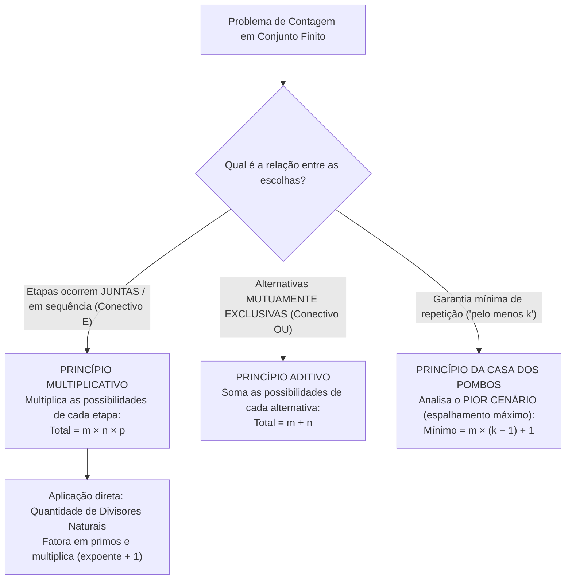

Iniciamos o estudo da **Análise Combinatória**, ramo da matemática e da estatística voltado às ferramentas de contagem. Essas técnicas permitem descobrir quantos eventos ou agrupamentos podem ser formados a partir de conjuntos finitos sem listar cada caso manualmente. Ao longo deste capítulo, veremos por que a contagem estruturada é essencial em provas de concurso. Dominaremos o **Princípio Multiplicativo** (conectivo E) e o **Princípio Aditivo** (conectivo OU). Também aplicaremos a fatoração em números primos para calcular a quantidade de **divisores naturais** e o preenchimento de tabelas retangulares. Por fim, estudaremos o **Princípio da Casa dos Pombos**, usado para obter garantias no pior cenário.

> [!objetivos]
> Ao final deste capítulo, você será capaz de:
> - Compreender o papel da análise combinatória na contagem de possibilidades em conjuntos finitos.
> - Aplicar o Princípio Multiplicativo em eventos sucessivos ou concomitantes, inclusive com restrições.
> - Calcular a quantidade total de divisores positivos de um número natural e o total de tabelas retangulares.
> - Aplicar o Princípio Aditivo em eventos mutuamente exclusivos e combiná-lo com o Princípio Multiplicativo.
> - Resolver questões de garantia mínima no pior cenário pelo Princípio da Casa dos Pombos.

## Introdução à análise combinatória

A **análise combinatória** fornece ferramentas lógicas para **contar eventos e possibilidades em conjuntos finitos**. Com poucos elementos, poderíamos simplesmente escrever todas as opções no papel. Por exemplo, com os algarismos do conjunto `{1, 2, 3}`, formamos exatamente `6` números de três algarismos distintos (`123, 132, 213, 231, 312 e 321`).

Todavia, quando o conjunto cresce — como `{1, 2, 3, 4, 5, 6, 7, 8, 9, 0}` —, tentar listar todos os números de quatro algarismos distintos torna-se inviável. Perderíamos muito tempo na prova e correríamos grande risco de esquecer algum caso, sobretudo se a questão pedir apenas os números pares ou os iniciados por algarismos primos. Por isso, em toda a sua trajetória de estudos (inclusive em Estatística e Probabilidade, que cobram intensamente esse assunto), você utilizará os princípios fundamentais da contagem.

## Princípio multiplicativo e restrições entre etapas

O **Princípio Multiplicativo** aplica-se quando um evento global depende de duas ou mais etapas que ocorrem **juntas** (concomitantes ou em sequência, ligadas pelo conectivo **E**). Se um primeiro evento ocorre de `m` maneiras diferentes e, para cada uma delas, um segundo evento ocorre de `n` maneiras diferentes, ambos ocorrem juntos de **`m × n`** maneiras.

Para ilustrar, vamos considerar que **João** precisa se vestir escolhendo uma calça **e** uma blusa. Se ele possui **3 calças** e **4 blusas distintas**, existem `3 × 4 = 12` maneiras de se vestir. Se tivermos de colocar também um **cinto** (dispondo de **2 cintos**), o total sobe para `3 × 4 × 2 = 24` combinações. Do mesmo modo, em um cardápio com **3 opções de prato principal**, **2 tipos de acompanhamento** e **3 bebidas**, um cliente que deseja escolher um item de cada campo (prato **e** acompanhamento **e** bebida) pode calcular `3 × 2 × 3 = 18` combinações.

> [!exemplo] Escolhas concomitantes e pintura dos vértices de um quadrado
> - **Vestuário de Catarina**: Catarina deseja fazer uma combinação usando saia, blusa, sapatos e óculos. Se ela dispõe de 5 saias, 4 blusas, 6 pares de sapatos e 2 óculos, o produto das escolhas concomitantes fornece `5 × 4 × 6 × 2 = 240` combinações (ou `480`, caso disponha de 4 óculos). E se o enunciado informa que determinada saia não pode ser usada com determinado sapato? Basta calcular o total sem restrição e subtrair os casos proibidos!
> - **Pintura dos vértices de um quadrado (2016)**: Deseja-se pintar os 4 vértices de um quadrado (`A, B, C e D`) dispondo de **5 cores disponíveis**, de modo que vértices opostos (ligados pela diagonal) tenham cores diferentes. Na primeira diagonal (`A` e `C`), o primeiro vértice tem `5` cores e o oposto deverá ter cor diferente (`4` opções, dando `5 × 4 = 20`). Na segunda diagonal (`B` e `D`), também temos `5 × 4 = 20` opções. Multiplicando tudo, encontramos `20 × 20 = 400` maneiras de pintar o quadrado! (Se fossem apenas 3 vértices com cores todas distintas entre 5, teríamos `5 × 4 × 3 = 60`).

### Quantidade de divisores naturais e tabelas retangulares

Outra aplicação direta do princípio multiplicativo consiste em encontrar a **quantidade total de divisores naturais** de um número a partir da sua fatoração em primos. Vamos fatorar o número **`15`**: obtemos `15 = 3¹ × 5¹`. Todo divisor de `15` é do tipo `3^x × 5^y`, em que cada expoente pode assumir `0` ou `1` (`2` opções para `x` e `2` opções para `y`), gerando `2 × 2 = 4` divisores.

Agora considere o número **`216`**. Ao fatorar `216`, encontramos `216 = 2³ × 3³`. Os divisores positivos são representados por `2^x × 3^y`. O expoente `x` pode assumir 4 valores (`0, 1, 2 ou 3`) e o expoente `y` também pode assumir 4 valores (`0, 1, 2 ou 3`). Multiplicando as possibilidades de cada expoente, concluímos que `216` possui `(3 + 1) × (3 + 1) = 4 × 4 = 16` divisores naturais!

Esse método resolve imediatamente problemas de **preenchimento de tabelas retangulares** definidas por **linhas e colunas**. Se uma tabela retangular possui exatamente `216` células, cada divisor de `216` define uma quantidade possível de linhas, existindo `16` tabelas. Caso a questão exija que a tabela tenha mais de uma linha e mais de uma coluna (descartando `1 × 216` e `216 × 1`), restam `16 − 2 = 14` tabelas. Para `108` células (`108 = 2² × 3³`), há `(2 + 1) × (3 + 1) = 12` tabelas!

> [!pegadinha] Não esqueça de somar 1 a cada expoente!
> Ao calcular a quantidade de divisores naturais de um número fatorado em primos (`N = p1^a × p2^b`), nunca multiplique apenas `a × b`! Você precisa somar `1` a cada expoente antes de multiplicar: **`(a + 1) × (b + 1)`**. Isso ocorre porque o expoente zero (`p⁰ = 1`) também entra como possibilidade válida na formação do divisor.

## Princípio aditivo e uso combinado dos princípios

O **Princípio Aditivo** aplica-se a eventos **mutuamente exclusivos (excludentes)** — situações em que a ocorrência de uma opção impede a outra (conectivo **OU**). Se `A` ocorre de `m` modos e `B` ocorre de `n` modos excludentes, a escolha de `A` **ou** `B` ocorre de **`m + n`** modos.

Ninguém consegue calçar ao mesmo tempo um tênis e um sapato social. Logo, havendo 4 pares de tênis e 3 de sapatos, há `4 + 3 = 7` opções. Em outra situação hipotética, **Maria** pode ir a uma festa usando **1 entre 5 vestidos** (peça única) **ou** combinando **1 entre 4 blusas com 1 entre 3 saias** (`4 × 3 = 12`). Aplicando o princípio aditivo entre os dois trajes excludentes, Maria tem `5 + 12 = 17` opções!

> [!bizu] Combinando E (multiplica) com OU (soma) nas provas
> - **Lanche de Marta**: Marta vai escolher uma comida **e** uma bebida. Na comida, há 5 espécies de tapioca **ou** 3 tipos de sanduíche (`5 + 3 = 8` comidas). Na bebida, há 4 sucos **ou** 2 refrigerantes (`4 + 2 = 6` bebidas). Multiplicando comida por bebida, Marta terá `8 × 6 = 48` opções de lanche (ou `100`, se houver 10 comidas e 10 bebidas).
> - **Dicionários na estante (2017)**: Em uma prateleira existem **4 dicionários da língua inglesa**, **3 da língua espanhola** e **2 da língua francesa**. Quantas escolhas distintas permitem levar **2 obras de idiomas diferentes**? Separamos nos três pares mutuamente exclusivos: (1) Inglês e Espanhol = `4 × 3 = 12`; (2) Inglês e Francês = `4 × 2 = 8`; (3) Espanhol e Francês = `3 × 2 = 6`. Somando tudo pelo princípio aditivo, obtemos `12 + 8 + 6 = 26` maneiras!

> [!atencao] Como distinguir rapidamente se o problema pede soma ou multiplicação?
> Quando estiver diante de um enunciado complexo na prova, faça a si mesmo uma única pergunta prática: **"Realizar a primeira escolha encerra a minha tarefa ou eu ainda preciso fazer a segunda escolha?"**
> - Se realizar a primeira escolha **já cumpre integralmente a tarefa** (por exemplo, escolher ir ao trabalho de ônibus **ou** de metrô), as opções são mutuamente exclusivas. Você aplica o **Princípio Aditivo** e **soma** as possibilidades.
> - Se após realizar a primeira escolha você **ainda precisa executar a etapa seguinte** no agrupamento (por exemplo, escolher o algarismo das dezenas **e** depois escolher o algarismo das unidades, ou escolher a calça **e** depois escolher a camisa), as etapas são complementares e sucessivas. Você aplica o **Princípio Multiplicativo** e **multiplica** as possibilidades.
> - Nos problemas de contagem de senhas ou números com restrições (como formar números pares de 3 algarismos distintos), lembre-se de sempre definir primeiro a casa que sofre a maior exigência (a casa das unidades, que define se o número é par ou ímpar) e só depois ocupar as demais posições com os algarismos que sobraram.

| Critério Comparativo | Princípio Multiplicativo | Princípio Aditivo |
| --- | --- | --- |
| **Relação entre eventos** | Concomitantes ou sucessivos (ocorrem ambos). | Mutuamente exclusivos / excludentes (ocorre só um). |
| **Conectivo e Operação** | Conectivo **E** → **Multiplicar** (`m × n`). | Conectivo **OU** → **Somar** (`m + n`). |
| **Exemplo rápido** | 1 calça (3) **e** 1 blusa (4) = `12` trajes. | 1 tênis (4) **ou** 1 sapato (3) = `7` calçados. |

## Princípio da casa dos pombos

O **Princípio da Casa dos Pombos** afirma que, se o número de pombos for **maior** que o número de casas (`n > m`), então necessariamente **pelo menos uma casa ficará com mais de um pombo**. Na prova, esse raciocínio resolve afirmações sobre eventos imprevisíveis (sorteios ao acaso) quando se pede o **menor número** de escolhas necessárias para **garantir** (ter certeza de) que **haverá pelo menos `k` elementos** na mesma categoria.

A regra de ouro é pensar sempre no **pior cenário**: imagine que os elementos fiquem espalhados ao máximo entre as `m` categorias (colocando `k − 1` em cada casa) sem atingir a meta. Ao somar **`+ 1`** elemento, fica garantido que algum grupo completará `k` elementos: **`Mínimo = m × (k − 1) + 1`**.

| Situação-Problema | Categorias (`m`) e Meta (`k`) | Cálculo pelo Pior Cenário (`m × (k − 1) + 1`) |
| --- | --- | --- |
| **Aniversariantes no mesmo mês** | `m = 12` meses · `k = 2` pessoas | `12 × 1 + 1 = 13` pessoas no grupo. |
| **Funcionários no mesmo cargo** | `m = 4` cargos no setor · `k = 5` funcionários | `4 × 4 + 1 = 17` funcionários escolhidos. |
| **Urna com bolas de 9 cores** | `9` cores (branca, amarela, azul, vermelha, roxa, laranja, verde, marrom e preta) · `k = 3` bolas | `9 × 2 + 1 = 19` bolas retiradas (se houver estoque suficiente de cada bola). |

> [!resolvido] Casa dos pombos com quantidades limitadas na urna
> **Questão-modelo**: Uma urna escura contém bolas de 5 cores: 1 bola branca, 2 amarelas, 5 azuis, 6 vermelhas e 8 pretas. Qual é o menor número de bolas que devemos retirar ao acaso para garantir que haja pelo menos 4 bolas de uma mesma cor?
>
> **Resolução passo a passo**:
> 1. Queremos garantir `k = 4` bolas da mesma cor. Raciocinamos pelo **pior cenário** (retirar o máximo possível sem completar 4 de nenhuma cor).
> 2. Das cores que possuem menos de 3 bolas, esgotamos todo o estoque no pior cenário: sai **1 bola branca** e saem **2 bolas amarelas**.
> 3. Das cores que possuem 4 ou mais bolas (azul, vermelha e preta — 3 cores), retiramos `k − 1 = 3` bolas de cada uma: `3 × 3 = 9` bolas.
> 4. Ao todo, no pior cenário retiramos `1 + 2 + 9 = 12` bolas sem ter 4 da mesma cor. A próxima bola retirada (**`12 + 1 = 13`**) garante necessariamente 4 bolas da mesma cor.
> - **Gabarito**: **13 bolas**.

> [!esquema] Resumo estratégico do Capítulo 1
> - **Princípio Multiplicativo (E)**: eventos concomitantes multiplicam (`m × n`).
> - **Divisores Naturais e Tabelas**: fatore em primos, some 1 a cada expoente e multiplique `(a + 1) × (b + 1)`.
> - **Princípio Aditivo (OU)**: eventos mutuamente exclusivos somam (`m + n`).
> - **Casa dos Pombos**: pense no pior cenário (espalhados ao máximo) e some 1: `m × (k − 1) + 1`.

## Mapa do capítulo

| Ferramenta / Conceito | Quando utilizar | Fórmula / Regra Prática |
| --- | --- | --- |
| **Princípio Multiplicativo** | Etapas que ocorrem juntas (**E**) | `Total = p1 × p2 × ... × pk` |
| **Divisores e Tabelas (`L × C`)** | Contar divisores de `N` ou tabelas retangulares | Fatorar `N` → multiplicar `(expoente + 1)` |
| **Princípio Aditivo** | Alternativas excludentes (**OU**) | `Total = m + n` |
| **Casa dos Pombos** | Garantir no mínimo `k` iguais entre `m` casas | `Pior cenário + 1 = m × (k − 1) + 1` |

### Para fixar

- A **análise combinatória** conta possibilidades em conjuntos finitos sem listar cada caso, servindo de base para a estatística e a probabilidade.
- Pelo **Princípio Multiplicativo (E)**, etapas sucessivas ou concomitantes têm suas possibilidades multiplicadas (`m × n`).
- Para pintar os **4 vértices de um quadrado** com 5 cores sem repetir cor nos vértices opostos, multiplicamos as duas diagonais: `5 × 4 × 5 × 4 = 400`.
- Para achar a **quantidade de divisores naturais** (e o total de tabelas retangulares `linhas × colunas`), fatora-se o número em primos, soma-se `1` a cada expoente e multiplicam-se os resultados (`216 = 2³ × 3³` tem `4 × 4 = 16` divisores).
- Pelo **Princípio Aditivo (OU)**, alternativas mutuamente exclusivas têm suas possibilidades somadas (`m + n`).
- Pelo **Princípio da Casa dos Pombos**, para garantir pelo menos `k` elementos na mesma categoria, calcula-se o **pior cenário** e soma-se `1` (ex.: `13` pessoas garantem dois aniversariantes no mesmo mês).
