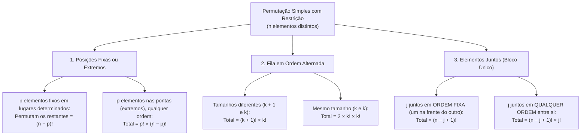

Avançamos agora para a transição entre o princípio da casa dos pombos, a contagem lógica de partidas e os modelos clássicos de ordenação da Análise Combinatória. Começaremos revisando a retirada de bolas de cores diferentes e estudando uma técnica imediata para calcular o total de partidas em um **torneio eliminatório simples (mata-mata)**. Em seguida, dominaremos o **fatorial de um número natural (`n!`)**, suas propriedades de divisão e parênteses. Por fim, estudaremos a **Permutação Simples (`Pn = n!`)** e suas **restrições** — elementos fixos na primeira, oitava ou extremas posições, filas com crianças (meninos e meninas) em ordem alternada e elementos que devem permanecer juntos como um elemento único.

> [!objetivos]
> Ao final deste capítulo, você será capaz de:
> - Calcular imediatamente o total de jogos em torneios eliminatórios com qualquer número de competidores (`N − 1`).
> - Operar e simplificar frações com fatoriais (`n!`), aplicando a precedência correta e os casos especiais `0! = 1` e `1! = 1`.
> - Aplicar a Permutação Simples (`Pn = n!`) para ordenar elementos distintos em filas, rankings e anagramas.
> - Resolver problemas de permutação com restrição: posições fixas ou extremas, alternância de subgrupos e elementos juntos em bloco.

## Contagem de jogos em torneios eliminatórios

Antes de passarmos aos torneios, lembre-se do raciocínio que vimos ao considerar a **retirada de bolas de cores diferentes** de uma urna: sabendo quantas bolas de cada cor estão disponíveis, calculamos o pior cenário para descobrir quantas retiradas são necessárias para que haja pelo menos determinada quantidade da mesma cor.

Uma lógica igualmente direta permite você **calcular o total de jogos** em um **torneio eliminatório simples**. Nesse formato, cada **jogo reúne 2 jogadores**: o **perdedor é eliminado** imediatamente e o **vencedor** avança para a **próxima fase**, até restar um **único campeão**.

Para entender como funciona, vamos supor um torneio com **23 jogadores**. Se contarmos fase por fase, como seriam as disputas?
- Na **primeira fase**, como 23 é um número **ímpar**, deixamos 1 jogador de fora: os outros 22 disputam **11 jogos**, saindo 11 eliminados e 11 vencedores (que se juntam ao que ficou de fora, totalizando 12 jogadores).
- Na **segunda fase**, teremos 12 jogadores em **6 jogos**, restando 6 vencedores.
- Na **terceira fase**, os 6 disputam **3 jogos** (restando 3 vencedores, inclusive quem não competiu na rodada inicial).
- Na penúltima fase, deixamos 1 de fora e realizamos **1 jogo** (restando 2 jogadores).
- Na **última fase (final)**, ocorre **1 jogo**, totalizando `11 + 6 + 3 + 1 + 1 = 22` jogos!

| Fase do Torneio (23 jogadores) | Jogadores na fase | Jogos realizados (= Eliminados) | Seguem para a próxima fase |
| --- | --- | --- | --- |
| **Primeira fase** | 23 (1 fica de fora) | **11 jogos** | 11 vencedores + 1 = 12 |
| **Segunda fase** | 12 | **6 jogos** | 6 vencedores |
| **Terceira fase** | 6 | **3 jogos** | 3 vencedores |
| **Quarta fase** | 3 (1 fica de fora) | **1 jogo** | 1 vencedor + 1 = 2 |
| **Última fase (Final)** | 2 | **1 jogo** | 1 único campeão |
| **Total acumulado** | **23 competidores** | **22 jogos (22 eliminados)** | **1 campeão** |

> [!bizu] A regra matadora do torneio eliminatório: Total de Jogos = N − 1
> Você nunca precisa desenhar as fases do torneio na prova! Pense assim: como **cada jogo elimina exatamente 1 jogador** e ao final deve sobrar apenas **1 único campeão**, em um torneio disputado por **`N` competidores** precisam ocorrer exatamente **`N − 1` eliminados** — e, portanto, **`N − 1` jogos**! Assim, se um torneio na região reúne **987 contendores**, haverá `987 − 1 = 986` jogos; se tiver **560 competidores**, haverá `560 − 1 = 559` jogos!

## O fatorial de um número natural (`n!`)

Na análise combinatória, o **fatorial** de um número natural `n` é representado por **`n!`** e representa o **produto de todos os números naturais inteiros positivos de `n` até `1`**. Vejamos os valores que você deve ter na ponta da língua:
- `2! = 2 × 1 = 2`;
- `3! = 3 × 2 × 1 = 6`;
- `4! = 4 × 3 × 2 × 1 = 24`;
- `5! = 5 × 4 × 3 × 2 × 1 = 120`;
- `6! = 6 × 5 × 4 × 3 × 2 × 1 = 720`;
- `7! = 7 × 6 × 5 × 4 × 3 × 2 × 1 = 5.040`;
- `8! = 8 × 7 × 6 × 5 × 4 × 3 × 2 × 1 = 40.320`.

Além desses produtos, vejamos os **dois casos especiais** fundamentais: **`1! = 1`** e **`0! = 1`**.

### Simplificação de divisões e precedência com parênteses

Qualquer fatorial maior pode ser escrito multiplicando seus fatores iniciais por um fatorial menor (ex.: `6! = 6 × 5 × 4 × 3!`, ou `10! = 10 × 9 × 8 × 7!`, ou `15! = 15 × 14 × 13!`). Nesses casos de **divisão de fatoriais**, abrimos o maior até alcançar o menor e cancelamos os fatores iguais:
- Em `6! ÷ 3!`, escrevemos `(6 × 5 × 4 × 3!) ÷ 3! = 6 × 5 × 4 = 120`.
- Em `15! ÷ 13!`, escrevemos `(15 × 14 × 13!) ÷ 13! = 15 × 14 = 210` (e se estiver dividido por `2!`, obtemos `210 ÷ 2 = 105`).
- Em uma questão de prefeitura de 2021 que peça `10! ÷ (8! × 2!)}` ou similar, calculamos `(10 × 9 × 8!) ÷ (8! × 2) = 90 ÷ 2 = 45` (ou `10 × 9 = 90`, `8! = 40.320`, `7! = 5.040`, `70`, `76`, `109`, conforme a expressão dada).

| Expressão com Fatorial | Como calculamos (atenção aos parênteses!) | Resultado |
| --- | --- | --- |
| **`6! ÷ 2!`** | Calculamos os fatoriais antes da divisão: `720 ÷ 2` | **360** |
| **`(6 ÷ 2)!`** | Resolvemos primeiro o parêntesis: `3! = 3 × 2 × 1` | **6** |
| **`3 × 4!`** | Calculamos `4! = 24` e depois multiplicamos por 3 | **72** |
| **`(3 × 4)!`** | Multiplicamos dentro do parêntesis primeiro: `12!` | **479.001.600** |
| **`2 + 5!`** | Calculamos `5! = 120` e somamos 2 | **122** |

> [!pegadinha] O fatorial vem antes da multiplicação e da divisão!
> Nunca divida nem multiplique os números antes de aplicar o fatorial se não houver **parêntesis**! Em `8! ÷ 4!`, o resultado **não** é `2!`: abrimos `(8 × 7 × 6 × 5 × 4!) ÷ 4! = 1.680`. Só calculamos `8 ÷ 4 = 2` primeiro quando a expressão trouxer parêntesis: `(8 ÷ 4)! = 2! = 2`.

## Permutação simples (`Pn = n!`)

Na análise combinatória, **permutar quer dizer trocar de lugar**. Usamos a **Permutação Simples** quando todos os `n` elementos disponíveis são **distintos** e serão **todos ordenados** (em uma fila, classificação ou anagrama, onde a **ordem** importa).

Suponha um grupo de **4 alunos distintos** (entre eles **Beto e Caio**) que serão **ranqueados** do 1º ao 4º lugar. De quantas formas poderíamos resolver essa ordenação?
- Na **primeira posição**, pode ficar qualquer um dos `4` alunos.
- Uma vez que alguém tenha ocupado o 1º lugar, **restarão 3 alunos** para a segunda posição.
- Definido o segundo colocado, **sobrarão 2 alunos** para a terceira posição.
- Na última posição, **ficará 1 aluno** restante.

Pelo princípio multiplicativo, basta multiplicar as possibilidades de cada etapa: `4 × 3 × 2 × 1 = 4! = 24` ordenações! Mantendo essa lógica para `n` elementos distintos colocados em `n` lugares, a quantidade de maneiras é dada pela fórmula:
- **`Pn = n!`**

> [!exemplo] Anagramas de siglas e palavras sem letras repetidas
> Se houvesse a tarefa de **reordenar as letras de uma sigla ou palavra** formando **anagramas** (ou formar números com algarismos distintos), basta contar quantas letras distintas existem:
> - Com 4 letras distintas (ex.: `AMOR` ou `BMPE`), teríamos `P4 = 4! = 24` anagramas.
> - Com 5 letras distintas (ex.: `PRATO`), teríamos `P5 = 5! = 120` anagramas.
> - Com 6 letras distintas (ex.: `BRASIL`), teríamos `P6 = 6! = 720` anagramas.

## Permutação simples com restrição

Em muitas questões, precisamos organizar elementos em fila obedecendo a uma **restrição** específica. Podemos representar os **espaços** da fila e aplicar uma das três técnicas abaixo.

### Elementos em posições determinadas, extremas ou pares/ímpares

1. **Elementos fixos em posições determinadas (`(n − p)!`)**: suponha uma fila ou palavra de 8 lugares em que 1 elemento esteja **fixo na primeira posição** e outro esteja **fixo na oitava posição**. Como esses `p = 2` elementos já estão fixos, fazemos apenas a permutação dos `8 − 2 = 6` elementos **restantes** nas posições intermediárias quaisquer: `6! = 720`.
2. **Elementos nos extremos em qualquer ordem (`p! × (n − p)!`)**: se a condição exigir que dois elementos específicos fiquem nas **posições extremas (nos extremos da fila)**, sem fixar qual vai na frente e qual vai atrás, primeiro fixamos os 2 nos extremos de `2! = 2` maneiras diferentes e multiplicamos pelos `(n − 2)!` elementos restantes!
3. **Separação em posições pares e ímpares ou municípios**: se em uma palavra ou número com 6 lugares as 3 primeiras letras (ou as **posições ímpares**) tiverem de ser ocupadas por vogais e as **posições pares** por consoantes (ou se **candidatos aprovados** forem **alocados em municípios** específicos por categoria), calculamos separado cada bloco e multiplicamos: `3! × 3! = 6 × 6 = 36`.

### Filas em ordem alternada (intercalada)

Considere uma **situação hipotética** em que **crianças (meninas e meninos)** estão em uma **fila para comprar pipoca**, e queremos que **fiquem em ordem alternada** (nunca dois meninos juntos nem duas meninas juntas):
- **Quantidades diferentes (ex.: 4 meninas e 3 meninos)**: para intercalar sem repetir sexo lado a lado, a fila precisa obrigatoriamente começar e terminar com uma **menina** (`M - H - M - H - M - H - M`). Permutamos as 4 meninas nos 4 lugares delas (`4! = 24`) e os 3 meninos nos 3 lugares deles (`3! = 6`), obtendo `4! × 3! = 144` maneiras.
- **Quantidades iguais (ex.: 3 meninas e 3 meninos)**: agora existem **2 configurações** possíveis (começar por menina **ou** começar por menino), resultando em `2 × 3! × 3! = 2 × 6 × 6 = 72` maneiras!

### Elementos que devem permanecer juntos (bloco único)

E quando o problema exige que determinados elementos (por exemplo, **Ana, Beto e Célia**) fiquem **juntos** na fila?
- **Juntos em uma ordem determinada (ex.: Ana imediatamente na frente de Beto)**: tratamos o grupo junto como um **elemento único (um bloco)**. Se houver `n` elementos ao todo e `j` ficarem juntos nessa ordem fixa, permutamos `(n − j + 1)!`.
- **Juntos em qualquer ordem entre si**: além de permutar o bloco com os demais (`(n − j + 1)!`), os `j` elementos dentro do bloco podem ser **reordenados** entre si de `j!` modos, resultando em **`(n − j + 1)! × j!`**.

> [!atencao] Cuidado com a diferença entre "juntos em qualquer ordem" e "juntos nesta ordem"!
> Na hora da prova, sublinhe imediatamente a expressão que acompanha os elementos juntos:
> 1. Quando o enunciado diz apenas que as letras `A`, `B` e `C` devem ficar **juntas** (ou lado a lado, ou em vagas consecutivas), subentende-se que elas podem permutar internamente dentro do bloco. Nesse caso, além da permutação externa `(n − j + 1)!`, você **multiplica obrigatoriamente por `j!`** (no caso de 3 letras, multiplica por `3! = 6`).
> 2. Já quando o enunciado exige que as letras `A`, `B` e `C` fiquem **juntas e exatamente nessa ordem** (formando a sequência fixa `ABC`, ou dizendo que Ana deve ficar imediatamente à frente de Beto), a arrumação interna já está travada em uma única possibilidade (`1`). Portanto, você calcula apenas a permutação externa **`(n − j + 1)!`**, sem multiplicar por `j!`.
> 3. E se o enunciado pedir o número de filas em que **dois elementos específicos (`A` e `B`) NÃO fiquem juntos**? A maneira mais rápida consiste em usar o **método complementar**: calcule o total de permutações livres sem restrição (`n!`) e subtraia o total de permutações em que `A` e `B` ficam juntos (`(n − 1)! × 2!`). Por exemplo, com 5 pessoas em fila, o total livre é `5! = 120`, e os casos com `A` e `B` juntos somam `4! × 2! = 24 × 2 = 48`. Logo, existem `120 − 48 = 72` filas em que `A` e `B` estão separados!

| Caso de Análise com 2 Pessoas (`A` e `B`) em uma Fila de `n` Pessoas | Raciocínio Combinatório | Fórmula Direta | Valor para `n = 5` |
| --- | --- | --- | --- |
| **Fila livre (sem restrição)** | Permutação simples de todos os `n` elementos | `n!` | `5! = 120` |
| **`A` e `B` juntos na ordem fixa `[A - B]`** | Bloco `[AB]` + `(n − 2)` pessoas = `(n − 1)` elementos | `(n − 1)!` | `4! = 24` |
| **`A` e `B` juntos em qualquer ordem** | Permutação externa `(n − 1)!` vezes interna `2!` | `(n − 1)! × 2!` | `4! × 2! = 48` |
| **`A` e `B` separados (NÃO juntos)** | Total livre menos o total em que ficam juntos | `n! − [(n − 1)! × 2!]` | `120 − 48 = 72` |
| **`A` e `B` nos extremos da fila (qualquer ordem)** | `2!` modos nas pontas vezes `(n − 2)!` no miolo | `2! × (n − 2)!` | `2! × 3! = 12` |

### Aplicações em formação de números com algarismos distintos

As mesmas técnicas de permutação simples com restrição aplicam-se à contagem de **números formados por algarismos distintos**. Suponha que disponhamos dos 5 algarismos `{1, 2, 3, 4, 5}` e queiramos formar números de 5 algarismos distintos:
- **Total de números de 5 algarismos distintos**: basta permutar os 5 algarismos nos 5 espaços (`P5 = 5! = 120` números).
- **Quantos desses números são PARES?**: para um número ser par, seu último algarismo (casa das unidades) deve ser par (`2` ou `4`, ou seja, `2` possibilidades). Fixado um par no final, sobram `4` algarismos quaisquer para permutar nas quatro primeiras casas (`4! = 24`). Multiplicando: `2 × 24 = 48` números pares.
- **Quantos desses números são ÍMPARES?**: a casa das unidades deve ser ocupada por um algarismo ímpar (`1`, `3` ou `5`, isto é, `3` possibilidades), restando `4! = 24` para as demais casas: `3 × 24 = 72` números ímpares (note que `48 pares + 72 ímpares = 120` números ao todo!).
- **Quantos têm os algarismos pares (`2` e `4`) juntos?**: tratando o par `[2, 4]` como um bloco único, temos `4! × 2! = 24 × 2 = 48` números.
- **Quantos têm os algarismos pares e ímpares alternados?**: como há 3 ímpares (`I`) e 2 pares (`P`), a única configuração alternada é `I - P - I - P - I`, gerando `3! × 2! = 6 × 2 = 12` números!

| Condição / Restrição na Fila de `n` Elementos | Fórmula Aplicável | Exemplo (`n = 6` pessoas) |
| --- | --- | --- |
| **Fila sem restrição** | `Pn = n!` | `6! = 720` |
| **`p` elementos fixos em lugares exatos** | `(n − p)!` | 2 fixos no 1º e 6º lugares: `4! = 24` |
| **`p` elementos nos extremos (qualquer ordem)** | `p! × (n − p)!` | 2 nos extremos: `2! × 4! = 48` |
| **`j` elementos juntos em ordem fixa** | `(n − j + 1)!` | 2 juntos com A na frente de B: `5! = 120` |
| **`j` elementos juntos em qualquer ordem** | `(n − j + 1)! × j!` | 2 juntos em qualquer ordem: `5! × 2! = 240` |

> [!resolvido] Organização de animais em um navio
> **Questão-modelo**: Em um navio serão transportados 6 animais de espécies diferentes — dentre eles um camelo, um elefante e um leão —, que deverão ser organizados em uma fila de 6 jaulas (uma subsequente à outra). A respeito dessa organização, de quantas maneiras distintas os 6 animais podem ser colocados nas jaulas de modo que o camelo, o elefante e o leão permaneçam sempre juntos, em qualquer ordem entre si?
>
> **Resolução passo a passo**:
> 1. Como o **camelo, o elefante e o leão** (`j = 3`) devem permanecer **juntos**, nós os agrupamos como se tivessem formado um **elemento único** `[Camelo, Elefante, Leão]`.
> 2. Somando esse bloco único aos outros `3` animais restantes, passamos a ter `6 − 3 + 1 = 4` elementos para permutar nos espaços da fila: `P4 = 4! = 24`.
> 3. Dentro do bloco, os 3 animais (camelo, elefante e leão) podem ser reordenados entre si de `P3 = 3! = 6` maneiras diferentes.
> 4. Multiplicando pelo princípio multiplicativo: `24 × 6 = 144` maneiras distintas.
> - **Gabarito**: **144 maneiras**.

> [!esquema] Resumo estratégico do Capítulo 2
> - **Contagem de Jogos**: torneio eliminatório simples com `N` competidores tem exatamente **`N − 1` jogos**.
> - **Fatorial (`n!`)**: produto de `n` até `1`, com **`0! = 1`** e **`1! = 1`**. Precedência antes de somar, multiplicar ou dividir (salvo parêntesis).
> - **Permutação Simples (`Pn = n!`)**: ordena todos os `n` elementos distintos.
> - **Restrições**: fixos `(n − p)!`; extremos `p! × (n − p)!`; alternados `(k + 1)! × k!` ou `2 × k! × k!`; juntos em bloco `(n − j + 1)! × j!`.

## Mapa do capítulo

| Tópico / Modelo | Quando utilizar | Fórmula / Regra Prática |
| --- | --- | --- |
| **Torneio Eliminatório** | Mata-mata com `N` competidores e 1 campeão | `Jogos = N − 1` |
| **Fatorial e Simplificação** | Produto de `1` a `n` (`0! = 1`, `1! = 1`) | Abrir o maior fatorial até cortar com o menor |
| **Permutação Simples** | Trocar de lugar todos os `n` elementos distintos | `Pn = n!` |
| **Posições Fixas / Extremos** | Travar elementos em lugares específicos | `(n − p)!` (fixos) ou `p! × (n − p)!` (ordem livre) |
| **Ordem Alternada** | Intercalar meninas e meninos na fila | `(k + 1)! × k!` (tamanhos `k+1` e `k`) ou `2 × k! × k!` (`k` e `k`) |
| **Elementos Juntos** | Manter `j` elementos lado a lado | `(n − j + 1)! × j!` (ordem livre) ou `(n − j + 1)!` (fixa) |

### Para fixar

- Em um **torneio eliminatório** com `N` competidores, cada partida elimina um jogador; por isso, o total de jogos até o único campeão é sempre **`N − 1`** (ex.: 987 contendores realizam 986 jogos).
- O **fatorial (`n!`)** representa o produto dos naturais de `n` até `1`, valendo **`0! = 1`** e **`1! = 1`**; na ausência de parêntesis, calcula-se o fatorial antes da divisão ou multiplicação.
- A **Permutação Simples (`Pn = n!`)** calcula de quantas maneiras podemos ordenar (trocar de lugar) `n` elementos distintos em uma fila, ranking ou anagrama.
- Se **`p` elementos estiverem fixos** em posições determinadas, permutamos os demais (`(n − p)!`); se puderem trocar de lugar entre si (como nas posições extremas), multiplicamos por `p!`.
- Para organizar dois grupos em **ordem alternada**, usamos `(k + 1)! × k!` quando um grupo tem um elemento a mais (4 meninas e 3 meninos = `4! × 3! = 144`) e `2 × k! × k!` quando têm o mesmo tamanho.
- Quando **`j` elementos devem permanecer juntos**, tratamos o grupo como um elemento único (`(n − j + 1)!`) e multiplicamos por `j!` se puderem trocar de posição entre si dentro do bloco.
