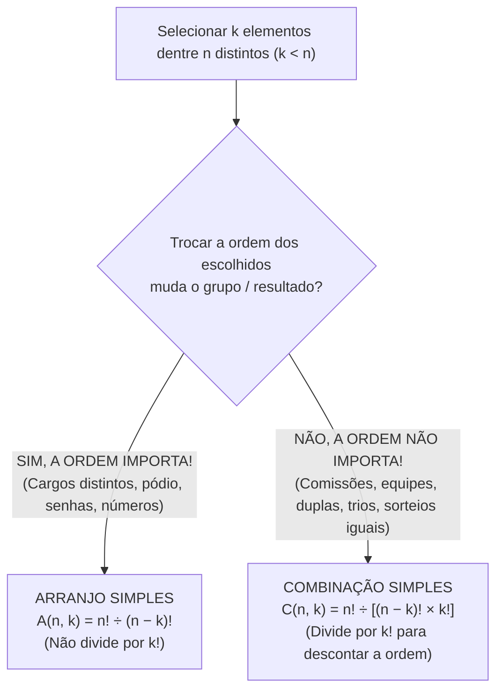

Neste quarto capítulo, estudaremos a ferramenta mais cobrada em toda a Análise Combinatória. Trata-se da **Combinação Simples (`C(n, k)`)**, utilizada sempre que selecionamos um subconjunto de elementos no qual **a ordem da escolha não importa** (formação de comissões, equipes, grupos de trabalho, trios ou duplas). Além de dominar a combinação simples e o método complementar para restrições do tipo "pelo menos um", examinaremos os **casos particulares**, os números binomiais e as propriedades do **Triângulo de Pascal** (teorema das linhas, relação de Stifel e teorema das colunas). Ao final, avançaremos para a **Combinação Completa (com repetição)** e sua aplicação direta no cálculo do **número de soluções inteiras não negativas de uma equação linear**.

> [!objetivos]
> Ao final deste capítulo, você será capaz de:
> - Distinguir imediatamente problemas de Arranjo e de Combinação Simples e calcular `C(n, k) = n! / ((n − k)! × k!)`.
> - Resolver problemas de combinação com múltiplos grupos e com restrições do tipo "pelo menos um" pelo método complementar.
> - Aplicar os casos particulares de combinação e as propriedades do Triângulo de Pascal (soma da linha `2^n`).
> - Calcular a Combinação Completa ou com repetição (`CR(n, p) = C(n − 1 + p, p)`) na escolha de itens repetíveis e objetos idênticos.
> - Determinar a quantidade de soluções inteiras não negativas (`≥ 0`) ou positivas (`≥ 1`) de equações lineares.

## Da revisão de senhas com reposição à combinação simples

Antes de entrarmos na combinação, concluamos a aplicação do arranjo com e sem reposição na formação de **senhas com letras e dígitos**. Suponha uma senha formada por **2 letras distintas** (escolhidas entre as **26 letras** do alfabeto) seguidas por **3 números (dígitos) que admitem repetição** (escolhidos entre os 10 algarismos de 0 a 9). Para os 2 espaços de letras distintas, temos `26 × 25 = 650` possibilidades. Para os 3 espaços de dígitos com reposição, temos `10 × 10 × 10 = 1.000` possibilidades. Multiplicando as etapas pelo princípio multiplicativo, obtemos `650 × 1.000 = 650.000` senhas. Se as letras pudessem repetir, seriam `676.000` (ou `600.000` e `500.000`, conforme o conjunto dado).

Agora compare essa situação com a seleção de uma **comissão ou equipe homogênea**. Suponha que, dentre **6 policiais**, queiramos escolher **2 policiais** para participar de um **treinamento especial**. Aqui, escolher `{Policial A, Policial B}` é **exatamente a mesma dupla** que escolher `{Policial B, Policial A}`! Quando **a ordem dos elementos escolhidos NÃO importa**, estamos diante de uma **Combinação Simples**!

Para calcular a **Combinação Simples de `n` elementos distintos tomados `k` a `k`** (representada por **`C(n, k)`** ou pelo número binomial), basta pegar o Arranjo Simples `A(n, k)` e **dividir por `k!`**. Fazemos isso porque cada grupo de `k` pessoas foi contado `k!` vezes em ordens diferentes no arranjo:
- **`C(n, k) = A(n, k) ÷ k! = n! ÷ [ (n − k)! × k! ]`**

Na prática, você calcula `C(n, k)` de forma muito rápida sem precisar escrever a fórmula inteira. **Abra `k` fatores decrescentes a partir de `n` no numerador e divida por `k!` no denominador!** Veja os exemplos:
- Escolher **2 policiais dentre 6 (`C(6, 2)`)**. Abrimos 2 fatores a partir de 6 e dividimos por `2!`. Calculamos `(6 × 5) ÷ (2 × 1) = 30 ÷ 2 = 15` pares diferentes!
- Escolher **3 estudantes dentre 7 (`C(7, 3)`)** para formar um grupo de estudo. Abrimos 3 fatores a partir de 7 e dividimos por `3!`. Obtemos `(7 × 6 × 5) ÷ (3 × 2 × 1) = 35` grupos! Se da turma de 7 alunos 1 aluno específico ficar sozinho ou for excluído, escolhemos os restantes dentre os 6 que sobram.

| Situação Prática de Prova | A ordem importa? | Ferramenta e Cálculo (para `n = 8` e `k = 3`) |
| --- | --- | --- |
| Escolher **1 presidente, 1 vice e 1 relator** entre 8 pessoas | **Sim** (cargos diferentes) | **Arranjo**: `A(8, 3) = 8 × 7 × 6 = 336` |
| Escolher uma **comissão de 3 membros iguais** entre 8 pessoas | **Não** (mesma função) | **Combinação**: `C(8, 3) = (8 × 7 × 6) ÷ 3! = 56` |
| Formar **números de 3 algarismos distintos** com 8 dígitos | **Sim** (`123 ≠ 321`) | **Arranjo**: `A(8, 3) = 8 × 7 × 6 = 336` |
| Escolher **3 frutas para uma vitamina** entre 8 opções | **Não** (mistura igual) | **Combinação**: `C(8, 3) = (8 × 7 × 6) ÷ 6 = 56` |

> [!pegadinha] O erro mais comum da prova: esquecer de dividir por `k!` na comissão!
> Quando o enunciado pede para formar um trio de plantão com 3 bombeiros escolhidos entre 10 disponíveis, muita gente multiplica apenas `10 × 9 × 8 = 720` e marca a alternativa errada! Multiplicar `10 × 9 × 8` sem dividir por `3! = 6` calcula um **arranjo** (como se houvesse 1º, 2º e 3º colocados). Como no trio de plantão a ordem não importa, você **precisa dividir por `3! = 6`**, encontrando `720 ÷ 6 = 120` trios!

### Combinações com vários grupos e restrição "pelo menos um"

Dentro dos **princípios de contagem e probabilidade**, duas variações de Combinação Simples despencam nas provas. Vejamos cada uma delas com períodos curtos e diretos:
1. **Escolha simultânea em grupos distintos (multiplica as combinações)**. Em uma **escola de musica** (2021), há **5 guitarristas**, **4 contrabaixistas**, **3 bateristas** e **2 teclados (tecladistas)**. De quantas formas poderão ser formadas bandas compostas por **2 guitarristas, 1 contrabaixista, 1 baterista e 1 tecladista**? Escolhemos os guitarristas (`C(5, 2) = 10`). Escolhemos o contrabaixista (`C(4, 1) = 4`). Escolhemos o baterista (`C(3, 1) = 3`) e o tecladista (`C(2, 1) = 2`). Multiplicando tudo, obtemos `10 × 4 × 3 × 2 = 240` bandas!
2. **Restrição do tipo "pelo menos um" (Método Complementar)**. Suponha um grupo com **5 homens e 4 mulheres** (`9` pessoas ao todo). Serão escolhidas **3 pessoas** para uma comissão, exigindo-se que haja **pelo menos 1 mulher** na comissão. Você pode resolver de dois modos:
   - **Modo 1 (Mais rápido — pelo Complemento)**. Calculamos o **total de comissões sem restrição** (`C(9, 3) = (9 × 8 × 7) ÷ 6 = 84`). Depois, **subtraímos o único caso proibido** (comissões formadas **exclusivamente por homens**, sem nenhuma mulher, que somam `C(5, 3) = 10`). O resultado é imediato: **`84 − 10 = 74` comissões**!
   - **Modo 2 (Soma dos casos possíveis)**. Somamos os casos com **1 mulher e 2 homens** (`C(4, 1) × C(5, 2) = 4 × 10 = 40`), com **2 mulheres e 1 homem** (`C(4, 2) × C(5, 1) = 6 × 5 = 30`) e com **3 mulheres e 0 homem** (`C(4, 3) × C(5, 0) = 4 × 1 = 4`). Ao todo, temos `40 + 30 + 4 = 74` comissões!

> [!exemplo] Trios de crianças com pelo menos 1 menino
> Suponha um grupo de **7 crianças**, sendo **4 meninas e 3 meninos**. Quantos **trios** distintos podemos formar de modo que haja **pelo menos 1 menino** no trio?
> - **Total de trios sem restrição**: `C(7, 3) = (7 × 6 × 5) ÷ (3 × 2 × 1) = 35` trios.
> - **Caso proibido (trios formados apenas por meninas)**: `C(4, 3) = 4` trios.
> - **Total válido**: subtraindo o caso proibido do total livre, encontramos `35 − 4 = 31` trios com pelo menos 1 menino!

## Casos particulares e o triângulo de Pascal

Para ganhar velocidade nas contas, domine os **cinco casos particulares** da combinação simples e a simetria das **combinações complementares**:

| Caso Particular / Propriedade | Resultado Direto | Explicação Lógica e Atalho de Prova |
| --- | --- | --- |
| **`C(n, 0)`** | **`1`** | Só há 1 maneira de não escolher ninguém (conjunto vazio). |
| **`C(n, n)`** | **`1`** | Só há 1 maneira de escolher todos os `n` elementos disponíveis. |
| **`C(n, 1)`** | **`n`** | Para escolher 1 elemento entre `n`, há `n` opções. |
| **`C(n, n − 1)`** | **`n`** | Escolher `n − 1` pessoas equivale a escolher a única pessoa que ficará de fora (`n` opções). |
| **Complementares: `C(n, k) = C(n, n − k)`** | **Iguais!** | Escolher `k` para entrar equivale a escolher `n − k` para sair. Ex.: `C(9, 7) = C(9, 2) = (9 × 8) ÷ 2 = 36`! |

### Propriedades do triângulo de Pascal e somatório de combinações

Quando organizamos os números binomiais `C(n, k)` em uma tabela triangular em que **`n` indica a linha** (começando da linha `0`) e **`k` indica a coluna** (começando da coluna `0`), obtemos o famoso **Triângulo de Pascal**. Dele decorrem três propriedades clássicas para resolver problemas que envolvem o **somatório de combinações**:
1. **Teorema das Linhas (Soma de uma linha inteira = `2^n`)**. A soma de todas as combinações de uma mesma linha `n` (desde `k = 0` até `k = n`) é igual a **`2^n`**. Ou seja, `C(n, 0) + C(n, 1) + C(n, 2) + ... + C(n, n) = 2^n`.
2. **Relação de Stifel (`C(n, k) + C(n, k + 1) = C(n + 1, k + 1)`)**. Somando dois números vizinhos de uma mesma linha `n`, o resultado é o número situado na linha de baixo (`n + 1`) e na coluna do maior (`k + 1`). Por exemplo, `C(6, 2) + C(6, 3) = C(7, 3) = 35`.
3. **Teorema das Colunas**. A soma dos elementos de uma mesma coluna `k`, partindo do primeiro elemento `C(k, k)` e descendo até a linha `k + m`, é igual ao elemento situado uma linha abaixo e uma coluna à direita (`C(k + m + 1, k + 1)`).

> [!bizu] Aplicações rápidas do Teorema das Linhas (`2^n`) em provas
> - **Escolher pelo menos 1 jogador entre `n` (`2^n − 1`)**: de quantas formas um técnico pode selecionar **pelo menos 1** dentre `n` jogadores disponíveis (podendo escolher 1, ou 2, ou 3... até todos os `n`)? Como a soma completa da linha vale `2^n`, basta descontar a opção de não escolher ninguém (`C(n, 0) = 1`), obtendo **`2^n − 1`**!
> - **Guardar pastas em 2 caixas sem deixar caixa vazia (`2^n − 2`)**: de quantas formas **5 pastas diferentes** podem ser guardadas em **2 caixas distintas** de modo que **nenhuma caixa fique vazia**? Cada pasta tem 2 opções de caixa (`2⁵ = 32`). Descontamos os 2 casos em que uma caixa fica vazia (todas na caixa A ou todas na caixa B), restando `32 − 2 = 30` modos! (Para escolher exatamente 4 pastas entre 9 para a primeira caixa, fazemos `C(9, 4) = 126`).

## Combinação completa (com repetição) e soluções inteiras de equações

Na combinação simples que estudamos acima, escolhíamos `k` elementos distintos sem repetição. E quando queremos escolher **`p` objetos** dentre **`n` tipos (ou marcas / categorias) disponíveis**, **podendo repetir os tipos** e sem que a ordem da escolha importe? Ou quando queremos **distribuir `p` objetos idênticos (iguais / indistinguíveis) entre `n` pessoas ou caixas distintas**? Esse modelo chama-se **Combinação Completa (ou Combinação com Repetição, `CR(n, p)`)**!

### A lógica das barras divisórias e a fórmula `CR(n, p)`

Imagine que você vá à sorveteria comprar **`p = 5` potes de sorvete**, havendo **`n = 3` sabores (marcas/tipos) disponíveis**: Chocolate (`C`), Morango (`M`) e Baunilha (`B`). Você pode comprar todos os 5 de um único sabor ou misturar sabores. A ordem na sacola não importa.

Podemos representar cada escolha como uma fila de **`5` bolinhas (`o`)** — representando os `p = 5` potes de sorvete — separadas por **`2` barras divisórias (`|`)**. Para separar `n = 3` sabores, precisamos de apenas **`n − 1 = 2` divisórias** (antes da 1ª barra é Chocolate, no meio é Morango e depois da 2ª barra é Baunilha):
- Configuração `o o | o o | o` → 2 de Chocolate, 2 de Morango e 1 de Baunilha.
- Configuração `o o o o o | |` → 5 de Chocolate, 0 de Morango e 0 de Baunilha.

Contar todas as escolhas possíveis equivale a **permutar com repetição** um total de **`p + (n − 1)` símbolos**, sendo **`p` objetos iguais (`o`)** e **`n − 1` barras divisórias iguais (`|`)**! Daí nasce a fórmula da **Combinação Completa de `n` tipos para escolher `p` objetos**:
- **`CR(n, p) = C(n − 1 + p, p) = (n − 1 + p)! ÷ [ p! × (n − 1)! ]`**

No exemplo dos `p = 5` potes de sorvete escolhidos entre `n = 3` sabores, temos `n − 1 = 2` barras e `p = 5` potes, somando `2 + 5 = 7` elementos. Calculamos `CR(3, 5) = C(7, 5) = C(7, 2) = (7 × 6) ÷ 2 = 21` maneiras!

| Situação de Combinação Completa / Equação Linear | Tipos / Variáveis (`n`) e Barras (`n − 1`) | Objetos / Soma (`p`) | Cálculo `C(n − 1 + p, p)` |
| --- | --- | --- | --- |
| **5 potes de sorvete entre 3 sabores** | `n = 3` sabores (`2` barras) | `p = 5` potes | `C(7, 5) = C(7, 2) = 21` |
| **10 convites iguais para 4 amigos (mínimo 1 para cada)** | `n = 4` amigos (`3` barras) | `p' = 10 − 4 = 6` livres | `C(9, 6) = C(9, 3) = 84` |
| **Soluções inteiras `≥ 0` de `x + y + z = 5`** | `n = 3` variáveis (`2` sinais `+`) | `p = 5` unidades | `C(7, 5) = C(7, 2) = 21` |
| **Soluções inteiras `≥ 1` de `x + y + z = 5`** | `n = 3` variáveis (`2` sinais `+`) | `p' = 5 − 3 = 2` livres | `C(4, 2) = 6` |

### Distribuição com mínimo obrigatório e soluções inteiras de equações

O modelo das barras divisórias (`CR(n, p)`) resolve diretamente **dois problemas clássicos de concurso**:
1. **Distribuição de objetos iguais (indistinguíveis) com mínimo obrigatório**. Suponha que um aplicativo dê **10 convites idênticos (ou 10 maçãs iguais)** para serem distribuídos entre **4 amigos (`n = 4`)**, mas cada amigo precisa receber **pelo menos 1 convite**. **Entregue primeiro o mínimo obrigatório!** Dando `1` convite para cada um dos 4 amigos, gastamos `4` convites e **restarão `p = 6` convites** para serem distribuídos livremente entre os **`n = 4` amigos** (3 barras divisórias). Aplicando a combinação completa ao saldo, obtemos `CR(4, 6) = C(4 − 1 + 6, 6) = C(9, 6) = C(9, 3) = 84` maneiras!
2. **Número de soluções inteiras não negativas de uma equação linear (`x1 + x2 + ... + xn = p`)**. Encontrar quantas soluções **inteiras e não negativas (`≥ 0`)** possui a equação **`x + y + z = 5`** é **exatamente o mesmo problema** dos potes de sorvete! A soma total `p = 5` representa os objetos, e os sinais de adição (`+`) funcionam como as **`n − 1` barras divisórias** que separam as **`n = 3` variáveis (`x, y, z`)**:
   - **Soluções inteiras NÃO NEGATIVAS (`x ≥ 0, y ≥ 0, z ≥ 0`)**: aplicamos direto `CR(n, p) = C(n − 1 + p, p)`. Para `x + y + z = 5`, temos `C(3 − 1 + 5, 5) = C(7, 5) = C(7, 2) = 21` soluções!
   - **Soluções inteiras POSITIVAS (`x ≥ 1, y ≥ 1, z ≥ 1`, sem valores nulos)**: como nenhuma incógnita pode ser zero, **damos 1 unidade para cada variável antes** (subtraindo `n` do total `p`). Na equação `x + y + z = 5` com inteiros positivos (`≥ 1`), sobram `p' = 5 − 3 = 2` unidades. Calculamos `CR(3, 2) = C(4, 2) = 6` soluções!
   - **Por que a questão sempre pede soluções inteiras e não negativas?**: se fossem permitidas soluções negativas ou decimais quaisquer, poderíamos diminuir uma variável e aumentar outra sem fim para manter a soma constante, gerando **infinitas soluções**!

> [!esquema] Passo a passo para equações lineares e objetos iguais
> - **Passo 1**: Conte quantas variáveis ou pessoas destinatárias existem (`n`) → o número de barras divisórias é **`n − 1`**.
> - **Passo 2**: Se houver exigência de mínimo (`≥ 1`), entregue primeiro o mínimo para cada variável e reduza o total `p`.
> - **Passo 3**: Some as barras `(n − 1)` com os objetos restantes `p` e calcule a combinação simples **`C(n − 1 + p, p)`**.

> [!resolvido] Soluções inteiras não negativas (Instituto Verbena, 2024)
> **Questão-modelo**: Qual é o número total de soluções inteiras não negativas da equação linear `x + y + z + w = 6`? E quantas seriam as soluções se a questão exigisse soluções inteiras estritamente positivas (`x ≥ 1, y ≥ 1, z ≥ 1, w ≥ 1`)?
>
> **Resolução passo a passo**:
> - **Parte 1 — Soluções inteiras não negativas (`≥ 0`)**:
>   1. Identificamos o número de variáveis (tipos): **`n = 4`** (`x, y, z, w`), o que corresponde a **`n − 1 = 3` sinais de `+` (barras divisórias)**.
>   2. Identificamos a soma total (objetos): **`p = 6`**.
>   3. Aplicamos a fórmula da Combinação Completa: `CR(4, 6) = C(4 − 1 + 6, 6) = C(9, 6)`.
>   4. Pela propriedade das combinações complementares, `C(9, 6) = C(9, 3) = (9 × 8 × 7) ÷ (3 × 2 × 1) = 72 ÷ 6 × 7 = 12 × 7 = 84` soluções!
> - **Parte 2 — Soluções inteiras estritamente positivas (`≥ 1`)**:
>   1. Entregamos `1` unidade para cada uma das 4 variáveis, restando `p' = 6 − 4 = 2` unidades para distribuir livremente entre as `n = 4` variáveis.
>   2. Calculamos `CR(4, 2) = C(4 − 1 + 2, 2) = C(5, 2) = (5 × 4) ÷ 2 = 10` soluções!
> - **Gabarito**: **84 soluções inteiras não negativas** (e **10 soluções inteiras positivas**).

> [!esquema] Resumo estratégico do Capítulo 4
> - **Combinação Simples (`C(n, k)`)**: escolhe `k` entre `n` distintos quando **A ORDEM NÃO IMPORTA** (comissões, equipes, duplas, trios) → `C(n, k) = n! ÷ [(n − k)! × k!]`.
> - **Restrição "Pelo menos um"**: calcule o **Total sem restrição menos o Caso Proibido** (ex.: pelo menos 1 mulher = Total menos comissões só de homens).
> - **Casos Particulares e Pascal**: `C(n, 0) = C(n, n) = 1`; `C(n, 1) = C(n, n − 1) = n`; `C(n, k) = C(n, n − k)`; soma da linha `n` = **`2^n`**.
> - **Combinação Completa (`CR(n, p)`) e Equações (`x1 + ... + xn = p`)**: escolher `p` objetos entre `n` tipos podendo repetir, ou achar soluções inteiras não negativas (`≥ 0`) → **`C(n − 1 + p, p)`**. Se exigir mínimo `≥ 1`, distribua o mínimo antes!

## Mapa do capítulo

| Modelo / Propriedade | Quando aplicar | Fórmula / Atalho Prático |
| --- | --- | --- |
| **Combinação Simples** | Escolher `k` entre `n` distintos; **ordem não importa** | `C(n, k) = n! ÷ [(n − k)! × k!]` |
| **Restrição "Pelo menos 1"** | Comissões com ao menos 1 elemento de certo grupo | `Total C(n, k) − Casos sem nenhum elemento do grupo` |
| **Combinação Complementar** | Simplificar `C(n, k)` quando `k` é próximo de `n` | `C(n, k) = C(n, n − k)` (ex.: `C(9, 7) = C(9, 2) = 36`) |
| **Teorema das Linhas (Pascal)** | Soma de todas as combinações de `0` a `n` | `C(n, 0) + C(n, 1) + ... + C(n, n) = 2^n` |
| **Combinação Completa** | Escolher `p` itens entre `n` tipos (com repetição) | `CR(n, p) = C(n − 1 + p, p)` (`n − 1` barras e `p` itens) |
| **Soluções Inteiras (`≥ 0`)** | Equação `x1 + x2 + ... + xn = p` com inteiros `≥ 0` | `C(n − 1 + p, p)` (se `≥ 1`, subtraia 1 de cada variável antes) |

### Para fixar

- Na **Combinação Simples (`C(n, k) = n! ÷ [(n − k)! × k!]`)**, selecionam-se `k` elementos dentre `n` distintos em problemas nos quais **a ordem da escolha não importa** (como comissões, grupos de estudo, equipes e trios).
- Quando a escolha envolve **vários subgrupos simultâneos** (como escolher 2 guitarristas e 1 baterista), multiplicam-se as combinações de cada subgrupo pelo Princípio Multiplicativo.
- Nas questões que pedem comissões com **"pelo menos um"** integrante de determinada categoria, o caminho mais rápido é subtrair do total sem restrição o número de comissões que não possuem nenhum integrante daquela categoria.
- Pelas propriedades dos **números binomiais e do Triângulo de Pascal**, valem `C(n, 0) = C(n, n) = 1`, `C(n, 1) = n`, a simetria complementar `C(n, k) = C(n, n − k)` e o **Teorema das Linhas** (`C(n, 0) + ... + C(n, n) = 2^n`).
- A **Combinação Completa (`CR(n, p) = C(n − 1 + p, p)`)** conta de quantos modos podemos escolher `p` objetos dentre `n` tipos disponíveis permitindo repetição, ou distribuir `p` objetos idênticos entre `n` destinatários distintos.
- O número de **soluções inteiras não negativas (`≥ 0`)** da equação `x1 + x2 + ... + xn = p` é dado por `CR(n, p) = C(n − 1 + p, p)`; caso o enunciado exija soluções **inteiras positivas (`≥ 1`)**, entrega-se previamente `1` unidade a cada variável e aplica-se a fórmula ao saldo restante.
