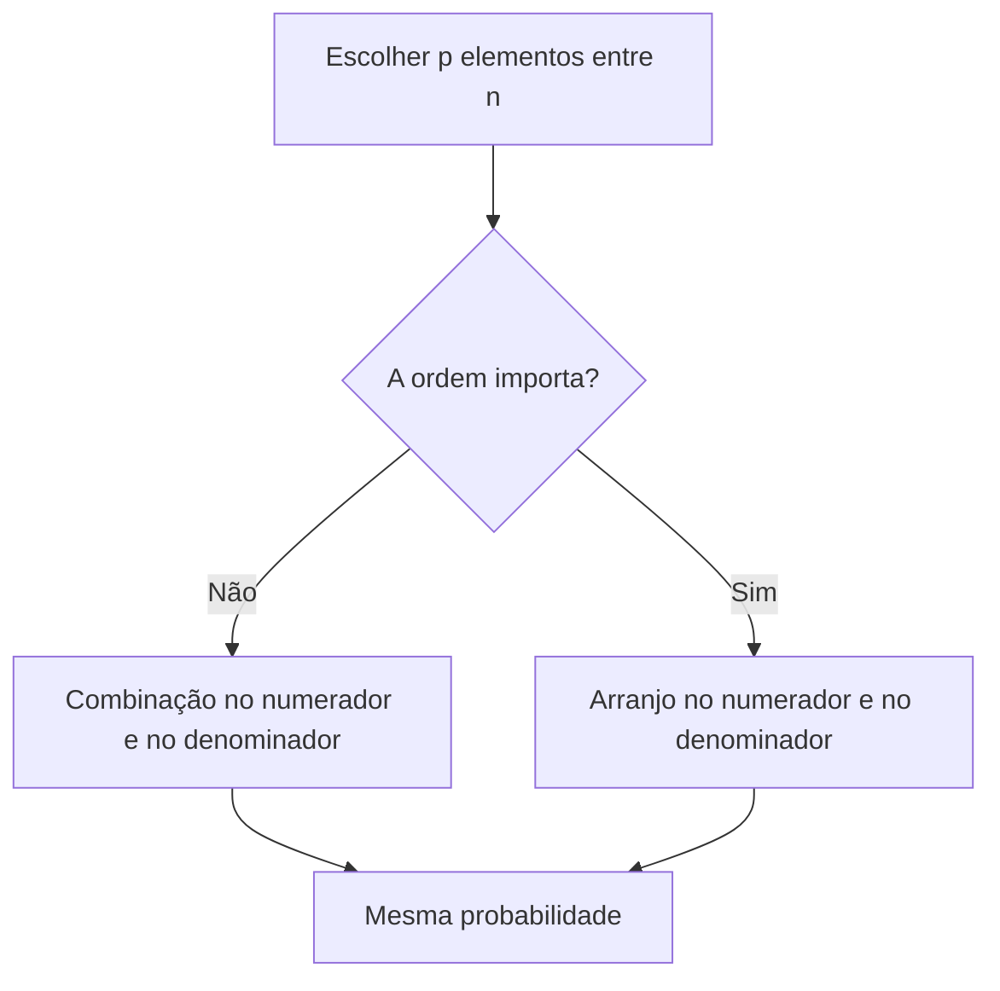

Quem joga uma moeda para decidir quem começa uma partida está usando, sem saber, a teoria da probabilidade. Ela mede, com um número entre 0 e 1, o quanto é provável que algo aconteça quando o resultado não pode ser previsto com certeza: o sorteio de um plantonista, a retirada de uma peça de uma caixa, a chuva no dia da formatura. Este capítulo monta a base de todo o assunto: o que é um experimento aleatório, como listar todos os resultados possíveis, o que é um evento e como calcular sua probabilidade quando todos os resultados têm a mesma chance. Os capítulos seguintes só acrescentam regras a essa base.

> [!objetivos]
> - Reconhecer um experimento aleatório e descrever seu espaço amostral.
> - Classificar um evento como simples, impossível ou certo.
> - Aplicar a definição clássica de probabilidade e verificar quando ela vale.
> - Usar combinação e arranjo para contar casos favoráveis e totais.

## Conceitos iniciais: experimentos aleatórios

A teoria da probabilidade estuda os **experimentos aleatórios**, também chamados de fenômenos aleatórios: situações cujo resultado é **incerto** antes de acontecer. Exemplos: lançar um dado, sortear um militar para uma escala, retirar uma carta do baralho, saber se vai chover amanhã.

Embora o resultado de cada tentativa seja imprevisível, repetindo o experimento muitas vezes surge um padrão. Se uma moeda honesta for lançada milhares de vezes, a face "cara" aparece em cerca de metade delas. Para que o padrão apareça, duas condições precisam valer:

1. o experimento pode ser **repetido indefinidamente**, sob condições inalteradas;
2. o resultado de cada repetição é incerto, mas o conjunto dos resultados possíveis é conhecido.

Um lançamento que não satisfaz a primeira condição é o de uma moeda atirada por uma janela sobre um bueiro: se ela cair na grade, o experimento não pode ser repetido. Para esses casos, os conceitos deste capítulo não se aplicam diretamente.

## Espaço amostral e pontos amostrais

O **espaço amostral** é o conjunto de **todos** os resultados possíveis do experimento. Também é chamado de **universo** e representado por U (ou pela letra grega ômega). Cada resultado possível é um **ponto amostral**. O número de pontos do espaço amostral é n(U).

| Experimento | Espaço amostral | n(U) |
| --- | --- | --- |
| Lançar uma moeda | U = {cara, coroa} | 2 |
| Lançar um dado de 6 faces | U = {1, 2, 3, 4, 5, 6} | 6 |
| Lançar duas moedas, uma após a outra | U = {(cara, cara), (cara, coroa), (coroa, cara), (coroa, coroa)} | 4 |
| Lançar dois dados distintos | Pares (a, b), com a e b de 1 a 6 | 36 |

Repare no último exemplo. Cada resultado é um **par ordenado**: (2, 5) significa "2 no primeiro dado e 5 no segundo", e é diferente de (5, 2). Por isso há 6 × 6 = 36 pontos, e não 21. Quem conta resultados como "soma 7" sem separar as ordens erra a questão.

## Eventos

Um **evento** é qualquer subconjunto do espaço amostral para o qual se atribui uma probabilidade. Dá-se a ele uma letra maiúscula (A, B, C) e conta-se seus elementos por n(A).

No lançamento de duas moedas, seja A o evento "as duas faces são iguais". Então A = {(cara, cara), (coroa, coroa)} e n(A) = 2.

Há três tipos especiais:

| Tipo de evento | Característica | Contagem | Exemplo |
| --- | --- | --- | --- |
| Simples ou elementar | Tem um único elemento | n(A) = 1 | Soma 12 em dois dados: só o par (6, 6) |
| Impossível | Conjunto vazio; nunca ocorre | n(A) = 0 | Soma 13 em dois dados |
| Certo | Coincide com o espaço amostral inteiro | n(A) = n(U) | Face menor que 7 em um dado comum |

A leitura do enunciado decide tudo. "Sair um número maior que 6 em um dado comum" é evento impossível; "sair um número de 1 a 6" é evento certo.

> [!atencao] Evento não é resultado
> Resultado é um ponto do espaço amostral. Evento é um **conjunto** de resultados. Sair "5" é um resultado; sair "número ímpar" é um evento com três pontos: 1, 3 e 5.

## Definição clássica de probabilidade

Quando todos os pontos do espaço amostral têm a **mesma chance** de ocorrer (são **equiprováveis**), a probabilidade de um evento A é a razão entre o número de casos favoráveis e o número de casos possíveis:

> [!esquema] Definição clássica (Laplace)
> P(A) = n(A) / n(U), isto é, número de casos favoráveis dividido pelo número de casos totais.

Consequências diretas:

- P(A) está sempre entre 0 e 1: 0 ≤ P(A) ≤ 1;
- P(evento impossível) = 0;
- P(evento certo) = 1;
- o resultado pode ser dado em fração, número decimal ou porcentagem: 1/4 = 0,25 = 25%.

### A condição de equiprobabilidade

A definição clássica só vale se todos os pontos forem igualmente prováveis. Numa moeda **viciada**, em que cara sai mais que coroa, a fórmula n(A)/n(U) dá 1/2 para a cara e erra. Em enunciados, procure expressões como "ao acaso", "aleatoriamente", "honesto", "não viciado": elas indicam que a equiprobabilidade vale.

Vale também cuidar do espaço amostral escolhido. Na soma de dois dados, os valores 2, 3, ..., 12 **não** são equiprováveis: a soma 7 pode sair de seis maneiras, enquanto a soma 2 só sai de uma. Os 36 pares ordenados é que são equiprováveis, e é neles que se conta.

| Soma | Pares favoráveis | Quantidade |
| --- | --- | --- |
| 2 | (1,1) | 1 |
| 5 | (1,4), (2,3), (3,2), (4,1) | 4 |
| 7 | (1,6), (2,5), (3,4), (4,3), (5,2), (6,1) | 6 |
| 12 | (6,6) | 1 |

Assim, P(soma = 7) = 6/36 = 1/6, e P(soma = 2) = 1/36.

> [!resolvido] Questão comentada: sorteio de um número
> Uma urna contém 12 bolas idênticas numeradas de 1 a 12. Uma bola é sorteada ao acaso. Qual é a probabilidade de o número ser múltiplo de 3?
>
> **Resolução.** O espaço amostral tem 12 pontos: n(U) = 12. Os múltiplos de 3 entre 1 e 12 são 3, 6, 9 e 12, portanto n(A) = 4. Logo, P(A) = 4/12 = 1/3, ou cerca de 33,3%.

> [!resolvido] Questão comentada: efetivo dividido em plantões
> Um quartel tem 30 bombeiros em serviço: 12 no plantão A, 10 no B e 8 no C. Escolhe-se um deles ao acaso. Qual é a probabilidade de que seja do plantão B?
>
> **Resolução.** n(U) = 12 + 10 + 8 = 30. Os casos favoráveis são os 10 do plantão B. Então P = 10/30 = 1/3.

> [!bizu] Antes de calcular, defina U
> Escreva primeiro quantos são os casos totais e só depois conte os favoráveis. A maior parte dos erros vem de contar os favoráveis dentro de um universo diferente do universo do denominador.

## Probabilidade e análise combinatória

Muitas questões pedem a probabilidade de escolher pessoas, peças ou cartas dentre um grupo. Aí os casos favoráveis e os casos totais são **contagens de agrupamentos**, feitas com combinação ou arranjo:

- **Combinação** C(n, p) = n! / [p! × (n − p)!], quando a **ordem não importa** (escolher um grupo);
- **Arranjo** A(n, p) = n! / (n − p)!, quando a **ordem importa** (escolher para cargos distintos).

Exemplo com ordem irrelevante: de um grupo de 10 bombeiros, 6 homens e 4 mulheres, sorteiam-se 2 para uma comissão. A probabilidade de as duas serem mulheres é:

- casos totais: C(10, 2) = (10 × 9) / 2 = 45;
- casos favoráveis: C(4, 2) = (4 × 3) / 2 = 6;
- P = 6/45 = 2/15.

Agora suponha que os 2 sorteados ocupem **cargos distintos**, coordenador e auxiliar. A ordem passa a importar:

- casos totais: A(10, 2) = 10 × 9 = 90;
- casos favoráveis: A(4, 2) = 4 × 3 = 12;
- P = 12/90 = 2/15.

O resultado é o mesmo. A razão: se numerador e denominador usam o **mesmo critério de ordem**, cada grupo é multiplicado pelo mesmo fator (2!, no caso), que se cancela na divisão.

| Critério | Contagem | Quando usar |
| --- | --- | --- |
| Ordem não importa | C(n, p) | Comissões, mãos de cartas, bolas retiradas de uma vez |
| Ordem importa | A(n, p) | Cargos distintos, filas, senhas |
| Mesmo critério nos dois lados | Qualquer um serve | Probabilidade de um grupo específico |

> [!resolvido] Questão comentada: sorteio de três nomes
> De um grupo de 8 militares, 3 são oficiais. Sorteiam-se 2 militares ao acaso, sem importar a ordem. Qual é a probabilidade de que ambos sejam oficiais?
>
> **Resolução.** Casos totais: C(8, 2) = (8 × 7) / 2 = 28. Casos favoráveis: C(3, 2) = (3 × 2) / 2 = 3. Logo, P = 3/28, cerca de 10,7%.

> [!pegadinha] Misturar combinação com arranjo
> Calcular os favoráveis com combinação e os totais com arranjo (ou o contrário) produz um resultado errado. A regra de ouro é manter o mesmo critério no numerador e no denominador.

> [!exemplo] Quem fica sem vizinho
> Num auditório com 15 cadeiras em fila, três pessoas já estão sentadas nas cadeiras 4, 9 e 12. Uma quarta pessoa escolhe uma das cadeiras livres ao acaso. Livres são 15 − 3 = 12. As vizinhas de algum ocupante são 3, 5, 8, 10, 11 e 13, ou seja, 6 cadeiras. Sobram 1, 2, 6, 7, 14 e 15 para quem não quer sentar ao lado de ninguém. A probabilidade é 6/12 = 1/2. O raciocínio é sempre contar o universo (as cadeiras livres) e depois o favorável.

## Probabilidade a partir de tabelas e de dados de pesquisa

Muitas questões entregam o espaço amostral já organizado em uma tabela ou em um texto de pesquisa. O método não muda: some o total, identifique o grupo pedido e divida.

> [!resolvido] Questão comentada: vistorias por resultado
> Em uma campanha, a seção técnica vistoriou 40 edifícios: 18 foram aprovados sem ressalvas, 14 foram aprovados com ressalvas e os demais foram reprovados. Um relatório é escolhido ao acaso. Qual é a probabilidade de que corresponda a um edifício reprovado?
>
> **Resolução.** Os reprovados são 40 − 18 − 14 = 8. Como n(U) = 40, P = 8/40 = 1/5 = 20%.

Repare numa armadilha comum: o enunciado dá os números de **dois** grupos e pede um **terceiro**. Calcule o que falta por subtração, antes de dividir.

> [!resolvido] Questão comentada: faixas de uma pesquisa
> Numa pesquisa com 24 alunos de um curso, 8 preferem o turno da manhã, 7 o da tarde, 5 o da noite, 3 aceitam qualquer turno e 1 não respondeu. Sorteado um aluno ao acaso, qual é a probabilidade de que prefira a tarde?
>
> **Resolução.** O total é 8 + 7 + 5 + 3 + 1 = 24. Preferem a tarde 7 alunos. Então P = 7/24, cerca de 29,2%. Note que o aluno que não respondeu faz parte do universo, porque também pode ser sorteado.

## Baralho: o espaço amostral mais cobrado

O baralho comum tem **52 cartas**, em 4 naipes (copas, ouros, espadas e paus) de 13 cartas cada. Cada naipe tem A, 2 a 10, valete, dama e rei, portanto são 4 de cada valor e 12 figuras (valete, dama e rei) no total. Retirada uma carta ao acaso:

| Evento | Casos favoráveis | Probabilidade |
| --- | --- | --- |
| Ser uma carta de copas | 13 | 13/52 = 1/4 |
| Ser um rei | 4 | 4/52 = 1/13 |
| Ser uma figura | 12 | 12/52 = 3/13 |
| Ser um ás de espadas | 1 | 1/52 |

Quando a questão pede que se retirem **duas** cartas de uma vez, o universo passa a ser C(52, 2) = (52 × 51) / 2 = 1.326. A probabilidade de duas cartas serem reis é C(4, 2) / C(52, 2) = 6/1.326 = 1/221.

## Como a banca cobra este assunto

As questões desse tema são, em geral, diretas: dão uma situação de sorteio e pedem uma razão. A dificuldade está na contagem. Os desvios mais frequentes são: contar a soma de dois dados como se os valores fossem equiprováveis, esquecer de separar as ordens dos pares, usar combinação em um lado e arranjo no outro, e responder em fração quando a alternativa vem em porcentagem. Em itens de certo ou errado, a banca costuma afirmar uma probabilidade superior ou inferior a certo patamar: calcule o valor exato e compare.

## Mapa do capítulo

| Tema | Ideia central | Armadilha |
| --- | --- | --- |
| Experimento aleatório | Resultado incerto, repetível, com padrão | Aplicar a fenômenos não repetíveis |
| Espaço amostral | Conjunto de todos os resultados | Esquecer a ordem dos pares |
| Evento | Subconjunto do espaço amostral | Confundir evento com resultado |
| Tipos de evento | Simples, impossível e certo | Trocar 0 e n(U) |
| Definição clássica | n(A) / n(U), com equiprobabilidade | Usar com moeda viciada |
| Intervalo | 0 ≤ P(A) ≤ 1 | Aceitar probabilidade maior que 1 |
| Combinatória | Mesmo critério de ordem nos dois lados | Misturar C e A |

### Para fixar

1. Experimento aleatório tem resultado incerto e pode ser repetido sob as mesmas condições.
2. O espaço amostral reúne todos os resultados possíveis; cada um é um ponto amostral.
3. Evento é qualquer subconjunto do espaço amostral.
4. Evento simples tem um elemento, o impossível não tem nenhum e o certo coincide com o espaço amostral.
5. A definição clássica é P(A) = n(A) / n(U) e exige pontos equiprováveis.
6. A probabilidade está sempre entre 0 e 1, ou entre 0% e 100%.
7. Em dois dados, o espaço amostral tem 36 pares ordenados, e a soma 7 sai de 6 deles.
8. Quando a ordem não importa, use combinação; quando importa, use arranjo.
9. Usando o mesmo critério de ordem nos favoráveis e nos totais, o resultado é o mesmo.
10. Antes de contar os favoráveis, defina bem o universo do denominador.
