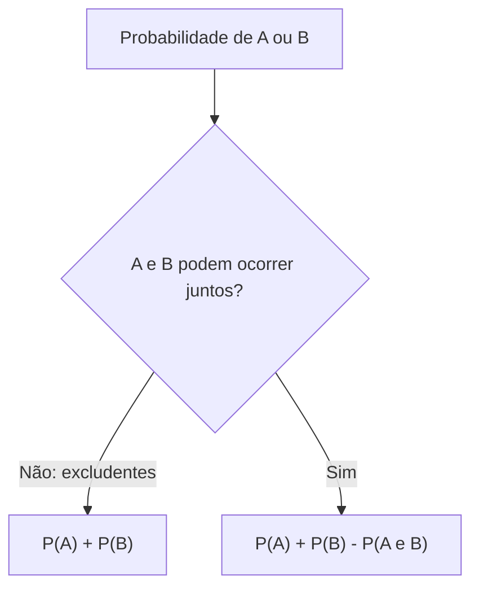

A definição clássica do capítulo anterior funciona quando todos os resultados têm a mesma chance. Mas e se não tiverem? E como calcular a probabilidade de acontecer "isto **ou** aquilo", ou de **não** acontecer algo? Este capítulo responde a essas perguntas. Primeiro, mostra como estimar uma probabilidade pela observação repetida do experimento, a frequência relativa. Depois apresenta as duas operações mais cobradas entre eventos, a união e o complemento, e o truque de contar pelo caminho inverso, que transforma muitas questões difíceis em contas de uma linha.

> [!objetivos]
> - Calcular a probabilidade pela frequência relativa e explicar por que ela se aproxima da probabilidade teórica.
> - Aplicar o teorema da união para dois e para três eventos.
> - Distinguir eventos mutuamente excludentes, exaustivos e complementares.
> - Usar o evento complementar e a ideia de "pelo menos um".

## Probabilidade como frequência relativa

Suponha que um fabricante de lanternas queira saber a chance de uma lanterna sair com defeito. Ele não tem como listar "casos igualmente prováveis". O que pode fazer é observar. Em uma amostra de N unidades, n saíram com defeito. O mesmo vale para um carregamento de telhas ou de tijolos, em que o fornecedor registra a média de peças quebradas no transporte. A **frequência relativa** do evento "defeito" é:

f = n / N

Se uma moeda comum é lançada e o resultado é registrado, a frequência relativa de "coroa" oscila no começo e tende a se aproximar de 1/2 à medida que o número de lançamentos cresce.

| Lançamentos (N) | Coroas obtidas (n) | Frequência relativa (n/N) |
| --- | --- | --- |
| 100 | 46 | 46% |
| 1.000 | 497 | 49,7% |
| 10.000 | 5.012 | 50,12% |

A frequência relativa **não** é exatamente igual à probabilidade, mas se aproxima dela quanto maior for N. No limite, para infinitas repetições, as duas coincidem. Por isso essa abordagem é chamada de definição **frequentista** (ou empírica) de probabilidade.

A grande vantagem é que ela vale mesmo quando os resultados **não são equiprováveis**, caso em que a definição clássica falha. Se, depois de muitos lançamentos de uma moeda desequilibrada, se verifica que sai coroa uma vez a cada quatro lançamentos, a probabilidade de coroa é estimada em 1/4.

> [!resolvido] Questão comentada: lotes e defeitos
> Em um lote de 5.000 parafusos, uma inspeção mostrou que, em média, 150 chegam à obra com rosca danificada. Escolhendo um parafuso ao acaso, qual é a probabilidade de que ele esteja danificado?
>
> **Resolução.** A informação é de frequência observada: f = 150 / 5.000 = 3/100 = 0,03 = 3%.

Na prova, o enunciado indica qual definição usar. Textos com "ao acaso" e resultados igualmente possíveis pedem a definição clássica, por contagem. Textos que trazem **dados de observação** ("em média", "em 1.000 casos registrados", "historicamente") pedem a frequência relativa.

## Operações com eventos

Para tratar situações como "A ou B", usa-se a linguagem dos conjuntos. Sejam A e B dois eventos do mesmo espaço amostral U.

| Operação | Símbolo | Significado | Leitura em palavras |
| --- | --- | --- | --- |
| União | A ∪ B | Elementos de A, de B ou de ambos | Ocorre A **ou** B (ou os dois) |
| Interseção | A ∩ B | Elementos comuns a A e B | Ocorrem A **e** B ao mesmo tempo |
| Complementar | A' | Elementos de U que não estão em A | **Não** ocorre A |

Os diagramas de Venn ajudam: um retângulo representa o universo e círculos representam os eventos. A união é toda a região coberta pelos círculos, que no desenho costuma aparecer pintada em cinza; a interseção é a região onde eles se sobrepõem. Quando dois círculos não se tocam, os eventos não têm elemento em comum.

### Excludentes, exaustivos e complementares

Três palavras aparecem sempre nas provas:

- Dois eventos são **mutuamente excludentes** (ou disjuntos) quando não têm elementos em comum, isto é, A ∩ B = ∅. Não podem ocorrer juntos.
- Dois eventos são **exaustivos** quando sua união é todo o espaço amostral, isto é, A ∪ B = U. Pelo menos um deles ocorre.
- Dois eventos são **complementares** quando são ao mesmo tempo excludentes e exaustivos.

Num dado comum, os eventos "número par" e "número ímpar" são complementares. Já "número menor que 3" ({1, 2}) e "número maior que 4" ({5, 6}) são excludentes, mas não exaustivos, porque os resultados 3 e 4 ficam de fora.

## Teorema da união

Para contar os elementos de A ∪ B sem repetir ninguém, somam-se os de A e os de B e **subtrai-se** a interseção, que foi contada duas vezes: n(A ∪ B) = n(A) + n(B) − n(A ∩ B). Dividindo tudo por n(U), obtém-se a regra de probabilidade.

> [!esquema] Teorema da união (ou regra da soma)
> - Caso geral: P(A ∪ B) = P(A) + P(B) − P(A ∩ B)
> - Eventos mutuamente excludentes: P(A ∪ B) = P(A) + P(B), pois P(A ∩ B) = 0

Exemplo com um dado comum. Seja A o evento "número par" e B o evento "múltiplo de 3". Temos A = {2, 4, 6}, B = {3, 6} e A ∩ B = {6}. Então P(A) = 3/6, P(B) = 2/6 e P(A ∩ B) = 1/6, o que dá P(A ∪ B) = 3/6 + 2/6 − 1/6 = 4/6 = 2/3. Conferindo por contagem direta, A ∪ B = {2, 3, 4, 6}, quatro elementos em seis. O 6 foi o único elemento duplicado.

> [!resolvido] Questão comentada: cursos de especialização
> Em um grupo de 80 bombeiros, 50 têm o curso de salvamento e 40 têm o curso de combate a incêndio; 20 têm os dois. Sorteado um bombeiro, qual é a probabilidade de que tenha pelo menos um dos cursos?
>
> **Resolução.** P(S) = 50/80, P(I) = 40/80 e P(S ∩ I) = 20/80. Logo, P(S ∪ I) = (50 + 40 − 20) / 80 = 70/80 = 7/8 = 87,5%. A probabilidade de não ter nenhum dos dois é o complemento: 1 − 7/8 = 1/8.

Também é comum que o enunciado dê a união e peça a interseção. Basta isolar o termo desconhecido.

> [!resolvido] Questão comentada: interseção desconhecida
> Dois eventos A e B têm P(A) = 45% e P(B) = 35%, e a probabilidade de ocorrer A ou B é 60%. Qual é a probabilidade de ocorrerem A e B?
>
> **Resolução.** Pela regra da união, 60% = 45% + 35% − P(A ∩ B). Logo, P(A ∩ B) = 80% − 60% = 20%.

Somar P(A) + P(B) sem descontar a interseção só é correto quando os eventos são excludentes. Se a soma ultrapassar 100%, é sinal claro de que há interseção e de que ela precisa ser subtraída.

## União de três eventos

Com três eventos, a ideia é a mesma, com um ajuste. Somando P(A), P(B) e P(C), as interseções duas a duas ficam contadas em dobro e são descontadas. Mas, ao descontá-las todas, a interseção dos **três** acaba excluída por completo e precisa voltar:

P(A ∪ B ∪ C) = P(A) + P(B) + P(C) − P(A ∩ B) − P(A ∩ C) − P(B ∩ C) + P(A ∩ B ∩ C)

Decorar a fórmula é menos seguro do que montar o **diagrama de Venn**, começando de dentro para fora:

1. coloque no centro a interseção dos três;
2. em cada interseção dupla, escreva o valor total menos o centro;
3. em cada região exclusiva de um evento, escreva o total do evento menos tudo o que já foi lançado nele;
4. o que sobrar do universo é a região fora dos três círculos.

> [!resolvido] Questão comentada: três modalidades esportivas
> Entre 100 militares, 60 praticam natação (N), 50 corrida (C) e 40 tiro esportivo (T). Praticam natação e corrida 25; natação e tiro 20; corrida e tiro 15; e as três modalidades, 10. Sorteado um militar, qual é a probabilidade de que pratique **exatamente uma** modalidade?
>
> **Resolução.** Monte o diagrama de dentro para fora. Centro: 10. Duplas sem o centro: N e C apenas = 25 − 10 = 15; N e T apenas = 20 − 10 = 10; C e T apenas = 15 − 10 = 5. Regiões exclusivas: só natação = 60 − 15 − 10 − 10 = 25; só corrida = 50 − 15 − 5 − 10 = 20; só tiro = 40 − 10 − 5 − 10 = 15. Exatamente uma modalidade: 25 + 20 + 15 = 60 militares. P = 60/100 = 60%. Conferência: 25 + 20 + 15 + 15 + 10 + 5 + 10 = 100, o que mostra que todos praticam pelo menos uma.

| Região do diagrama | Cálculo | Valor |
| --- | --- | --- |
| Só natação | 60 − 15 − 10 − 10 | 25 |
| Só corrida | 50 − 15 − 5 − 10 | 20 |
| Só tiro | 40 − 10 − 5 − 10 | 15 |
| Natação e corrida, sem tiro | 25 − 10 | 15 |
| Natação e tiro, sem corrida | 20 − 10 | 10 |
| Corrida e tiro, sem natação | 15 − 10 | 5 |
| Os três | dado | 10 |

> [!bizu] Diagrama antes da fórmula
> Em questões de três eventos com a palavra "exatamente" ou "somente", monte o diagrama. A fórmula serve para descobrir um dado que falta, como P(A ∩ B ∩ C).

### Quando a interseção tripla é desconhecida

É comum que o enunciado informe quase tudo e peça justamente o centro do diagrama. Nesse caso, a fórmula da união dos três eventos é a ferramenta: isole P(A ∩ B ∩ C).

> [!resolvido] Questão comentada: marcas de café
> Numa pesquisa de consumo, 45% das pessoas tomam a marca A, 40% a marca B e 35% a marca C. Tomam A e B, 15%; A e C, 14%; B e C, 12%. Apenas 10% não consomem nenhuma das três. Escolhida uma pessoa ao acaso, qual é a probabilidade de que consuma **exatamente uma** marca?
>
> **Resolução.** Quem consome pelo menos uma marca soma 100% − 10% = 90%. Pela fórmula da união: 90% = 45% + 40% + 35% − 15% − 14% − 12% + P(A ∩ B ∩ C), ou seja, 90% = 120% − 41% + P(A ∩ B ∩ C), logo P(A ∩ B ∩ C) = 11%. Regiões: só A e B, 15% − 11% = 4%; só A e C, 14% − 11% = 3%; só B e C, 12% − 11% = 1%. Exclusivas: só A = 45% − 4% − 3% − 11% = 27%; só B = 40% − 4% − 1% − 11% = 24%; só C = 35% − 3% − 1% − 11% = 20%. Exatamente uma marca: 27% + 20% + 24% = 71%. Conferência: 27 + 24 + 20 + 4 + 3 + 1 + 11 + 10 (fora) = 100.

## Probabilidade de uma pessoa específica ser escolhida

Uma pergunta frequente em concursos: de um grupo de n pessoas, escolhem-se p ao acaso; qual a chance de uma pessoa determinada estar entre as escolhidas? A resposta curta é p/n. Para quatro soldados escolhidos entre dez, a chance de um soldado específico fazer parte do grupo é 4/10 = 2/5.

A conferência por combinação mostra por que isso vale. Os casos totais são C(10, 4) = 210. Os favoráveis são os grupos que contêm o soldado: restam 3 vagas para escolher entre os outros 9, ou seja, C(9, 3) = 84. Daí P = 84/210 = 2/5. Pelo complemento, a chance de **não** ser escolhido é 1 − 2/5 = 3/5.

O mesmo raciocínio vale para bolas numa urna. Se 5 bolas são retiradas de uma vez de uma urna com 20 bolas, a chance de uma bola determinada estar entre as retiradas é 5/20 = 1/4. O atalho p/n só funciona quando todos têm a mesma chance de ser escolhidos.

## Evento complementar

O **complementar** de A, escrito A', reúne tudo o que está no espaço amostral e não está em A. Como A e A' juntos formam U e não se sobrepõem, n(A) + n(A') = n(U). Dividindo por n(U):

> [!esquema] Teorema do evento complementar
> - P(A) + P(A') = 1
> - P(A') = 1 − P(A)

Num dado, se A = {1, 2, 3, 4}, então A' = {5, 6}. Como P(A) = 4/6 = 2/3, vale P(A') = 1 − 2/3 = 1/3, ou 2/6, que confere com a contagem direta.

### O caminho inverso: "pelo menos um"

A grande utilidade do complementar é nas perguntas com "pelo menos um". O complemento de "pelo menos um" é "nenhum", muito mais simples de calcular.

> [!resolvido] Questão comentada: pelo menos uma cara
> Uma moeda honesta é lançada três vezes. Qual é a probabilidade de obter pelo menos uma cara?
>
> **Resolução.** O espaço amostral tem 2 × 2 × 2 = 8 sequências. "Nenhuma cara" ocorre em uma só: coroa, coroa, coroa. Logo, P(nenhuma cara) = 1/8. O evento pedido é o complemento: P = 1 − 1/8 = 7/8 = 87,5%. Contar diretamente as sete sequências favoráveis seria possível, mas mais trabalhoso e arriscado.

> [!pegadinha] Complementar de "pelo menos um"
> O complemento de "pelo menos um" é "nenhum", e não "exatamente um". Já o complemento de "no máximo um" é "dois ou mais". Escreva o evento oposto antes de calcular.

A relação também funciona ao contrário: se uma questão dá P(A ∪ B) e pede a probabilidade de "nem A nem B", a resposta é 1 − P(A ∪ B).

## Como a banca cobra este assunto

Esse bloco concentra a maioria das questões de probabilidade. As bancas apresentam pesquisas com sobreposição de grupos (cursos, hábitos, marcas) e pedem a probabilidade de "ao menos um", "só um" ou "nenhum". Também trocam excludentes por independentes, esquecem a interseção na soma e confundem o complementar com a diferença. Em itens de certo ou errado, aparecem afirmações como "a probabilidade da união é igual à soma" sem que os eventos sejam excludentes. Para evitar a armadilha, pergunte sempre se os eventos podem ocorrer juntos.

## Mapa do capítulo

| Tema | Ideia central | Armadilha |
| --- | --- | --- |
| Frequência relativa | f = n / N, que tende à probabilidade | Aplicá-la como valor exato |
| Excludentes | A ∩ B = ∅ | Confundir com independentes |
| Exaustivos | A ∪ B = U | Confundir com complementares |
| Complementares | Excludentes e exaustivos | Esquecer uma das condições |
| União de dois eventos | P(A) + P(B) − P(A ∩ B) | Não subtrair a interseção |
| União de três eventos | Soma, menos duplas, mais tripla | Esquecer de somar a interseção tripla |
| Complementar | P(A') = 1 − P(A) | Trocar "pelo menos um" por "exatamente um" |

### Para fixar

1. A frequência relativa é n/N e se aproxima da probabilidade quando N cresce.
2. A definição frequentista vale mesmo quando os resultados não são equiprováveis.
3. A união A ∪ B significa "A ou B (ou ambos)"; a interseção A ∩ B, "A e B".
4. Eventos mutuamente excludentes têm interseção vazia; exaustivos têm união igual ao universo.
5. Eventos complementares são excludentes e exaustivos ao mesmo tempo.
6. P(A ∪ B) = P(A) + P(B) − P(A ∩ B) no caso geral.
7. Para excludentes, P(A ∪ B) = P(A) + P(B).
8. Em três eventos, monte o diagrama de Venn de dentro para fora.
9. P(A') = 1 − P(A), e P(A) + P(A') = 1.
10. Em "pelo menos um", calcule o complemento "nenhum" e subtraia de 1.
