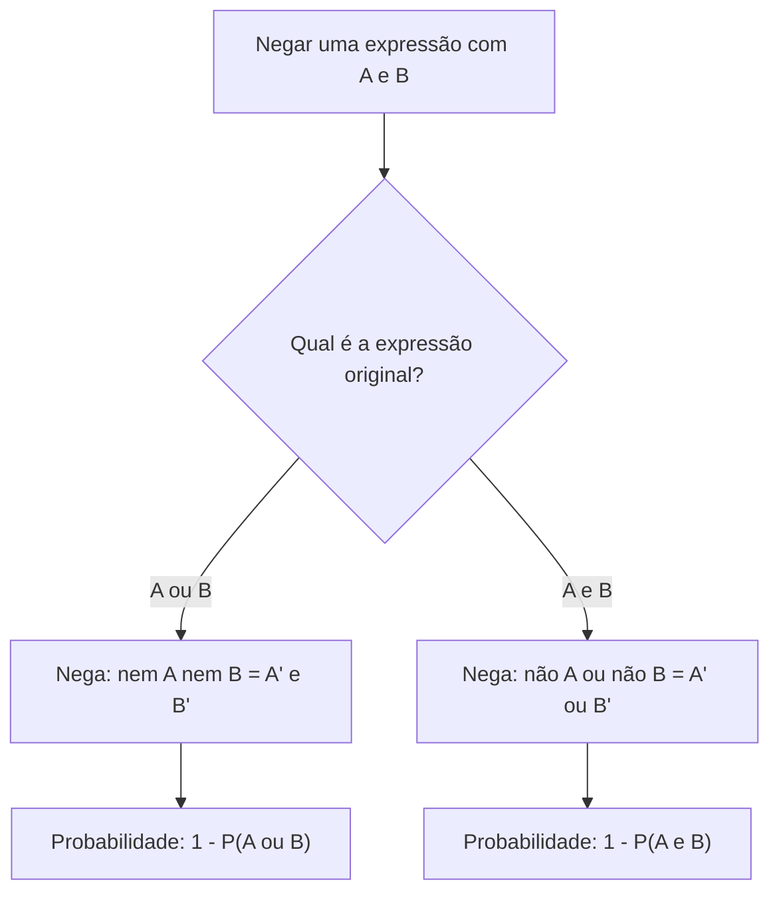

Os capítulos anteriores deram duas ferramentas: a probabilidade de "A ou B" e a de "não A". Agora elas se encontram. Como calcular a chance de **não ocorrer nenhum** de dois eventos? E a de **não ocorrerem os dois ao mesmo tempo**? A resposta usa as leis de De Morgan, as mesmas da lógica proposicional, vestidas de conjuntos. Em seguida, o capítulo organiza as regras da probabilidade em três axiomas, dos quais tudo decorre, e apresenta a **probabilidade condicional**: a chance de algo acontecer quando já se sabe que outra coisa aconteceu.

> [!objetivos]
> - Calcular a probabilidade de "nem A nem B" e de "não ocorrerem A e B juntos".
> - Enunciar os axiomas de Kolmogorov e aplicar suas consequências imediatas.
> - Calcular probabilidades do tipo "A e não B" e comparar eventos por inclusão.
> - Resolver problemas de probabilidade condicional por universo reduzido e por fórmula.

## Complementar da união e da interseção

O teorema do evento complementar vale para qualquer evento, inclusive os formados por combinações. Dois resultados merecem atenção especial.

**Complementar da união.** A negação de "ocorre A ou B" é "não ocorre A **e** não ocorre B". Em conjuntos, a região fora de ambos os círculos do diagrama de Venn:

P((A ∪ B)') = P(A' ∩ B') = 1 − P(A ∪ B)

**Complementar da interseção.** A negação de "ocorrem A e B" é "não ocorre A **ou** não ocorre B". Em conjuntos, tudo o que está fora da região comum aos dois círculos:

P((A ∩ B)') = P(A' ∪ B') = 1 − P(A ∩ B)

São as leis de De Morgan, as mesmas aprendidas em lógica: negar uma disjunção produz uma conjunção de negações, e negar uma conjunção produz uma disjunção de negações.

| Expressão em palavras | Notação | Cálculo |
| --- | --- | --- |
| Nem A nem B | A' ∩ B' = (A ∪ B)' | 1 − P(A ∪ B) |
| Não ocorrem A e B ao mesmo tempo | A' ∪ B' = (A ∩ B)' | 1 − P(A ∩ B) |
| Pelo menos um de A e B | A ∪ B | P(A) + P(B) − P(A ∩ B) |
| Nenhum dos três | (A ∪ B ∪ C)' | 1 − P(A ∪ B ∪ C) |

Verificação num dado. Sejam A = {2, 3, 5} (números primos) e B = {1, 3, 5} (números ímpares). A união é {1, 2, 3, 5}, com probabilidade 4/6 = 2/3. Então a probabilidade de não ocorrer A nem B é 1 − 2/3 = 1/3: só o 4 e o 6 não estão em nenhum dos dois. Já A ∩ B = {3, 5}, com probabilidade 2/6 = 1/3; a probabilidade de não ocorrerem os dois ao mesmo tempo é 1 − 1/3 = 2/3, pois só os resultados 3 e 5 satisfazem ambos.

### Uma analogia para guardar De Morgan

Pense na portaria de um quartel que só libera a entrada de quem tem crachá **e** documento com foto. Quem é barrado? Quem **não** tem crachá **ou** não tem documento: basta faltar um dos dois. Já a entrada em uma sala de espera liberada a quem tem convite **ou** senha só é negada a quem não tem convite **e** não tem senha: precisam faltar os dois. Negar um "e" produz um "ou"; negar um "ou" produz um "e". Em probabilidade, isso se traduz exatamente nas duas fórmulas acima.

> [!resolvido] Questão comentada: nem A nem B
> Dois eventos têm P(A) = 35% e P(B) = 25%, e a probabilidade de ocorrerem ambos é 10%. Qual é a probabilidade de que não ocorra nenhum dos dois?
>
> **Resolução.** Primeiro a união: P(A ∪ B) = 35% + 25% − 10% = 50%. Depois o complemento: P(A' ∩ B') = 100% − 50% = 50%.

Quando os eventos são mutuamente excludentes, a conta fica ainda mais simples. Num condomínio com 500 moradores, se 180 torcem pelo time X e 130 pelo time Y, e ninguém torce pelos dois, a probabilidade de um sorteado não torcer por nenhum deles é 1 − (180 + 130) / 500 = 1 − 0,62 = 38%.

### Complementar em sorteios por cartões

O complementar também economiza tempo em sorteios com várias categorias. Imagine um painel quadriculado de 10 linhas por 10 colunas, com 100 casas pintadas: 28 vermelhas, 32 azuis, 25 brancas e 15 verdes. Cada casa tem um cartão numerado com a sua posição (linha e coluna), e os cartões ficam numa urna.

> [!resolvido] Questão comentada: cartão que não é verde
> Um cartão é retirado ao acaso da urna. Qual é a probabilidade de que a casa correspondente **não** seja verde?
>
> **Resolução.** Há 100 cartões e 15 casas verdes. A probabilidade de ser verde é 15/100 = 0,15. Pelo complementar, P(não verde) = 1 − 0,15 = 0,85. Contar diretamente (28 + 32 + 25 = 85 casas) leva ao mesmo resultado, 85/100.

### Três eventos

A mesma ideia estende-se a três eventos: P((A ∪ B ∪ C)') = P(A' ∩ B' ∩ C') = 1 − P(A ∪ B ∪ C), e P((A ∩ B ∩ C)') = P(A' ∪ B' ∪ C') = 1 − P(A ∩ B ∩ C).

> [!resolvido] Questão comentada: três plataformas
> Entre 120 pessoas consultadas, 70 usam a plataforma A, 60 a plataforma B e 50 a plataforma C. Usam A e B, 30; A e C, 25; B e C, 20; as três, 10. Qual é a probabilidade de que uma pessoa sorteada não use nenhuma delas?
>
> **Resolução.** A união vale 70 + 60 + 50 − 30 − 25 − 20 + 10 = 115 pessoas. Quem não usa nenhuma plataforma é 120 − 115 = 5. Logo, P = 5/120 = 1/24, cerca de 4,2%. Confirmando pelo diagrama: só A = 25, só B = 20, só C = 15, A e B apenas = 20, A e C apenas = 15, B e C apenas = 10, os três = 10, soma 115.

> [!pegadinha] Negar "ou" mantendo "ou"
> Quem escreve que o complementar de "A ou B" é "não A ou não B" erra. O complementar da união é a **interseção** dos complementares ("nem A nem B"). A troca de conectivo é obrigatória na negação.

## Axiomas de probabilidade

Axiomas são afirmações tão básicas que se aceitam sem demonstração; delas se deduzem as demais regras. A teoria moderna da probabilidade se apoia em três axiomas, atribuídos ao matemático soviético Andrei Kolmogorov.

| Axioma | Enunciado | Significado |
| --- | --- | --- |
| 1 | P(A) ≥ 0 | Não existe probabilidade negativa |
| 2 | P(U) = 1 | Algum resultado do espaço amostral certamente ocorre |
| 3 | Se A ∩ B = ∅, então P(A ∪ B) = P(A) + P(B) | A probabilidade se soma quando os eventos não se sobrepõem |

No lançamento de um dado, a chance de sair algum dos números de 1 a 6 é 100%: é o axioma 2. E a chance de sair 1 **ou** 2 é a soma das chances de cada um, 1/6 + 1/6 = 1/3, porque os dois resultados não podem ocorrer juntos: é o axioma 3.

### Propriedades que decorrem dos axiomas

Dos três axiomas deduzem-se as propriedades que já utilizamos e outras novas:

| Propriedade | Enunciado |
| --- | --- |
| Evento impossível | Se A = ∅, então P(A) = 0 |
| Limites | 0 ≤ P(A) ≤ 1 para qualquer evento |
| Diferença | P(A − B) = P(A) − P(A ∩ B), a chance de ocorrer A e **não** ocorrer B |
| Inclusão | Se A ⊆ B, então P(A) ≤ P(B) |
| União | P(A ∪ B) = P(A) + P(B) − P(A ∩ B) |
| Complementar | P(A') = 1 − P(A) |

A propriedade da **diferença** é muito útil. O evento "A e não B", escrito A − B ou A \ B, é a parte de A que fica fora de B. Retirar de P(A) a parte comum com B deixa só a parte exclusiva.

> [!resolvido] Questão comentada: só um dos cursos
> Num grupo de 100 bombeiros, 75 têm carteira de habilitação para viaturas de emergência e 40 têm curso de mergulho. Vinte não têm nenhuma das duas qualificações. Sorteado um bombeiro, qual é a probabilidade de ter o curso de mergulho **mas não** a habilitação?
>
> **Resolução.** Têm pelo menos uma das duas: 100 − 20 = 80. Pela regra da união, 80 = 75 + 40 − n(ambas), logo n(ambas) = 35. Têm mergulho e não têm habilitação: 40 − 35 = 5. Então P = 5/100 = 5%. Pela propriedade da diferença: P(M − H) = P(M) − P(M ∩ H) = 0,40 − 0,35 = 0,05.

### Evento impossível, probabilidade zero e a recíproca

Há uma sutileza de que as bancas gostam. Todo evento impossível tem probabilidade zero. Mas o **contrário não vale**: um evento de probabilidade zero não é necessariamente impossível. O exemplo clássico é o de lançar uma moeda infinitas vezes: obter cara em todos os lançamentos é possível, em tese, mas sua probabilidade é nula. Do mesmo modo, evento certo tem probabilidade 1, mas probabilidade 1 não garante que o evento seja certo.

> [!atencao] Probabilidade zero não é sinônimo de impossível
> Um item que diga "se a probabilidade de E é zero, então E é impossível" está errado. A implicação correta é a inversa: se E é impossível, então P(E) = 0.

### Distribuição de probabilidade em tabela

Algumas questões apresentam uma tabela com os possíveis valores de um fenômeno e suas probabilidades. Como a tabela cobre **todo** o espaço amostral, a soma das probabilidades é 1. Essa informação permite descobrir valores desconhecidos.

> [!resolvido] Questão comentada: chamados por hora
> O número de chamados atendidos por uma central em uma hora varia de 0 a 4, com as probabilidades abaixo, em que p é uma constante a determinar.
>
> | Chamados | 0 | 1 | 2 | 3 | 4 |
> | --- | --- | --- | --- | --- | --- |
> | Probabilidade | 0,10 | p | 2p | 2p | p |
>
> Qual é a probabilidade de que haja de 1 a 3 chamados em uma hora?
>
> **Resolução.** A soma deve ser 1: 0,10 + p + 2p + 2p + p = 1, ou seja, 6p = 0,90 e p = 0,15. De 1 a 3 chamados: p + 2p + 2p = 5p = 0,75, isto é, 75%.

Observe que as faixas "de 1 a 3" e "pelo menos 1 e no máximo 3" são o mesmo evento. Conferir com o complementar ajuda: fora da faixa ficam 0 e 4, com 0,10 + 0,15 = 0,25, e 1 − 0,25 = 0,75.

## Probabilidade condicional

Até aqui, a chance de um evento era calculada em relação a todo o espaço amostral. A **probabilidade condicional** muda esse universo: ela é a chance de um evento ocorrer **sabendo que outro já ocorreu**. A informação adicional reduz as possibilidades.

Considere um quartel com 200 militares, assim distribuídos:

| | Homens | Mulheres | Total |
| --- | --- | --- | --- |
| Oficiais | 36 | 16 | 52 |
| Praças | 84 | 64 | 148 |
| Total | 120 | 80 | 200 |

Sorteado um militar ao acaso, qual é a probabilidade de que seja oficial, sabendo que é mulher? O fato de ser mulher elimina todos os homens do universo: sobram 80 casos. Entre elas, 16 são oficiais. A resposta é 16/80 = 1/5, e não 52/200.

### A fórmula

Chamando de E o evento de interesse (oficial) e H o evento conhecido (mulher), dividindo numerador e denominador pelo total do espaço amostral, obtém-se:

> [!esquema] Probabilidade condicional
> - P(E | H) = P(E ∩ H) / P(H), lida como "probabilidade de E dado H"
> - Em contagem: P(E | H) = n(E ∩ H) / n(H)
> - Condição: P(H) > 0

Aplicando ao quartel: P(oficial | mulher) = (16/200) / (80/200) = 16/80 = 1/5. O evento conhecido, que se sabe ter ocorrido, é o **evento a priori** (aqui, "ser mulher"). O evento cuja chance se quer calcular é o **a posteriori** (aqui, "ser oficial").

A ordem importa. Calcule agora a probabilidade inversa, a de ser mulher dado que é oficial: P(mulher | oficial) = 16/52 = 4/13. É um valor diferente, porque o universo reduzido é outro (os 52 oficiais). Em geral, P(E | H) ≠ P(H | E).

| Pergunta | Universo reduzido | Resultado |
| --- | --- | --- |
| Ser oficial, dado que é mulher | 80 mulheres | 16/80 = 1/5 |
| Ser mulher, dado que é oficial | 52 oficiais | 16/52 = 4/13 |
| Ser oficial, dado que é homem | 120 homens | 36/120 = 3/10 |
| Ser praça, dado que é homem | 120 homens | 84/120 = 7/10 |

> [!pegadinha] Trocar o evento condicionante
> A frase "dado que" aponta o novo universo. Em "a probabilidade de ser mulher, sabendo que é oficial", o universo são os oficiais. Inverter os eventos muda a resposta, e as alternativas costumam trazer as duas possibilidades.

### Condicional complementar

As operações com eventos continuam valendo dentro da condicional. A mais usada é a do complementar, em que o evento a priori **permanece o mesmo**:

P(E' | H) = 1 − P(E | H)

No quartel, a probabilidade de uma mulher sorteada **não** ser oficial é 1 − 1/5 = 4/5, o que confere com 64/80. Cuidado: o complemento atua sobre o evento a posteriori. Não vale 1 − P(E | H') para nada.

### Quando o evento está contido no condicionante

Se todos os elementos de E pertencem a H, a interseção E ∩ H é o próprio E, e a fórmula se simplifica: P(E | H) = P(E) / P(H). Imagine que, entre os 52 oficiais do quartel, 13 tenham mais de quinze anos de serviço (X). A probabilidade de um oficial sorteado ter mais de quinze anos de serviço é P(X | oficial) = 13/52 = 1/4, pois todos os 13 já são oficiais.

> [!resolvido] Questão comentada: renda e sexo
> Numa empresa de 300 funcionários, 40% ganham acima de determinado piso. Há 180 homens e 120 mulheres, e 84 mulheres ganham no máximo o piso. Sorteado um funcionário e verificado que é homem, qual é a probabilidade de ganhar acima do piso?
>
> **Resolução.** Acima do piso estão 40% de 300 = 120 funcionários. Entre as mulheres, ganham acima do piso 120 − 84 = 36. Portanto, entre os homens ganham acima do piso 120 − 36 = 84. O novo universo são os 180 homens. P = 84/180 = 7/15, cerca de 46,7%.

> [!bizu] Condicional é tabela de dupla entrada
> Quando o enunciado traz um quadro com duas características, localize a linha ou a coluna do evento "dado que" e divida a célula procurada pelo **total dessa linha ou coluna**, e não pelo total geral.

### Condicional com porcentagens

Quando o enunciado dá porcentagens do total, imagine um grupo de 100 (ou de 1.000) pessoas e trabalhe com contagens.

> [!resolvido] Questão comentada: efetivo em porcentagens
> Numa corporação, 70% do efetivo é masculino e 30% é feminino. Do efetivo total, 18% são mulheres com curso superior. Sorteado um militar, sabendo que é mulher, qual é a probabilidade de que tenha curso superior?
>
> **Resolução.** Chame de M o evento "ser mulher" e de S o evento "ter curso superior". Então P(M) = 30% e P(M ∩ S) = 18%. A condicional é P(S dado M) = 18% / 30% = 0,6, ou 60%. Em um grupo de 100 militares: 30 mulheres, das quais 18 têm curso superior, e 18/30 = 60%.

### Condicional com mais de duas categorias

Em quadros com três ou mais grupos, o procedimento é o mesmo: descubra qual é o novo universo e conte somente dentro dele. Considere o efetivo de três companhias, por sexo:

| Companhia | Homens | Mulheres | Total |
| --- | --- | --- | --- |
| Alfa | 8 | 5 | 13 |
| Beta | 6 | 7 | 13 |
| Gama | 4 | 10 | 14 |
| Total | 18 | 22 | 40 |

> [!resolvido] Questão comentada: dado que não é da Gama
> Um nome é sorteado entre os 40 integrantes. Sabendo que o sorteado **não** é uma mulher da companhia Gama, qual é a probabilidade de que seja uma mulher da companhia Beta?
>
> **Resolução.** O novo universo exclui as 10 mulheres da Gama: sobram 40 − 10 = 30 casos possíveis. As mulheres da Beta são 7, e todas fazem parte do novo universo. Portanto P = 7/30, cerca de 23,3%. Pela fórmula, P = P(mulher Beta ∩ não mulher Gama) / P(não mulher Gama) = (7/40) / (30/40) = 7/30.

Perceba que a interseção entre "mulher da Beta" e "não é mulher da Gama" coincide com o evento "mulher da Beta", o que torna o numerador simples: quem é mulher da Beta, por definição, não é mulher da Gama.

### Informação nova, probabilidade nova

A probabilidade condicional mostra que **saber mais muda a chance**. Entre os 200 militares do quartel, a chance de sortear um oficial é 52/200 = 26%. Mas se já se sabe que o sorteado é homem, passa para 36/120 = 30%; se já se sabe que é mulher, cai para 16/80 = 20%. Quando saber uma coisa altera a chance da outra, os eventos são **dependentes**. Quando não altera, são **independentes**, noção que será central no capítulo seguinte.

## Como a banca cobra este assunto

Três formatos dominam. O primeiro pede "nem A nem B" ou "nenhum dos três", que se resolve pelo complemento da união. O segundo testa os axiomas e as propriedades em itens de certo ou errado, com afirmações sobre a probabilidade zero ou sobre a soma dos eventos que não são excludentes. O terceiro apresenta uma tabela e pede a condicional, com a palavra "sabendo que" ou "dado que". Os erros típicos são dividir pelo total geral em vez do total condicionante, confundir P(E | H) com P(H | E) e esquecer que P(A ∪ B) só vira soma simples quando os eventos são excludentes. Um bom hábito é traduzir o enunciado em linguagem de conjuntos antes de calcular: "nem A nem B" vira (A ∪ B)', "A mas não B" vira A − B, "sabendo que B" vira o universo B. Feita a tradução, a fórmula aparece sozinha. Outro hábito útil é conferir a resposta por um segundo caminho, como contar diretamente os casos favoráveis depois de usar o complemento.

## Mapa do capítulo

| Tema | Ideia central | Armadilha |
| --- | --- | --- |
| Complementar da união | P(A' ∩ B') = 1 − P(A ∪ B) | Manter "ou" ao negar |
| Complementar da interseção | P(A' ∪ B') = 1 − P(A ∩ B) | Manter "e" ao negar |
| Axiomas | P(A) ≥ 0, P(U) = 1, soma para excludentes | Aplicar o terceiro a eventos que se sobrepõem |
| Diferença | P(A − B) = P(A) − P(A ∩ B) | Subtrair P(B) inteiro |
| Probabilidade zero | Impossível implica zero, mas não o inverso | Inverter a implicação |
| Distribuição em tabela | A soma das probabilidades é 1 | Esquecer um valor da tabela |
| Condicional | P(E dado H) = P(E ∩ H) / P(H) | Dividir pelo total geral |
| Ordem | P(E dado H) é diferente de P(H dado E) | Trocar os eventos |

### Para fixar

1. O complementar da união é a interseção dos complementares: nem A nem B.
2. O complementar da interseção é a união dos complementares: não A ou não B.
3. P(nem A nem B) = 1 − P(A ∪ B).
4. Os axiomas de Kolmogorov são P(A) ≥ 0, P(U) = 1 e a soma para eventos excludentes.
5. P(A − B) = P(A) − P(A ∩ B).
6. Se A está contido em B, então P(A) ≤ P(B).
7. Evento impossível tem probabilidade zero, mas probabilidade zero não implica evento impossível.
8. Em uma tabela que cobre todo o espaço amostral, a soma das probabilidades é 1.
9. P(E | H) = P(E ∩ H) / P(H), ou n(E ∩ H) / n(H): o universo passa a ser H.
10. P(E' | H) = 1 − P(E | H), e P(E | H) em geral difere de P(H | E).
