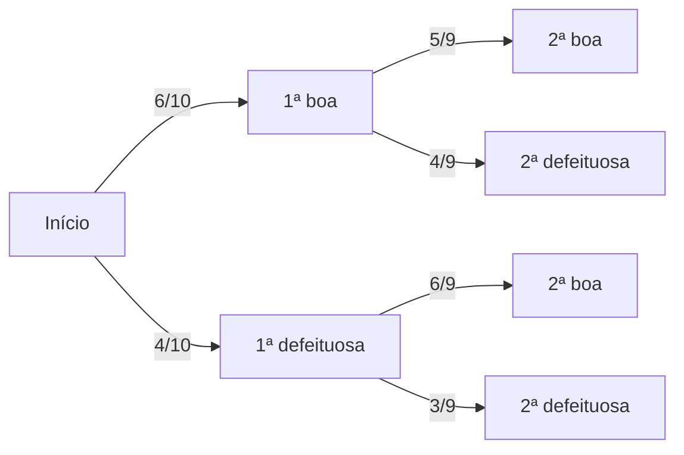
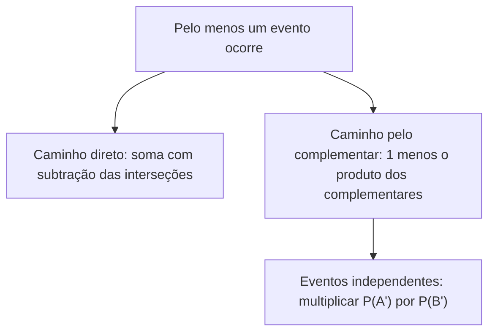

Se a probabilidade condicional serve para reduzir o universo, ela também serve para o caminho inverso: construir a probabilidade de que **dois eventos aconteçam em sequência**. É isso que o teorema da multiplicação faz, e dele nasce uma das regras mais usadas em concursos: a das retiradas sucessivas, com ou sem reposição. O capítulo termina com a **independência de eventos**, o caso especial em que saber de um não muda a chance do outro e a multiplicação fica ainda mais simples.

> [!objetivos]
> - Aplicar o teorema da multiplicação para dois e para três eventos.
> - Resolver retiradas sucessivas, com e sem reposição, usando o diagrama de árvore.
> - Identificar eventos independentes e testar a independência pelo produto.
> - Distinguir eventos independentes de eventos mutuamente excludentes.

## Teorema da multiplicação

Da definição de probabilidade condicional, P(B | A) = P(A ∩ B) / P(A), isola-se a probabilidade da interseção:

> [!esquema] Teorema da multiplicação
> - P(A ∩ B) = P(A) × P(B | A)
> - Também vale a ordem inversa: P(A ∩ B) = P(B) × P(A | B)

Em palavras: a chance de ocorrerem A **e** B é a chance de A multiplicada pela chance de B **depois** de A ter ocorrido. A multiplicação corresponde ao conectivo "e".

Retomando o quartel de 200 militares do capítulo anterior (120 homens e 80 mulheres, dos quais 36 homens e 16 mulheres são oficiais), a probabilidade de sortear uma mulher oficial é:

P(mulher ∩ oficial) = P(mulher) × P(oficial | mulher) = 80/200 × 16/80 = 2/5 × 1/5 = 2/25 = 0,08.

Contando direto na tabela, 16 em 200 resulta nos mesmos 0,08. A ordem inversa também funciona: P(oficial) × P(mulher | oficial) = 52/200 × 16/52 = 16/200.

### Usando a regra para achar a união

Muitas questões dão uma condicional e pedem a união. O caminho é: calcular a interseção pelo teorema da multiplicação e levá-la à fórmula da união.

> [!resolvido] Questão comentada: da condicional à união
> Dois eventos têm P(A) = 0,4 e P(B) = 0,7, e a probabilidade de A dado B é 0,5. Qual é a probabilidade de ocorrer A ou B?
>
> **Resolução.** Pelo teorema da multiplicação, P(A ∩ B) = P(B) × P(A | B) = 0,7 × 0,5 = 0,35. Na união, P(A ∪ B) = 0,4 + 0,7 − 0,35 = 0,75.

### Três eventos

Para três eventos, a regra encadeia as condições, cada uma levando em conta o que já ocorreu:

P(A ∩ B ∩ C) = P(A) × P(B | A) × P(C | A ∩ B)

## Retiradas sucessivas sem reposição

Quando os itens saem de uma caixa e **não voltam**, a composição da caixa muda a cada retirada. A probabilidade da segunda retirada é uma probabilidade **condicional** à primeira.

> [!resolvido] Questão comentada: lanternas sem reposição
> Uma gaveta contém 6 lanternas boas e 4 defeituosas. Duas lanternas são retiradas sucessivamente, sem reposição. Qual é a probabilidade de ambas serem boas?
>
> **Resolução.** Na primeira retirada, P(1ª boa) = 6/10. Retirada uma boa, restam 5 boas em 9 lanternas, então P(2ª boa | 1ª boa) = 5/9. Pelo teorema da multiplicação, P = 6/10 × 5/9 = 30/90 = 1/3.

Para três lanternas boas seguidas, continue o encadeamento: 6/10 × 5/9 × 4/8 = 120/720 = 1/6. Conferindo por combinação: C(6, 3) / C(10, 3) = 20/120 = 1/6, o mesmo valor. Quando a ordem dos itens não é relevante, vale usar a combinação; quando as retiradas são descritas em sequência, a multiplicação é mais natural.

| Situação | Cálculo | Resultado |
| --- | --- | --- |
| 1ª boa e 2ª boa | 6/10 × 5/9 | 1/3 |
| 1ª boa e 2ª defeituosa | 6/10 × 4/9 | 4/15 |
| 1ª defeituosa e 2ª boa | 4/10 × 6/9 | 4/15 |
| 1ª defeituosa e 2ª defeituosa | 4/10 × 3/9 | 2/15 |

A soma dos quatro resultados é 1/3 + 4/15 + 4/15 + 2/15 = 15/15 = 1, como deveria ser, pois os quatro casos esgotam todas as possibilidades.

> [!pegadinha] Esquecer que o denominador muda
> Em retiradas sem reposição, o denominador da segunda fração diminui em 1 e, se o item retirado era do tipo procurado, o numerador também. Usar 6/10 × 6/10 trata o experimento como se houvesse reposição e leva a uma resposta errada.

### Diagrama de árvore

O **diagrama de árvore** organiza esse tipo de cálculo. Cada ramo carrega a probabilidade condicional daquele passo, e a probabilidade de um caminho completo é o **produto** dos ramos. Quando há vários caminhos que levam ao mesmo resultado, somam-se as probabilidades dos caminhos, pois são eventos mutuamente excludentes.

> [!resolvido] Questão comentada: soma de caminhos
> Na gaveta acima, qual é a probabilidade de que exatamente uma das duas lanternas retiradas seja boa?
>
> **Resolução.** Há dois caminhos: boa e depois defeituosa (6/10 × 4/9 = 24/90) ou defeituosa e depois boa (4/10 × 6/9 = 24/90). Somam-se os caminhos: 24/90 + 24/90 = 48/90 = 8/15.

### Quando o resultado da segunda etapa depende do primeiro

Em algumas questões, o sorteio da primeira etapa decide **qual** experimento será feito na segunda. Um estudante domina 70% da matéria; quando sabe, acerta; quando não sabe, chuta uma entre cinco alternativas. A chance de acertar **por chute** é a interseção dos eventos "não saber" e "acertar": P(não sabe) × P(acerta | não sabe) = 0,30 × 1/5 = 0,06 = 6%. Já a chance total de acertar soma os dois caminhos: 0,70 × 1 + 0,30 × 0,2 = 0,76. Essa soma de caminhos será formalizada no próximo capítulo, como probabilidade total.

### Urnas em sequência

Uma situação clássica combina urnas: sorteia-se uma bola de uma urna, transfere-se para outra e sorteia-se de novo. A segunda etapa depende da cor da bola que mudou de urna, então cada cor da primeira etapa abre um ramo da árvore.

> [!resolvido] Questão comentada: bola que muda de urna
> A urna I tem 3 bolas azuis e 5 vermelhas. A urna II tem 4 azuis e 2 vermelhas. Uma bola da urna I é sorteada e colocada na urna II; em seguida, uma bola da urna II é sorteada. Qual é a probabilidade de que a bola sorteada da urna II seja azul?
>
> **Resolução.** Dois caminhos, conforme a cor da bola transferida. Se a transferida é azul (probabilidade 3/8), a urna II fica com 5 azuis em 7 bolas, e a chance de sair azul é 5/7. Se a transferida é vermelha (probabilidade 5/8), a urna II fica com 4 azuis em 7, e a chance é 4/7. Somando os caminhos: 3/8 × 5/7 + 5/8 × 4/7 = 15/56 + 20/56 = 35/56 = 5/8.

### Condicional e multiplicação em dados de campo

Os dados de equipamentos aparecem com frequência nesses enunciados. Se a probabilidade de um sensor falhar em condição de alta umidade é P(F | U) = 0,5 e a incidência de alta umidade é P(U) = 0,2, a probabilidade de, num dia qualquer, haver alta umidade **e** falha do sensor é P(U ∩ F) = 0,2 × 0,5 = 0,10. Por outro lado, se P(F) = 0,25 e a probabilidade de falha em alta temperatura T também é P(F | T) = 0,25, então saber que ocorreu T não muda a chance de F: os eventos F e T são independentes. É o teste da definição, P(F | T) = P(F), em ação.

## Independência de eventos

Dois eventos são **independentes** quando a ocorrência de um **não altera** a probabilidade do outro. O resultado de um lançamento de dado nada tem a ver com o do lançamento seguinte. Em símbolos:

P(B | A) = P(B)

Se A e B são independentes, os seus complementares também o são. Isso gera quatro igualdades equivalentes:

| Igualdade | Leitura |
| --- | --- |
| P(B dado A) = P(B) | Saber A não muda B |
| P(B dado A') = P(B) | Saber que A não ocorreu não muda B |
| P(B' dado A) = P(B') | Saber A não muda a chance de não B |
| P(B' dado A') = P(B') | Saber que não A não muda a chance de não B |

### A regra do produto

Combinando P(B | A) = P(B) com o teorema da multiplicação, obtém-se a regra que mais aparece em prova:

> [!esquema] Interseção de eventos independentes
> - P(A ∩ B) = P(A) × P(B)
> - Vale nos dois sentidos: se A e B são independentes, o produto é a interseção; se o produto das probabilidades é igual à probabilidade da interseção, os eventos são independentes.

O segundo sentido fornece o **teste de independência**. Se P(A) = 0,4, P(B) = 0,5 e P(A ∩ B) = 0,20, como 0,4 × 0,5 = 0,20, os eventos são independentes. Se P(A ∩ B) fosse 0,30, o produto não bateria e os eventos seriam dependentes.

> [!resolvido] Questão comentada: dois dados
> Lançam-se dois dados comuns. Seja A o evento "o primeiro dado mostra um número par" e B o evento "o segundo dado mostra 5 ou 6". Qual é a probabilidade de A e B?
>
> **Resolução.** Os dois lançamentos são independentes. P(A) = 3/6 = 1/2 e P(B) = 2/6 = 1/3. Então P(A ∩ B) = 1/2 × 1/3 = 1/6. Conferindo por contagem: 3 × 2 = 6 pares favoráveis em 36, ou 1/6.

### União e "pelo menos um" com eventos independentes

Para a união de eventos independentes, aplique a fórmula P(A ∪ B) = P(A) + P(B) − P(A) × P(B), ou use o complementar, que costuma ser mais curto:

P(A ∪ B) = 1 − P(A') × P(B')

> [!resolvido] Questão comentada: pelo menos um acerto
> Um atirador acerta o alvo em 80% dos disparos, e cada disparo é independente dos demais. Em três disparos, qual é a probabilidade de acertar **pelo menos um**?
>
> **Resolução.** O complementar de "pelo menos um acerto" é "errar os três". Cada erro tem probabilidade 0,20, e como os disparos são independentes, P(três erros) = 0,2 × 0,2 × 0,2 = 0,008. Então P(pelo menos um acerto) = 1 − 0,008 = 0,992, ou 99,2%.

O mesmo vale para sistemas com **reserva**. Se um gerador principal falha com probabilidade 1/10 e um gerador reserva, independente, falha com probabilidade 1/20, a falta de energia só ocorre se ambos falharem: 1/10 × 1/20 = 1/200 = 0,5%. A chance de o sistema funcionar é, portanto, 1 − 0,005 = 99,5%.

### Independentes não são excludentes

Um erro comum é confundir **independentes** com **mutuamente excludentes**.

| Característica | Mutuamente excludentes | Independentes |
| --- | --- | --- |
| Definição | A ∩ B = ∅ | P(A ∩ B) = P(A) × P(B) |
| Podem ocorrer juntos? | Não | Sim |
| Probabilidade da interseção | Zero | Produto das probabilidades |
| Saber um muda o outro? | Sim: se um ocorreu, o outro não ocorre | Não |

Se dois eventos têm probabilidade maior que zero e são excludentes, eles são **dependentes**: com P(A ∩ B) = 0, mas P(A) × P(B) > 0, o produto não coincide com a interseção. O fato de A ter ocorrido impede B e altera sua probabilidade para zero.

> [!bizu] Independente se multiplica, excludente se soma
> Independentes: multiplique para obter a interseção. Excludentes: some para obter a união. Quem multiplica probabilidades de eventos excludentes, ou soma as de independentes sem descontar a interseção, erra.

## Como a banca cobra este assunto

O padrão é o das retiradas: "duas bolas retiradas sem reposição", "três sorteios sucessivos". O candidato precisa decidir se há ou não reposição e se os eventos são independentes. Também aparecem itens de certo ou errado sobre definições, como "eventos independentes são aqueles cuja interseção é vazia" (errado) ou "se P(A ∩ B) = P(A) × P(B), então A e B são independentes" (certo). Outra variação traz probabilidades condicionais e pede a união, exigindo o teorema da multiplicação como passo intermediário.

## Mapa do capítulo

| Tema | Ideia central | Armadilha |
| --- | --- | --- |
| Teorema da multiplicação | P(A ∩ B) = P(A) × P(B dado A) | Esquecer de condicionar a segunda etapa |
| Sem reposição | O universo muda a cada retirada | Manter o denominador |
| Árvore | Multiplica nos ramos, soma entre caminhos | Somar dentro de um mesmo caminho |
| Independência | Saber A não altera B | Confundir com excludência |
| Regra do produto | P(A ∩ B) = P(A) × P(B), nos dois sentidos | Usar sem verificar a independência |
| Pelo menos um | 1 menos o produto dos complementares | Multiplicar as probabilidades de sucesso |
| Excludentes | Probabilidade da interseção igual a zero | Chamar de independentes |

### Para fixar

1. P(A ∩ B) = P(A) × P(B | A): a multiplicação corresponde ao "e".
2. Para três eventos, P(A ∩ B ∩ C) = P(A) × P(B | A) × P(C | A ∩ B).
3. Sem reposição, a segunda probabilidade é condicional à primeira retirada.
4. No diagrama de árvore, multiplicam-se os ramos de um caminho e somam-se os caminhos alternativos.
5. Eventos independentes: P(B | A) = P(B).
6. Se A e B são independentes, seus complementares também são.
7. Para independentes, P(A ∩ B) = P(A) × P(B), e a recíproca é verdadeira.
8. Para independentes, P(A ∪ B) = 1 − P(A') × P(B').
9. "Pelo menos um" se resolve pelo complementar: 1 menos o produto das chances de falha.
10. Eventos excludentes de probabilidade positiva nunca são independentes.
