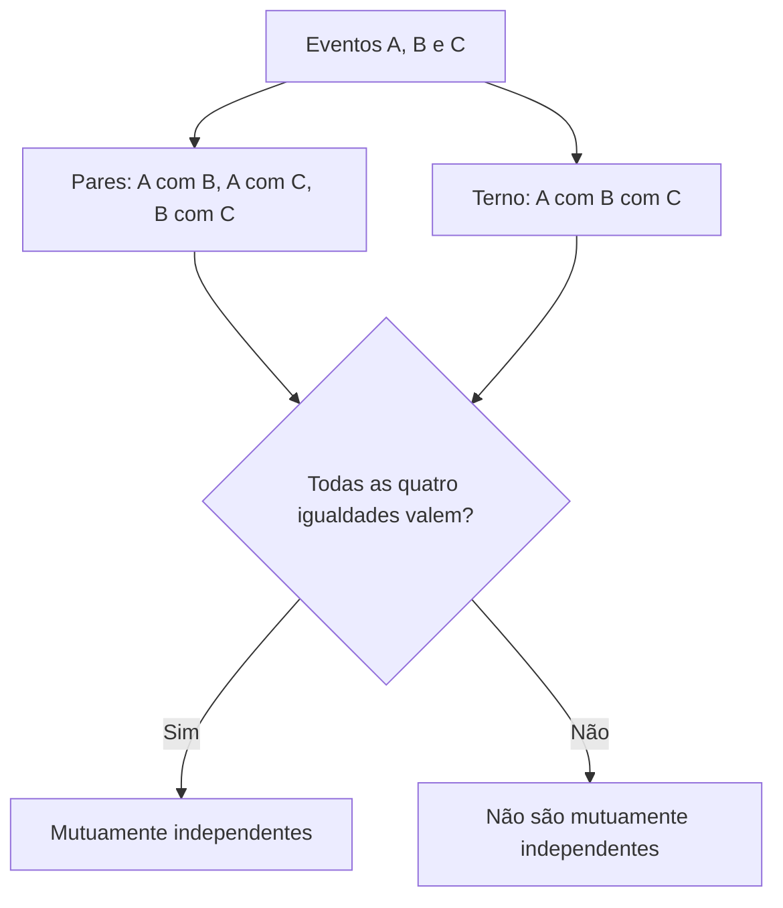
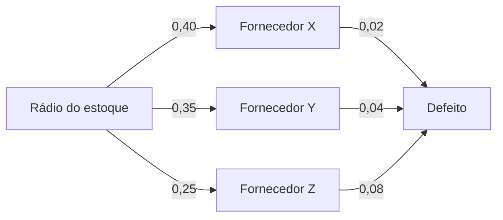

Este capítulo fecha o assunto com três ideias que as bancas adoram: a independência de **três** eventos, cheia de sutilezas; o teorema da **probabilidade total**, que calcula a chance de um evento quando ele pode vir por vários caminhos; e o teorema de **Bayes**, que faz o caminho de volta, descobrindo de qual caminho veio um resultado já observado. Os três usam o que foi visto antes: probabilidade condicional, teorema da multiplicação e soma de eventos excludentes.

> [!objetivos]
> - Diferenciar independência dois a dois de independência mútua de três eventos.
> - Calcular a probabilidade total de um evento a partir de grupos que dividem o universo.
> - Aplicar o teorema de Bayes para inverter condicionais.
> - Reconhecer pelo enunciado qual dos dois teoremas a questão pede.

## Independência de três eventos

Para dois eventos, independência é simples: P(A ∩ B) = P(A) × P(B). Para três, é preciso mais. Os eventos A, B e C são **mutuamente independentes** quando valem **todas** as igualdades abaixo:

| Combinação | Igualdade exigida |
| --- | --- |
| A com B | P(A ∩ B) = P(A) × P(B) |
| A com C | P(A ∩ C) = P(A) × P(C) |
| B com C | P(B ∩ C) = P(B) × P(C) |
| Os três juntos | P(A ∩ B ∩ C) = P(A) × P(B) × P(C) |

Se os eventos são mutuamente independentes, a probabilidade de ocorrerem os três é o produto das probabilidades. Para n eventos independentes vale a mesma regra: P(A1 ∩ A2 ∩ ... ∩ An) = P(A1) × P(A2) × ... × P(An).

> [!resolvido] Questão comentada: seis questões ao acaso
> Uma prova tem 6 questões de múltipla escolha, cada uma com 5 alternativas. Uma pessoa que não conhece o assunto marca ao acaso uma alternativa em cada questão. Qual é a probabilidade de acertar todas?
>
> **Resolução.** A chance de acertar cada questão é 1/5, e as marcações são independentes. Então P = (1/5)⁶ = 1/15.625, aproximadamente 0,0064%.

> [!resolvido] Questão comentada: duas doses de vacina
> Cada dose de uma vacina imuniza 60% das pessoas que ainda não estão imunizadas, e os efeitos das doses são independentes. Toda a população começou sem imunização e recebeu duas doses consecutivas. Sorteada uma pessoa ao acaso, qual é a probabilidade de que esteja imunizada?
>
> **Resolução.** O complemento é mais simples: a pessoa continua não imunizada se a 1ª dose falhar **e** a 2ª também. Cada falha tem probabilidade 0,40, e as doses são independentes, então P(não imunizada) = 0,4 × 0,4 = 0,16. A probabilidade de estar imunizada é 1 − 0,16 = 0,84, ou 84%.

### As armadilhas da independência

Três erros de raciocínio são cobrados com frequência. Todos vêm de tratar a regra do produto como se ela valesse "de volta" sem cuidado.

1. **O produto triplo não basta.** Saber apenas que P(A ∩ B ∩ C) = P(A) × P(B) × P(C) **não** permite concluir que os eventos são independentes. É preciso conferir também os pares.
2. **Independência dois a dois não implica independência dos três.** Lançam-se duas moedas honestas. Sejam A = "a 1ª é cara", B = "a 2ª é cara" e C = "as duas moedas mostram a mesma face". Cada evento tem probabilidade 1/2. Os pares são independentes: P(A ∩ B) = 1/4, P(A ∩ C) = 1/4 (as duas caras) e P(B ∩ C) = 1/4 (as duas caras), todos iguais a 1/2 × 1/2. Mas P(A ∩ B ∩ C) = 1/4 (as duas caras), e o produto P(A) × P(B) × P(C) = 1/8. Os três não são mutuamente independentes.
3. **A independência não é transitiva.** Saber que A é independente de B e que B é independente de C **não** garante que A seja independente de C. Seja A = "1ª moeda cara", B = "2ª moeda cara" e C = "1ª moeda cara" (o mesmo evento que A). A e B são independentes, B e C também, mas A e C são o mesmo evento, e P(A ∩ C) = 1/2, diferente de 1/2 × 1/2.

A frase "A independe de B e B independe de C, logo A independe de C" é uma conclusão inválida. Também não se pode afirmar que os três são mutuamente independentes, nem que A e C são excludentes. O que se mantém verdadeiro é que os **complementares** herdam a relação: se B e C são independentes, B e o complementar de C também são.

## Teorema da probabilidade total

Imagine que o universo foi dividido em **grupos** que não se sobrepõem e que juntos cobrem tudo (por exemplo, três fornecedores, que respondem por toda a oferta de uma peça). Conhecem-se a proporção de cada grupo e a chance de um evento ocorrer **dentro de cada grupo**. Pergunta-se a chance do evento ocorrer em um item escolhido ao acaso, sem saber de que grupo veio.

A resposta é a soma das contribuições de cada grupo. Pelo teorema da multiplicação, a contribuição de um grupo é P(grupo) × P(evento dado grupo).

> [!esquema] Probabilidade total
> - Com grupos A1, A2, ..., An que não se sobrepõem e cobrem o universo: P(E) = P(E dado A1) × P(A1) + P(E dado A2) × P(A2) + ... + P(E dado An) × P(An)
> - Com dois grupos complementares, A e A': P(E) = P(E dado A) × P(A) + P(E dado A') × P(A')

> [!resolvido] Questão comentada: peças de três fornecedores
> Um almoxarifado recebe rádios de três fornecedores: X fornece 40% do estoque, Y fornece 35% e Z fornece 25%. As taxas de rádios com defeito são 2% (X), 4% (Y) e 8% (Z). Um rádio é escolhido ao acaso do estoque. Qual é a probabilidade de que seja defeituoso?
>
> **Resolução.** P(D) = 0,40 × 0,02 + 0,35 × 0,04 + 0,25 × 0,08 = 0,008 + 0,014 + 0,020 = 0,042, ou 4,2%.

| Fornecedor | P(fornecedor) | P(defeito dado fornecedor) | Contribuição |
| --- | --- | --- | --- |
| X | 0,40 | 0,02 | 0,008 |
| Y | 0,35 | 0,04 | 0,014 |
| Z | 0,25 | 0,08 | 0,020 |
| Total | 1,00 | | 0,042 |

Uma maneira intuitiva de enxergar a fórmula é imaginar um estoque de 1.000 rádios: 400 de X (8 defeituosos), 350 de Y (14) e 250 de Z (20). No total são 42 defeituosos em 1.000, ou 4,2%.

### O complemento

Quando a pergunta é pela chance de **não** ter o atributo, calcule P(E) e use o complemento, ou aplique a mesma fórmula às probabilidades contrárias. No exemplo, a probabilidade de um rádio estar sem defeito é 1 − 0,042 = 0,958.

Um exemplo com apenas dois grupos: num cadastro, 70% das inscrições são feitas por aplicativo e 30%, presencialmente; as feitas por aplicativo são concluídas corretamente em 95% dos casos, e as presenciais, em 85%. A probabilidade de uma inscrição ao acaso ter sido concluída corretamente é 0,70 × 0,95 + 0,30 × 0,85 = 0,665 + 0,255 = 0,92, ou 92%.

Antes de aplicar a fórmula, confira que as proporções dos grupos somam 1. Se o enunciado disser "metade" dos casos para o grupo A e "20%" para o grupo B, o grupo restante tem 30%, e ele conta na soma.

## Teorema de Bayes

A probabilidade total vai dos grupos para o evento: dado o grupo, qual a chance do evento? O **teorema de Bayes** faz o caminho **inverso**: dado que o evento aconteceu, qual a chance de ter vindo de determinado grupo? Troca-se P(E dado grupo) por P(grupo dado E).

A dedução é curta e vale conhecer. Pela definição de condicional, P(A dado E) = P(A ∩ E) / P(E). O numerador, pelo teorema da multiplicação, é P(E dado A) × P(A). O denominador, pela probabilidade total, é a soma das contribuições de todos os grupos. Daí a fórmula:

> [!esquema] Teorema de Bayes
> P(Am dado E) = [P(E dado Am) × P(Am)] / [P(E dado A1) × P(A1) + ... + P(E dado An) × P(An)]
>
> O denominador é a probabilidade total de E. O numerador é a contribuição do grupo Am.

Na prática: calcule a probabilidade total (a soma de todas as contribuições) e divida a contribuição do grupo procurado por essa soma.

> [!resolvido] Questão comentada: de onde veio o rádio defeituoso
> No estoque de rádios do exemplo anterior, o rádio sorteado é defeituoso. Qual é a probabilidade de que tenha vindo do fornecedor Z?
>
> **Resolução.** A contribuição de Z é 0,020 e a probabilidade total de defeito é 0,042. Então P(Z dado defeito) = 0,020 / 0,042 = 10/21, cerca de 47,6%. Observe que, embora Z forneça apenas 25% do estoque, ele responde por quase metade dos defeitos, pois sua taxa de falha é alta.

Calculando também os outros fornecedores, a soma deve fechar em 100%:

| Fornecedor | Contribuição | P(fornecedor dado defeito) |
| --- | --- | --- |
| X | 0,008 | 0,008 / 0,042 = 4/21, cerca de 19,0% |
| Y | 0,014 | 0,014 / 0,042 = 1/3, cerca de 33,3% |
| Z | 0,020 | 0,020 / 0,042 = 10/21, cerca de 47,6% |
| Soma | 0,042 | 100% |

Esse tipo de conferência é útil na prova: se as probabilidades de Bayes de todos os grupos não somarem 1, houve erro de conta.

### Passo a passo para qualquer questão

Os enunciados de probabilidade total e de Bayes são parecidos entre si, e uma rotina evita confusão.

1. Identifique os **grupos** (fornecedores, turnos, oficinas, peritos, transportadoras) e escreva a proporção de cada um.
2. Escreva, para cada grupo, a probabilidade do **evento** dentro dele (defeito, atraso, inadimplência).
3. Multiplique, grupo a grupo, a proporção pela taxa. Cada produto é a contribuição do grupo.
4. Some as contribuições: é a **probabilidade total** do evento.
5. Se a pergunta for do tipo "sabendo que ocorreu o evento, de que grupo veio?", divida a contribuição do grupo procurado pela soma do passo 4: é **Bayes**.

### Mais exemplos de probabilidade total

> [!resolvido] Questão comentada: lâmpadas de três marcas
> Numa loja, 30% das lâmpadas em estoque são da marca A, 45% da marca B e 25% da marca C. Das fabricadas pela marca A, 6% queimam antes de 1.000 horas de uso; da marca B, 3%; da marca C, 2%. Uma lâmpada é escolhida ao acaso. Qual é a probabilidade de que **não** queime antes de 1.000 horas?
>
> **Resolução.** Primeiro a probabilidade de queimar: 0,30 × 0,06 + 0,45 × 0,03 + 0,25 × 0,02 = 0,018 + 0,0135 + 0,005 = 0,0365. Sua complementar é a pedida: 1 − 0,0365 = 0,9635, ou 96,35%.

> [!resolvido] Questão comentada: laudos concluídos no prazo
> Dois peritos elaboram laudos: o perito 1 responde por 60% do total e conclui no prazo 30% dos seus laudos; o perito 2 responde pelos outros 40% e conclui no prazo 50% dos seus. Um laudo é escolhido ao acaso. Qual é a probabilidade de que tenha sido concluído no prazo?
>
> **Resolução.** P(no prazo) = 0,60 × 0,30 + 0,40 × 0,50 = 0,18 + 0,20 = 0,38. Se o enunciado perguntasse de qual perito veio um laudo concluído no prazo, a resposta de Bayes seria 0,18 / 0,38 = 9/19 para o perito 1.

### Mais exemplos de Bayes

> [!resolvido] Questão comentada: falha elétrica por oficina
> Uma corporação tem três oficinas de manutenção de viaturas. A oficina 1 atende 45% das viaturas, a 2 atende 35% e a 3 atende 20%. As viaturas que voltam com falha elétrica representam 2%, 3% e 6% das atendidas pelas oficinas 1, 2 e 3, respectivamente. Uma viatura é escolhida ao acaso e verifica-se que voltou com falha elétrica. Qual é a probabilidade de ter sido atendida na oficina 3?
>
> **Resolução.** As contribuições são 0,45 × 0,02 = 0,009 (oficina 1), 0,35 × 0,03 = 0,0105 (oficina 2) e 0,20 × 0,06 = 0,012 (oficina 3). A probabilidade total de falha elétrica é 0,009 + 0,0105 + 0,012 = 0,0315. Então P(oficina 3 dado falha) = 0,012 / 0,0315 = 8/21, cerca de 38,1%. As outras são 2/7 (oficina 1) e 1/3 (oficina 2), e 6/21 + 7/21 + 8/21 = 1.

> [!resolvido] Questão comentada: atrasos por transportadora
> Um almoxarifado recebe cargas de três transportadoras: a T1 entrega 60% das cargas, com 2% de atraso; a T2 entrega 30%, com 6% de atraso; e a T3 entrega 10%, com 15% de atraso. Uma carga atrasada é sorteada. Qual é a probabilidade de que seja da T3?
>
> **Resolução.** Contribuições: 0,60 × 0,02 = 0,012; 0,30 × 0,06 = 0,018; 0,10 × 0,15 = 0,015. Total de atrasos: 0,045. Então P(T3 dado atraso) = 0,015 / 0,045 = 1/3. Embora a T3 entregue só 10% das cargas, responde por um terço dos atrasos.

| Pergunta do enunciado | Teorema | Fórmula resumida |
| --- | --- | --- |
| Qual a chance do evento em um item qualquer? | Probabilidade total | Soma de proporção × taxa |
| Sabendo que o evento ocorreu, qual a chance do grupo? | Bayes | Contribuição do grupo / probabilidade total |
| Qual a chance de dois eventos ocorrerem juntos? | Multiplicação | P(A) × P(B dado A) |
| Qual a chance de ocorrer pelo menos um? | Complementar | 1 menos P(nenhum) |

### O exemplo do teste de triagem

Um uso clássico de Bayes envolve exames. Suponha que 2% de um efetivo tenham determinada condição. Um teste dá resultado positivo em 90% dos que a têm e, por engano, em 5% dos que não a têm.

> [!resolvido] Questão comentada: teste positivo
> Um militar do efetivo é sorteado e o teste dá positivo. Qual é a probabilidade de que ele tenha a condição?
>
> **Resolução.** Sejam C (tem a condição) e + (teste positivo). P(C) = 0,02, P(+ dado C) = 0,90, P(+ dado C') = 0,05 e P(C') = 0,98. A probabilidade total de teste positivo é 0,02 × 0,90 + 0,98 × 0,05 = 0,018 + 0,049 = 0,067. Então P(C dado +) = 0,018 / 0,067 = 18/67, cerca de 26,9%.

O resultado surpreende: mesmo com um teste que acerta 90% dos casos, a chance de um positivo realmente ter a condição é de apenas 26,9%, porque a condição é rara e os falsos positivos (4,9% do total) superam os verdadeiros positivos (1,8%). Pensar em 1.000 pessoas ajuda: 20 têm a condição e 18 testam positivo; das 980 sem a condição, 49 testam positivo. Dos 67 positivos, só 18 são verdadeiros.

> [!pegadinha] A taxa do teste não é a chance de ter a condição
> "O teste acerta 90% dos casos" é P(positivo dado condição), e não P(condição dado positivo). Confundir as duas é o erro de inversão que o teorema de Bayes corrige. Quando a condição é rara, a segunda pode ser bem menor que a primeira.

> [!bizu] Probabilidade total ou Bayes?
> Se a pergunta é "qual a chance do evento?", o caminho é a **probabilidade total**. Se é "sabendo que o evento ocorreu, qual a chance de ter vindo do grupo X?", o caminho é **Bayes**. O sinal é a expressão "sabendo que", "dado que" ou "tendo-se verificado que" seguida do resultado observado.

## Contagem e probabilidade: o elo com a análise combinatória

O edital de probabilidade aparece junto com os princípios de contagem, e não por acaso. O princípio multiplicativo da contagem (número de maneiras de uma sequência de escolhas é o produto das maneiras em cada etapa) é irmão do teorema da multiplicação da probabilidade (chance de uma sequência de eventos é o produto das chances em cada etapa). Em ambos, o conectivo "e" pede multiplicação e o conectivo "ou" pede soma, desde que os casos não se sobreponham. Quando um problema parece fácil de resolver contando, conte; quando as etapas têm chances diferentes (taxas, proporções), multiplique probabilidades.

## Como a banca cobra este assunto

As questões trazem proporções de grupos (fornecedores, turnos, oficinas, peritos) e taxas de ocorrência dentro de cada grupo, e pedem ou a chance total, ou a chance de um grupo dado o resultado. Os contextos mais frequentes são varas trabalhistas e ações da atividade agropecuária, processos analisados e indeferidos, pedidos de gratuidade, pagadores inadimplentes, preenchimento de documentos em computador ou em papel (viabilidade de cada via) e lâmpadas que queimam antes de 1000h. Qualquer que seja o cenário, a estrutura é a mesma: grupos, proporções e taxas. A economia de tempo vem de reconhecer o padrão, e não de decorar casos. Os erros comuns: usar a taxa do grupo como se fosse a probabilidade total, esquecer um grupo na soma do denominador, dividir pelo total do universo em vez de pela probabilidade total do evento e trocar P(A dado E) por P(E dado A). Nas questões de independência, as bancas apresentam proposições como "se A e B são independentes e B e C são independentes, então A e C são independentes", que é falsa, e outras sobre o produto triplo, que não basta para provar independência.

## Mapa do capítulo

| Tema | Ideia central | Armadilha |
| --- | --- | --- |
| Independência de três eventos | Pares e terno devem satisfazer o produto | Concluir de um único produto |
| Dois a dois | Não garante independência mútua | Generalizar a regra |
| Transitividade | A independente de B e B de C não implica A de C | Assumir a transitividade |
| Probabilidade total | Soma de P(grupo) × P(evento dado grupo) | Esquecer um grupo |
| Pesos dos grupos | Devem somar 100% | Pesos que não fecham |
| Bayes | Contribuição do grupo dividida pela probabilidade total | Trocar os eventos |
| Conferência | As probabilidades de Bayes somam 1 | Não conferir |

### Para fixar

1. Três eventos são mutuamente independentes se os três pares e o terno satisfazem a regra do produto.
2. O produto triplo isolado não prova independência.
3. Independência dois a dois não implica independência mútua.
4. A independência não é transitiva, mas os complementares herdam as relações de independência.
5. Para n eventos independentes, a probabilidade da interseção é o produto das probabilidades.
6. A probabilidade total soma, grupo a grupo, P(grupo) × P(evento dado grupo).
7. Os grupos da probabilidade total não se sobrepõem e cobrem todo o universo.
8. O teorema de Bayes inverte a condicional: dado o evento, qual a chance do grupo.
9. Em Bayes, o denominador é a probabilidade total do evento.
10. A soma das probabilidades de Bayes de todos os grupos é 1.
