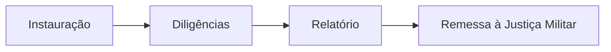
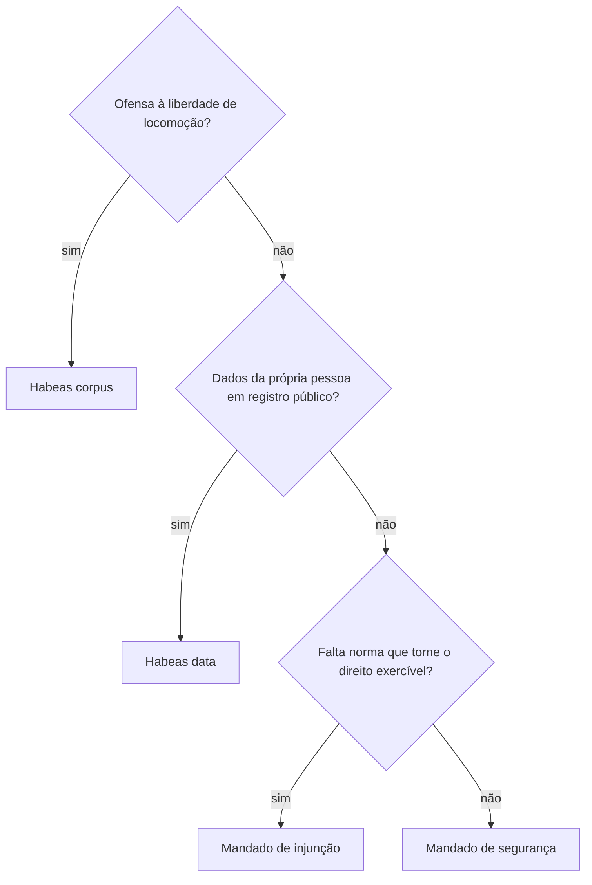

# Briefing: material próprio MentorIA (apostilas autorais)

Este documento é a sua ordem de serviço completa. **Leia inteiro antes de escrever a primeira linha.** Ele diz:
- o que produzir e em que formato;
- quanto escrever, quantas figuras e quadros usar;
- onde pesquisar;
- como o seu trabalho será revisado.

Tudo o que está aqui é exigência. Quando algo não estiver coberto, escolha o que deixa o material mais correto e mais útil para quem vai fazer a prova, e registre a decisão em `notas`.

Repositório: `C:\Users\Administrador\Documents\Projetos\CFO-BM` (Windows).
- Python: `pipeline/.venv/Scripts/python`, sempre com `PYTHONIOENCODING=utf-8`.
- Os comandos deste briefing estão na sintaxe do Bash: `PYTHONIOENCODING=utf-8 pipeline/.venv/Scripts/python ...`. No PowerShell, use `$env:PYTHONIOENCODING="utf-8"; pipeline/.venv/Scripts/python ...`.
- O `CLAUDE.md` traz as convenções do projeto. Ele já é carregado automaticamente na sessão: não precisa abri-lo de novo.

---

## 0. Seu papel e as regras que não se negociam

Você é o **autor**. Escreve o conteúdo de um volume por vez.

Outro agente é o **revisor**. Ele lê o que você entregou, roda as checagens e **aprova** ou **devolve** com uma lista de correções. Ninguém publica nada sem a aprovação dele.

Regras invioláveis (descumprir qualquer uma devolve o volume inteiro):

1. **Nada copiado.** O material do Estratégia (o "texto-fonte", em `docs/`) é protegido e traz a marca d'água de um aluno. Ele serve **só** como régua de:
   - volume (quanto escrever);
   - densidade (figuras, tabelas, quadros);
   - assuntos e pontos de atenção.

   Não copie frases, exemplos, nomes de personagens, numeração de casos, esquemas, tabelas nem a ordem exata dos parágrafos dele. O mesmo vale para qualquer outro curso, blog, livro ou site. Leia, entenda, feche a fonte e escreva com as suas palavras. Seção 8.
2. **Nada errado.** Uma informação errada num material de concurso custa a vaga do aluno. Toda regra, prazo, número, artigo, súmula, fórmula e data tem de estar certa e **vigente** na data em que você escreve. Na dúvida, confirme na fonte oficial (seção 7). Se ainda assim não tiver certeza, não afirme: registre em `notas` para o revisor.
3. **Nada fora do lugar.** Você só cria e edita arquivos dentro de `content/material/<disciplina>/<mNN>/`, a pasta do volume que recebeu. Não edite scripts, catálogo, resumos, bizus nem arquivos de outros volumes. Não faça commit. Não grave no banco. Não rode importadores.
4. **Nada de menção ao material-base ou à plataforma.** O texto nunca cita "Estratégia", "professor", "a aula X", "página Y", "o PDF", "o curso", "como vimos no material". Ele também não fala de si mesmo ("nesta apostila gerada…"). O aluno lê um livro didático, não um comentário sobre outro livro.
5. **Português do Brasil, norma culta, Acordo Ortográfico vigente.** Revise acentuação e crase. Um erro de português em apostila de concurso desmoraliza o resto.
6. **Siga o formato à risca** (seção 5). O PDF é montado por um programa, e o layout ainda está sendo escolhido. Por isso você escreve **conteúdo com marcação semântica** (o que é seção, quadro, tabela, figura), nunca formatação visual (cores, tamanhos, espaços, quebras de página).
7. **Valide antes de entregar.** `pipeline/validate_material.py` tem de passar **sem nenhum ERRO** no volume inteiro. AVISOS se resolvem ou se justificam em `notas`.

---

## 1. O que é este material e para quem

O MentorIA monta planos de estudo para concursos militares e policiais de Pernambuco:
- 2º Tenente CFOA do CBMPE;
- Oficial CBMPE (CFO BM);
- Agente da PCPE;
- Oficial PMPE (CFO PM);
- Soldado CBMPE (CFHP BM);
- Soldado PMPE (CFHP PM).

As bancas são Instituto AOCP (CBMPE e PMPE) e Cebraspe (PCPE). O plano é feito de atividades, num ciclo por aula: **Teoria → Revisão → Fixação → Questões**.

Até hoje, a atividade de Teoria mandava o aluno ler páginas do Estratégia. Muitos alunos não têm esse material. O material próprio substitui essa leitura. Por isso:

- **Ele precisa ser suficiente sozinho.** Um aluno que só tem o seu capítulo deve conseguir acertar as questões do assunto. Se algo é cobrado em prova e está no texto-fonte, tem de estar no seu capítulo, explicado.
- **Cada capítulo é uma atividade de Teoria de cerca de 60 minutos** de estudo ativo: ler, entender, anotar, rever um exemplo. Não é um resumo (os resumos já existem em `content/summaries`) nem um tratado. É o texto didático completo do trecho, enxuto e sem a conversa e a repetição do material-base.
- **O público** é adulto, de ensino médio completo ou superior, estudando sozinho, muitas vezes cansado, depois do trabalho.
  - Escreva claro e direto, com frases curtas e na ordem lógica.
  - Defina todo termo técnico na primeira vez que aparecer.
  - Mostre exemplo concreto de toda regra abstrata.
- **O padrão de qualidade** é o de um bom livro didático para concursos: preciso, completo no que é cobrado, com exemplos próprios, esquemas que ajudam a memorizar e alertas sobre as armadilhas da banca.

---

## 2. Unidade de trabalho: volume, capítulo e arquivos

Os termos usados neste briefing:
- **Trecho**: unidade do catálogo do sistema, com id `<disciplina>/aNN/sNN`. Corresponde a uma atividade de Teoria do plano, de ~60 min. Os ids de trecho são fixos: não invente nem renomeie.
- **Capítulo**: o texto que você escreve para **um** trecho. Um trecho vira exatamente um capítulo.
- **Volume (Aula MentorIA)**: conjunto de 1 a 8 capítulos em sequência didática, que vira **um PDF**. Id: `<disciplina>/mNN`.

A divisão completa está em `content/material/volumes/<disciplina>.json`: título, capítulos na ordem e onda. Ela é gerada por `pipeline/material_volumes.py` e você não a altera. Se achar que a divisão está ruim, diga em `notas` do `volume.md`.

### 2.1 Arquivos que você entrega por volume

```
content/material/<disciplina>/<mNN>/
  volume.md          apresentação do volume (seção 11)
  aNN-sNN.md         um arquivo por capítulo; o nome vem do id do trecho
                     (ex.: direito-penal-militar/a00/s01 → a00-s01.md;
                      complemento direito-constitucional/c06/s01 → c06-s01.md)
  fixacao.json       questões comentadas da Fixação do volume (seção 10)
```

O revisor acrescenta `REVISAO.md` na mesma pasta. Não o apague.

### 2.2 Como pegar trabalho

O orquestrador indica o volume. Se não indicar, pegue o primeiro pendente da fila:

```
PYTHONIOENCODING=utf-8 pipeline/.venv/Scripts/python pipeline/material_ficha.py --proximos --onda 1 -n 5
```

Um volume está "pendente" enquanto a pasta dele não existe. Ao começar, **crie a pasta e o `volume.md` com `status: "RASCUNHO"` imediatamente**: isso reserva o volume para você. Trabalhe em **um volume por vez**. Só pegue outro depois de entregar o atual com o validador limpo.

### 2.3 Ondas (ordem definida pelo dono do produto)

A onda de um trecho é o primeiro concurso desta lista que o cobra:

| Onda | Concurso | Volumes | Capítulos |
|---|---|---|---|
| 1 | 2º Tenente CFOA (CBMPE) | 71 | 341 |
| 2 | CFO BM (Oficial CBMPE) | 97 | 574 |
| 3 | Agente PCPE | 39 | 194 |
| 4 | CFO PM (Oficial PMPE) | já coberta pelas ondas 1 a 3 | — |
| 5 | CFHP BM (Soldado CBMPE) | 12 | 66 |
| 6 | CFHP PM (Soldado PMPE) | já coberta | — |

A fila completa, com a ordem de produção dos volumes, está em `content/material/_queue.json`. Dentro da onda, a ordem segue o peso da disciplina na prova.

---

## 3. Volume esperado: texto, figuras e quadros

### 3.1 De onde vêm as metas

`pipeline/material_metrics.py` mediu cada trecho do material-base e gravou as metas em `content/material/metrics/<disciplina>.json`. Você as vê na ficha do volume:

```
PYTHONIOENCODING=utf-8 pipeline/.venv/Scripts/python pipeline/material_ficha.py <disciplina>/mNN
```

Para cada capítulo, a ficha mostra:

| Meta | Regra | Como o validador conta |
|---|---|---|
| **Palavras** | 75% das palavras da teoria do trecho-fonte, com piso de 900. Faixa aceita: de −15% a +20% da meta. Abaixo do mínimo é ERRO; acima de +35% também é ERRO. | Todas as palavras do corpo, incluindo quadros e tabelas. Excluem-se o front matter e o conteúdo dos blocos de figura. |
| **Elementos visuais** | Pelo menos 0,5 × (figuras + tabelas da fonte), com mínimo de 2 e teto de 1 a cada 400 palavras. | Tabela com cabeçalho e 3 ou mais linhas de dados, bloco de figura (`mermaid`, `svg`, `grafico`, `molecula`) ou quadro `[!esquema]` com lista ou tabela. |
| **Quadros de destaque** | Pelo menos 1 a cada 600 palavras, ou 80% dos quadros da fonte (o maior dos dois), com teto de 14. **Também há limite superior**: mais de 1 quadro a cada 250 palavras (ou mais que o dobro da meta) gera AVISO. Excesso de quadros fragmenta a leitura; o que não é destaque fica no texto. | `[!atencao]`, `[!bizu]`, `[!exemplo]`, `[!lei]`, `[!jurisprudencia]`, `[!pegadinha]`, `[!esquema]`, `[!resolvido]`. O `[!objetivos]` não conta. |

Por que 75%:
- O material-base tem saudação, conversa, repetição, "vamos ver agora", páginas de imagem e listas de leis transcritas.
- O seu texto é mais denso, mas não pode perder conteúdo.
- O tempo de estudo do capítulo continua de ~60 min, porque a densidade maior, os exemplos e os exercícios resolvidos ocupam esse tempo.

**Não encha linguiça para bater a meta. Também não corte conteúdo para caber.** Se a meta parecer errada para um trecho, por exemplo porque a fonte tem muita lei transcrita, escreva o que o conteúdo pede e explique em `notas`. O revisor decide.

### 3.2 Densidade medida no material-base, por disciplina

Use esta tabela para calibrar o "jeito" de cada disciplina: quanto ela se apoia em figura, tabela ou quadro.

| Disciplina | Capítulos | Palavras por pág. da fonte | Figuras a cada 10 págs. | Tabelas a cada 10 págs. | Quadros a cada 10 págs. | Meta média por capítulo (palavras) | Elementos visuais por capítulo (meta média) | Quadros por capítulo (meta média) |
| --- | ---: | ---: | ---: | ---: | ---: | ---: | ---: | ---: |
| Administração | 24 | 254 | 16,3 | 0,7 | 0,0 | 2.511 | 4,8 | 4,7 |
| Atualidades | 63 | 301 | 7,2 | 0,9 | 0,1 | 2.637 | 4,4 | 4,9 |
| Biologia | 71 | 211 | 5,5 | 1,2 | 0,6 | 2.028 | 3,3 | 3,9 |
| Contabilidade Geral | 44 | 280 | 2,0 | 7,9 | 0,8 | 2.838 | 4,7 | 5,3 |
| Direito Administrativo | 120 | 345 | 8,6 | 2,0 | 1,9 | 3.046 | 4,8 | 5,8 |
| Direito Constitucional | 94 | 372 | 5,8 | 0,8 | 0,3 | 2.974 | 3,7 | 5,5 |
| Direito Penal | 69 | 357 | 0,5 | 0,6 | 8,3 | 3.092 | 2,1 | 8,3 |
| Direito Penal Militar | 40 | 373 | 2,5 | 0,7 | 0,4 | 2.535 | 2,4 | 4,9 |
| Direito Processual Penal | 38 | 358 | 0,6 | 0,5 | 3,2 | 2.994 | 2,0 | 6,0 |
| Direito Processual Penal Militar | 15 | 316 | 3,1 | 1,2 | 0,2 | 2.253 | 2,6 | 4,3 |
| Direitos Humanos | 13 | 289 | 4,1 | 2,4 | 0,8 | 2.479 | 3,0 | 4,7 |
| Espanhol | 37 | 153 | 1,1 | 4,9 | 0,0 | 1.578 | 2,9 | 3,2 |
| Estatística | 77 | 229 | 9,0 | 4,6 | 0,4 | 2.116 | 4,4 | 4,3 |
| Física | 41 | 161 | 10,0 | 0,6 | 0,8 | 1.771 | 3,4 | 3,7 |
| História de PE | 3 | 309 | 4,3 | 5,0 | 0,0 | 2.319 | 4,7 | 4,0 |
| Informática | 92 | 317 | 19,1 | 8,8 | 6,4 | 2.838 | 6,1 | 7,1 |
| Inglês | 24 | 188 | 2,8 | 2,4 | 0,3 | 1.827 | 3,0 | 3,7 |
| Legislação PCPE | 12 | 279 | 8,6 | 3,5 | 0,6 | 2.024 | 4,5 | 3,8 |
| Legislação Penal Especial | 29 | 329 | 5,3 | 3,0 | 0,2 | 2.769 | 3,9 | 5,1 |
| Legislações PE | 15 | 292 | 8,5 | 5,2 | 0,5 | 2.416 | 3,1 | 4,9 |
| Língua Portuguesa | 62 | 267 | 6,1 | 1,2 | 0,1 | 2.630 | 4,3 | 5,0 |
| Matemática | 77 | 174 | 9,4 | 2,4 | 0,6 | 1.632 | 3,2 | 3,5 |
| Química | 79 | 291 | 10,1 | 2,9 | 0,1 | 2.538 | 5,3 | 4,8 |
| Raciocínio Lógico | 36 | 262 | 8,5 | 0,5 | 0,8 | 2.693 | 4,7 | 5,6 |

Total: 1.175 capítulos em 219 volumes; meta de cerca de 2,97 milhões de palavras.

Leia esta tabela com cuidado:
- As **figuras da fonte** incluem capturas de tela, mapas mentais em imagem e ilustrações.
- Os **quadros** são os retângulos coloridos detectados no PDF. Em várias disciplinas, os destaques da fonte são só texto em negrito, e por isso a contagem sai baixa.
- A meta de cada capítulo (na ficha) já considera tudo isso. Siga a ficha.

Leitura da tabela:
- **Disciplinas com muitas figuras por página** (Administração, Informática, Matemática, Física, Estatística, Raciocínio Lógico, Química): o aluno aprende vendo.
  - Use esquemas (`mermaid`), gráficos (`grafico`), desenhos técnicos (`svg`) e tabelas comparativas.
  - Em exatas, cada método ensinado ganha pelo menos um exercício resolvido passo a passo.
- **Disciplinas jurídicas**: o que pesa é a letra da lei, as classificações e as exceções.
  - Use tabelas comparativas (prazos, legitimados, requisitos), fluxogramas de procedimento (`mermaid`) e quadros `[!lei]` curtos com o dispositivo central, seguidos de explicação.
- **Línguas** (Português, Inglês, Espanhol): o visual é a frase-exemplo.
  - Use muitos exemplos curtos, tabelas de formas (conjugações, pronomes, falsos cognatos) e quadros de pegadinha.

### 3.3 Fixação

Cada volume tem de 12 a 20 questões comentadas: `mín(20, máx(12, 3 × nº de capítulos))`, com pelo menos 2 por capítulo. Seção 10.

### 3.4 Apresentação do volume

O `volume.md` tem de 150 a 450 palavras. Seção 11.

---

## 4. Divisão do conteúdo

### 4.1 A divisão em volumes (já decidida)

Está em `content/material/volumes/<disciplina>.json`. Resumo da lógica:
- O volume agrupa capítulos que se estudam juntos. Às vezes junta trechos de aulas diferentes do material-base (ex.: "Coesão, significação das palavras e figuras de linguagem"). Às vezes divide uma aula grande em partes (ex.: "Atos administrativos I e II").
- A ordem dos capítulos no volume é a ordem de estudo. Escreva cada capítulo sabendo o que veio antes **no volume**. Você pode remeter a outro capítulo pelo **título**, nunca pela página: "como visto no capítulo *Princípios da Administração Pública*".
- Cada capítulo continua **autossuficiente** no essencial. O aluno pode cair nele direto pelo plano. Se um conceito anterior é indispensável, relembre-o em uma ou duas frases.

### 4.2 Estrutura obrigatória de cada capítulo

```
[front matter]

Abertura: 50 a 200 palavras, SEM título. Diz o que o capítulo cobre, por que importa para a prova
e como ele se liga ao anterior.

> [!objetivos]
> - 3 a 5 objetivos concretos ("Distinguir...", "Calcular...", "Identificar quem pode...")

## Primeira seção de conteúdo
(uma seção ## por tópico do trecho, normalmente; mínimo 3 seções de conteúdo,
 cada uma com 120 palavras ou mais)

### Subseção, quando ajudar

...explicação → exemplo → quadros (atenção, pegadinha, bizu) → tabela/figura quando couber...

## Outras seções...

## Mapa do capítulo
(uma tabela-resumo ou um esquema que reúne o capítulo inteiro numa vista)

### Para fixar
- 6 a 10 frases curtas, cada uma com uma regra, número ou distinção que cai em prova
```

Regras de estrutura (o validador confere):
- Use só `##` (seção) e `###` (subseção). **Não** use `#` nem `####`.
- **Não numere** títulos ("1.2 Conceito"): a numeração é automática no PDF.
- Títulos curtos (até 80 caracteres), sem ponto final nem dois-pontos no fim.
- A última seção é `## Mapa do capítulo`, que termina em `### Para fixar`.

### 4.3 A ordem dentro de cada seção

Siga a sequência que ensina melhor:
1. **O que é**: definição em linguagem simples. Se houver definição legal, cite o artigo e explique.
2. **Como funciona**: requisitos, classificações, procedimento, fórmula.
3. **Exemplo concreto e próprio**: situação do cotidiano, preferencialmente do mundo do aluno (bombeiros, policiais, serviço público, Pernambuco), com nomes e números inventados por você.
4. **Exceções e limites**.
5. **Como a banca cobra**: `[!pegadinha]` com a troca, a generalização ou a exceção que a banca explora.
6. **Atalho de memória**, se houver um bom: `[!bizu]`.

Use tabela quando houver comparação de três ou mais itens em dois ou mais aspectos: prazos, legitimados, espécies, diferenças entre institutos, fórmulas e suas condições. Use esquema `mermaid` para:
- procedimento (fluxograma);
- classificação (árvore ou mapa mental);
- linha do tempo.

### 4.4 Cobertura obrigatória

A ficha lista, por capítulo:
- **Tópicos da fonte**: todos têm de estar no capítulo. A ordem pode mudar se ficar mais didático.
- **Itens do edital ligados ao trecho**: todos têm de ser cobertos. Copie os `ref` para o campo `edital` do front matter. Item de edital é o que a banca promete cobrar: nenhum pode ficar de fora.
- **Pontos de atenção da fonte**: página e rótulo de cada quadro de destaque do material-base ("Atenção", "Esquematizando", "Jurisprudência"...). Abra a página com `--fonte`, entenda **qual** é o ponto e garanta que ele está no seu texto, com as suas palavras. Normalmente vira um quadro seu.

O validador mede quanto dos **termos específicos** da fonte aparecem no seu capítulo:
- abaixo de 0,50, ERRO;
- abaixo de 0,60, AVISO.

Os limites foram calibrados no piloto: capítulos completos ficaram entre 0,65 e 0,84.

A lista de termos que faltam é um ótimo checklist do que você esqueceu.

---

## 5. Formato (markdown com marcação semântica)

### 5.1 Front matter do capítulo

O arquivo começa com `---` e termina o cabeçalho com `---`. Cada linha é `chave: valor`, e **o valor é JSON**: texto entre aspas duplas, número sem aspas, listas com `[ ]`, objetos com `{ }`.

```
---
id: "direito-penal-militar/a00/s01"
volume: "direito-penal-militar/m01"
capitulo: 1
titulo: "Aplicação da lei penal militar no tempo"
fingerprint: {"startPage": 4, "endPage": 15, "startTopic": "Aplicação da Lei Penal Militar"}
status: "RASCUNHO"
autor: "AGENTE-MAT-01"
edital: ["cfoa:1.1", "geral:3.1"]
fontes: ["Decreto-Lei 1.001/1969 (Código Penal Militar), arts. 1º a 28 — https://www.planalto.gov.br/ccivil_03/decreto-lei/del1001.htm — consultado em 2026-10-28", "STM, Súmulas — https://www.stm.jus.br — consultado em 2026-10-28"]
notas: ""
---
```

Os campos:
- `id`, `volume`, `capitulo` e `fingerprint`: copie da ficha **exatamente**. A impressão digital acusa se o trecho mudar depois.
- `titulo`: de 8 a 90 caracteres, o nome do capítulo como aparecerá no sumário. Específico e sem numeração.
- `status`:
  - `"RASCUNHO"` enquanto escreve;
  - `"PRONTO_PARA_REVISAO"` quando o validador estiver limpo e você tiver feito a autorrevisão (seção 13);
  - os estados `EM_REVISAO`, `DEVOLVIDO` e `APROVADO` são do revisor.
- `autor`: o identificador que o orquestrador lhe deu.
- `edital`: todos os refs da ficha.
- `fontes`: cada fonte consultada que **sustenta** o conteúdo, no formato `"Título — URL ou referência — consultado em AAAA-MM-DD"`. Nas disciplinas jurídicas é obrigatório o texto oficial da norma (Planalto, ALEPE...). O texto-fonte do Estratégia **não** se cita.
- `notas`: problemas encontrados para o revisor: erro ou desatualização da fonte, divergência entre doutrina e jurisprudência, meta que não fez sentido, ponto em que você ficou em dúvida. Vazio (`""`) se não houver.
- `reaproveita` (opcional): o id do capítulo-par do qual este reaproveita a base (seção 9).

### 5.2 Texto

**Material genérico (regra do dono, 02/11/2026).** O material serve a qualquer concurso do site e aos que vierem.
- Nunca direcione a preparação para um concurso, órgão, cargo, carreira ou banca. Evite, por exemplo: "voltado para o concurso do CBMPE", "se você está se preparando para…", "em provas para oficiais e praças", "a AOCP costuma…".
- Escreva "nas provas", "em concursos", "a banca", "as bancas".
- Exemplo ambientado numa instituição ("uma guarnição do CBMPE atende…") e conteúdo legal sobre as instituições (Estatuto, LC estadual) são permitidos.
- O validador dá ERRO para direcionamento e nome de banca (`DIRECIONA`, `BANCA`) e AVISO para nomes de instituição. Detalhes em `pipeline/briefs/neutralidade.md`.

**Voz e estilo** (o que mais pesou na revisão do piloto). Escreva como um bom professor explica a um aluno inteligente que estuda sozinho, não como uma petição ou um parecer jurídico.
- **Frases curtas**: média de até ~25 palavras; a partir de 28 o validador avisa. Uma ideia por frase.
- **Palavras simples.** Troque, por exemplo:
  - "castrense" por "militar";
  - "consubstanciar" por "constituir" ou "ser";
  - "hígido" por "válido" ou "em vigor";
  - "celeuma" por "polêmica";
  - "precípuo" por "principal";
  - "plexo" por "conjunto";
  - "alienígena" por "estrangeiro";
  - "vigas mestras" por "bases".
- Evite também "nada obstante", "cumpre assinalar", "outrossim", "destarte". Mais de três ocorrências desse vocabulário no capítulo geram AVISO.
- O termo técnico de prova continua obrigatório ("crime propriamente militar", "agregação", "*abolitio criminis*"): definido na primeira vez e usado com precisão. Simplifique a sintaxe, não o conceito.
- **A abertura diz em linguagem direta** o que o aluno vai aprender, sem adjetivos ("altíssima incidência", "vigas mestras da carreira").

- **Negrito** (`**termo**`) para o termo-chave ou a regra central do parágrafo: no máximo um ou dois por parágrafo. Negrito em tudo não destaca nada.
- *Itálico* (`*termo*`) para estrangeirismos e expressões latinas (*habeas corpus*, *software*), e para o título de outro capítulo citado.
- Listas com `- ` (ou `1. ` quando a ordem importa: etapas, fases, sequência legal). Item de lista é frase completa ou expressão clara, não palavra solta.
- **Fórmulas em texto**, com caracteres Unicode: `x²`, `x³`, `√x`, `a·b`, `a/b`, `≤`, `≥`, `≠`, `≈`, `Δ`, `π`, `±`, `∞`, `°C`, `m/s²`, `H₂O`, `CO₂`, `Fe³⁺`.
  - Fórmula importante fica em linha própria, recuada com quatro espaços.
  - **LaTeX é proibido** (`$…$`, `\frac`, `\sqrt`): o validador recusa.
- Sem emoji, sem HTML no texto e sem quebras de página manuais.
- Citação literal de lei **só** dentro de `[!lei]`. No texto corrido, parafraseie e indique o artigo entre parênteses: "(CF, art. 5º, LXIX)".
- Remissões entre capítulos pelo título, nunca por página.
- Numerais:
  - por extenso de zero a dez no texto corrido, salvo em dados, prazos e fórmulas ("prazo de 120 dias", "3 testemunhas");
  - artigos como "art. 5º", "art. 10", "§ 2º", "inciso LXIX".

### 5.3 Quadros

Sintaxe: uma linha `> [!tipo] Título opcional`, seguida de linhas que começam com `> `. Deixe uma linha em branco antes e depois do quadro.

```
> [!atencao] Prazo decadencial
> O prazo de 120 dias para impetrar mandado de segurança não se suspende nem se interrompe.
```

| Tipo | Quando usar | Regras |
|---|---|---|
| `objetivos` | Uma única vez, logo após a abertura | 3 a 5 itens em lista |
| `atencao` | Regra que, se esquecida, faz errar a questão: prazo, exceção, requisito | Curto (até ~80 palavras) |
| `bizu` | Atalho de memória, macete, associação, frase-resumo | Original; nada de musiquinha copiada |
| `exemplo` | Situação concreta que aplica a regra | Nomes, números e casos inventados por você |
| `lei` | Transcrição literal do dispositivo central (paráfrase é ERRO: o validador compara com a norma em cache) | O título traz a referência ("CF, art. 5º, LXIX"); até 160 palavras por quadro; todos os `[!lei]` somados até 20% do capítulo; explique em seguida, no texto |
| `jurisprudencia` | Súmula, tese ou entendimento consolidado | O título traz tribunal e número ("STF, Súmula 629"); confira o texto no site do tribunal |
| `pegadinha` | Como a banca tenta enganar: troca de prazo, de legitimado, generalização ("sempre", "nunca", "apenas") | Obrigatório pelo menos um nos capítulos de importância ALTA |
| `esquema` | Lista estruturada ou tabela que organiza o assunto; pode envolver uma figura | Conta como elemento visual quando tem lista ou tabela |
| `resolvido` | Exercício resolvido passo a passo (enunciado, raciocínio, resposta) | Obrigatório em Matemática, Estatística, Física, Química, Raciocínio Lógico e Contabilidade; um por método ensinado |

### 5.4 Tabelas

Tabelas markdown com linha de cabeçalho e a linha `| --- | --- |`:
- até 5 colunas;
- células curtas (frase nominal, número, prazo);
- sem célula vazia sem motivo;
- sem tabela dentro de tabela.

Toda tabela vem precedida de uma frase que diz o que ela compara.

### 5.5 Figuras (só autorais, desenhadas por código)

**Nenhuma imagem pronta**: nada baixado da internet, do Google Imagens, do Estratégia, de banco de imagens nem gerado por IA de imagem. Toda figura é desenhada por você, com um dos quatro blocos abaixo.

A legenda vai **na mesma linha** de abertura do bloco, com pelo menos três palavras:

````

````

**`mermaid`**: fluxogramas, árvores de classificação, mapas mentais, linhas do tempo.
- Tipos aceitos: `flowchart`/`graph`, `mindmap`, `timeline`, `sequenceDiagram`, `stateDiagram`, `classDiagram`, `pie`, `quadrantChart`.
- Até 45 linhas e sem links.
- Rótulos curtos (até ~6 palavras por caixa).

**`svg`**: desenho técnico que o mermaid não faz: plano inclinado com forças, circuito, célula esquemática, órgão em corte simplificado, figura geométrica com medidas, vidraria de laboratório, faixa de tela de programa (esquemática).
- Precisa de `viewBox` e de pelo menos um `<text>`; até 20 KB.
- Sem `<script>`, `<image>`, `<foreignObject>` ou links externos.
- Desenhe para uma largura de 600 unidades.
- Texto com `font-family="Public Sans, Arial, sans-serif"` e `font-size` de 12 a 16.
- Cores **só desta paleta**:
  - `#0e1b2e` (traço e texto)
  - `#d4301f` (vermelho)
  - `#e9a90c` (dourado)
  - `#2563eb` (azul)
  - `#7c3aed` (roxo)
  - `#d9640f` (laranja)
  - `#059669` (verde)
  - `#5b6778` (cinza)
  - `#f3f5f8` e `#ffffff` (fundos)
- Todo elemento com `fill` explícito (`fill="none"` para contorno). Figura simples e legível vale mais que figura bonita e confusa.

**`grafico`**: gráficos matemáticos e estatísticos. É um JSON, que o programa desenha.

```
{"tipo": "funcao", "titulo": "f(x) = x² − 4", "eixoX": "x", "eixoY": "f(x)", "dominio": [-3, 3],
 "funcoes": [{"expr": "x**2 - 4", "rotulo": "f(x)"}], "pontos": [{"x": -2, "y": 0, "rotulo": "raiz"}, {"x": 2, "y": 0, "rotulo": "raiz"}]}
```

| `tipo` | Campos |
|---|---|
| `funcao` | `dominio` [início, fim]; `funcoes` [{`expr`, `rotulo`}]; `pontos` opcional. Em `expr` só valem: `x`, números, `+ - * / **`, `pi`, `e`, `sin cos tan exp log log10 sqrt abs` |
| `linhas` / `dispersao` | `series` [{`rotulo`, `x` [..], `y` [..]}] |
| `barras` | `categorias` [..]; `series` [{`rotulo`, `valores` [..]}] |
| `setores` | `categorias` [..]; `valores` [..] |
| `histograma` | `classes` [[início, fim], ..]; `frequencias` [..] |

Todos levam `titulo`; `eixoX` e `eixoY` quando houver eixos.

**`molecula`**: estrutura química por SMILES, com `{"smiles": "CCO", "rotulo": "etanol"}` ou uma lista desses objetos.
- Confira o SMILES: ele precisa representar a molécula certa.
- Para reação, faça uma linha de texto com as fórmulas e use `molecula` para as estruturas.

Uma figura não substitui o texto: o texto explica e a figura organiza. Toda figura é citada no texto antes de aparecer ("o esquema abaixo resume…").

---

## 6. Grau de importância e atenção

### 6.1 Correção é a régua número um

Antes de tudo, o capítulo tem de estar **certo**. Erros de conteúdo são o único defeito que reprova sozinho um capítulo inteiro. Cuidados específicos:

- **Legislação vigente.** Confira cada dispositivo no **texto compilado** oficial (seção 7). Leis mudam: a Lei 14.133/2021, a Lei de Improbidade (reforma da Lei 14.230/2021), o CPM (reforma da Lei 14.688/2023), as Emendas Constitucionais e as leis estaduais de PE.
  - Se o texto-fonte estiver desatualizado, siga a lei vigente e registre em `notas`: "fonte traz redação anterior à Lei X".
  - Dispositivo revogado se trata como revogado. Se a banca costuma cobrar a mudança, diga o que mudou.
- **Número de artigo.** Todo artigo citado (no texto, nos quadros, nos mapas e nos comentários da Fixação) tem de ser conferido com `pipeline/leis.py art <lei> <n>` **antes** de entrar no texto. No piloto, a maior causa de devolução foi artigo trocado: "ausente, art. 85", quando é o art. 81; "extraviado, art. 87", quando é o 84 (o prazo de 6 meses está no art. 117, § 1º); "prisão, art. 71", quando é o 69; "CPPM, art. 799", que não existe. Em prova de legislação, artigo errado é erro de conteúdo.
- **Lei antiga × Constituição.** Quando a lei estadual (às vezes de 1974) contrariar a Constituição ou uma lei federal posterior, diga isso e ensine as duas regras, indicando qual prevalece. Exemplo: a elegibilidade do militar, que é de 5 anos no art. 51 do Estatuto de PE e de 10 anos na CF, art. 14, § 8º. A banca pode cobrar a literalidade da lei estadual, mas o aluno não pode sair achando que ela vale contra a CF.
- **Jurisprudência.** Só cite súmula ou tese depois de conferir número e texto no site do tribunal.
  - Quando o STM e o STF (ou o STJ) divergem, apresente as duas posições e diga qual prevalece em prova. É o caso do crime entre militares da ativa de folga e fora do quartel (art. 9º, II, a) e da violência doméstica entre militares.
  - Não apresente só a posição de um tribunal como se fosse pacífica, e mantenha a mesma posição em todos os capítulos do volume.
  - Número de processo (RSE, apelação) só se você conferiu na fonte oficial; prefira súmulas e teses.
  - Diferencie "súmula vinculante", "súmula", "tese de repercussão geral" e "entendimento".
  - Se a súmula foi cancelada ou superada, diga isso ou não a use.
- **Divergências.** Quando doutrina e jurisprudência divergem, apresente as posições e diga **qual a banca costuma adotar**. A AOCP costuma seguir a letra da lei e a jurisprudência dos tribunais superiores; o Cebraspe cobra jurisprudência com mais frequência. Não invente consenso.
- **Números e cálculos.** Refaça todo cálculo de exemplo e de exercício resolvido. Confira unidades. Um exercício resolvido com conta errada ensina errado.
- **Fatos e datas** (História de PE, Atualidades): duas fontes independentes e confiáveis para cada fato. Na dúvida, não afirme.
- **Gramática** (Português, Inglês, Espanhol): siga a gramática normativa. Quando gramáticos divergem, registre e indique a posição mais aceita pelas bancas.

### 6.2 Importância do trecho (na ficha)

A nota vai de 1 a 100: é o percentil das questões esperadas do trecho nos concursos que o cobram. A faixa diz quanto investir:

| Faixa | Nota | O que muda no capítulo | Como o revisor lê |
|---|---|---|---|
| **ALTA** | ≥ 67 | Profundidade máxima: todos os detalhes cobráveis, mais exemplos, pelo menos uma pegadinha (obrigatória), exceções e jurisprudência relevantes, exercício resolvido extra em exatas | Leitura integral, linha a linha, contra as fontes oficiais |
| **MEDIA** | 34–66 | Completo e direto: tudo o que a fonte cobre, com exemplos essenciais | Leitura de metade das seções, sorteadas, mais o mapa do capítulo |
| **BASE** | ≤ 33 | Completo, sem aprofundar o que não cai: foco em definições, classificações e regras principais | Leitura de uma seção sorteada em cada três, mais o mapa do capítulo |

A importância **não** autoriza deixar tópico de fora. Ela muda a profundidade e a quantidade de exemplos, não a cobertura.

### 6.3 Como as bancas cobram (use para escolher exemplos e pegadinhas)

- **Instituto AOCP** (CBMPE e PMPE):
  - múltipla escolha com 5 alternativas;
  - muitas questões de "assinale a correta/incorreta";
  - assertivas I, II e III com "estão corretas apenas";
  - forte apego à **literalidade da lei** e às classificações.

  As pegadinhas típicas trocam prazo, número, órgão competente ou legitimado, e misturam requisitos de institutos parecidos. O perfil estatístico da banca está em `content/style/aocp-profile.json`.
- **Cebraspe** (PCPE): itens Certo ou Errado. As pegadinhas típicas são:
  - generalização ("sempre", "nunca", "somente", "em qualquer caso");
  - inversão de exceção e regra;
  - jurisprudência recente;
  - casos práticos curtos.

Use o que aprendeu sobre a banca para escolher **o que** destacar. Não copie questões da banca para dentro do texto teórico: questão vai na Fixação.

---

## 7. Fontes: o que usar, como procurar, como registrar

### 7.1 Hierarquia

1. **Fonte oficial primária**: a própria norma, a súmula, o pronunciamento técnico, a documentação oficial do software, o órgão oficial de estatística. É ela que dá a última palavra.
2. **Material autoral do próprio MentorIA**, que você pode reaproveitar livremente (é nosso), adaptando ao formato:
   - resumos analíticos em `content/summaries/<disciplina>/<aNN>.json` (campo `analytic` do trecho): ótimo ponto de partida para a estrutura, mas é um resumo, então você expande;
   - bizus em `content/items/<disciplina>/<aNN>.json`;
   - complementos autorais em `content/complements/*.md`. Os capítulos `cNN` **são** esses complementos, e a ficha avisa "COMPLEMENTO AUTORAL".
3. **Referências didáticas de consulta**: livros consagrados e materiais abertos, só para entender e conferir, **nunca** para copiar ou traduzir trechos.
4. **Texto-fonte do Estratégia**: régua de assunto, volume e pontos de atenção. Ele não sustenta afirmação nenhuma: se só o texto-fonte diz algo, confirme numa fonte oficial antes de escrever.

### 7.2 Onde procurar, por área

**Primeiro, o cache local de leis.** As 49 normas mais usadas já estão baixadas, em texto compilado e limpo, com os dispositivos revogados marcados `[REVOGADO: …]`:
- CF, CPM, CPPM, CP, CPP;
- leis administrativas, penais e processuais do edital;
- tratados;
- leis e decretos de PE.

Consulte por artigo ou por termo, **nunca** abrindo a página inteira:

```
pipeline/.venv/Scripts/python pipeline/leis.py lista                      # o que existe no cache
pipeline/.venv/Scripts/python pipeline/leis.py art cpm 9 10               # artigos 9 e 10 do CPM
pipeline/.venv/Scripts/python pipeline/leis.py buscar l12016 "decad|prazo" # artigos que contêm o termo
pipeline/.venv/Scripts/python pipeline/leis.py baixar cf                  # atualiza do site oficial (se suspeitar de mudança recente)
```

Use a busca na web (`WebSearch`/`firecrawl_search`; `firecrawl_scrape` com `onlyMainContent`) **só** para o que não está no cache: súmulas, pronunciamentos, documentação de software, fatos. Prefira domínios oficiais (`.gov.br`, `.jus.br`, `.leg.br`, `pe.gov.br`).

**Nunca faça `firecrawl_scrape` de página inteira de lei do Planalto ou da ALEPE.** A da Constituição tem 1,8 MB. Se faltar uma norma no cache, peça ao orquestrador para incluí-la em `pipeline/leis.py`.

**Legislação federal: Planalto** (`https://www.planalto.gov.br/ccivil_03/...`). Os endereços abaixo servem para citar em `fontes`; o conteúdo, leia pelo cache.

| Norma | Endereço |
|---|---|
| Constituição Federal | `constituicao/constituicao.htm` |
| Código Penal Militar (DL 1.001/1969) | `decreto-lei/del1001.htm` |
| Código de Processo Penal Militar (DL 1.002/1969) | `decreto-lei/del1002.htm` |
| Código Penal (DL 2.848/1940) | `decreto-lei/del2848compilado.htm` |
| Código de Processo Penal (DL 3.689/1941) | `decreto-lei/del3689compilado.htm` |
| Lei 8.112/1990 | `leis/l8112cons.htm` |
| Lei 9.784/1999 | `leis/l9784.htm` |
| Lei 14.133/2021 | `_ato2019-2022/2021/lei/l14133.htm` |
| Lei 8.429/1992 | `leis/l8429.htm` |
| Lei 13.869/2019 | `_ato2019-2022/2019/lei/l13869.htm` |
| Lei 7.716/1989 | `leis/l7716.htm` |
| Lei 8.069/1990 (ECA) | `leis/l8069.htm` |
| Lei 11.340/2006 | `_ato2004-2006/2006/lei/l11340.htm` |
| Lei 11.343/2006 | `_ato2004-2006/2006/lei/l11343.htm` |
| Lei 10.826/2003 | `leis/2003/l10.826.htm` |
| Lei 9.605/1998 | `leis/l9605.htm` |
| Lei 8.072/1990 | `leis/l8072.htm` |
| Lei 9.455/1997 | `leis/l9455.htm` |
| Lei 12.850/2013 | `_ato2011-2014/2013/lei/l12850.htm` |
| Lei 9.503/1997 | `leis/l9503compilado.htm` |
| Lei 9.099/1995 | `leis/l9099.htm` |
| Lei 7.960/1989 | `leis/l7960.htm` |
| Lei 12.830/2013 | `_ato2011-2014/2013/lei/l12830.htm` |
| Lei 12.527/2011 | `_ato2011-2014/2011/lei/l12527.htm` |
| Lei 12.852/2013 | `_ato2011-2014/2013/lei/l12852.htm` |
| Lei 6.404/1976 | `leis/l6404consol.htm` |

Se o endereço mudou, busque "Lei nº X planalto" e confirme o domínio.

- O cache foi baixado em 28/10/2026. Para conferir uma alteração muito recente, rode `leis.py baixar <nome>` e consulte de novo.
- **Tratados**: decreto de promulgação no Planalto:
  - CEDAW: Decreto 4.377/2002;
  - Convenção sobre os Direitos das Pessoas com Deficiência: Decreto 6.949/2009;
  - PNDH-3: Decreto 7.037/2009.
- **DUDH**: texto da ONU em português (`https://brasil.un.org`) e o Arquivo Nacional/Unicef como alternativa.

**Legislação de Pernambuco**
- Portal da ALEPE, `https://legis.alepe.pe.gov.br`: busque pelo número da lei (6.783/1974, 11.817/2000, 15.187/2013, 14.751/2023, LC 470/2021, 13.314/2007, 6.425/1972, 6.123/1968, LC 137/2008, LC 317/2015, Constituição do Estado).
- Decretos (50.014/2020, 22.114/2000) e portarias no próprio legis.alepe ou no Diário Oficial de PE (`https://diariooficial.cepe.com.br`).
- Normas internas do CBMPE (Portaria 395/2015, Provimento 21/2021): use o texto que o complemento autoral já reproduz em `content/complements/`. Se precisar conferir, busque no Diário Oficial/boletim. Se não achar, registre em `notas`.

**Jurisprudência**
- STF:
  - súmulas: `https://portal.stf.jus.br/jurisprudencia/sumariosumulas.asp`;
  - súmulas vinculantes: `https://portal.stf.jus.br/jurisprudencia/sumariosumulas.asp?base=26`;
  - temas de repercussão geral: `https://portal.stf.jus.br/repercussaogeral/`.
- STJ:
  - súmulas: `https://scon.stj.jus.br/SCON/sumstj/`;
  - Jurisprudência em Teses: `https://scon.stj.jus.br/SCON/jt/`.
- STM (Direito Penal Militar e Processo Penal Militar), súmulas: `https://www.stm.jus.br`.

**Contabilidade**
- Pronunciamentos do CPC (`https://www.cpc.org.br`): CPC 00 (R2), 01, 04, 16, 25, 26, 27.
- Lei 6.404/1976 (Planalto) e NBCs do CFC (`https://cfc.org.br`).

**Língua Portuguesa**
- VOLP da ABL (`https://www.academia.org.br/nossa-lingua/busca-no-vocabulario`).
- Acordo Ortográfico (Decreto 6.583/2008, Planalto).
- Manual de Redação da Presidência da República, 3ª ed. (`https://www4.planalto.gov.br/centrodeestudos/assuntos/manual-de-redacao-da-presidencia-da-republica`).
- Gramáticas normativas consagradas (Bechara, Cunha & Cintra, Rocha Lima): só para consulta.

**Inglês**
- Cambridge Dictionary (`https://dictionary.cambridge.org`), Cambridge Grammar e Merriam-Webster, para conferir uso e significado.

**Espanhol**
- Diccionario de la lengua española (`https://dle.rae.es`), Diccionario panhispánico de dudas (`https://www.rae.es/dpd`) e Fundéu (`https://www.fundeu.es`).

**Informática**
- Suporte oficial da Microsoft (`https://support.microsoft.com`): Windows 11, Word, Excel e PowerPoint do Microsoft 365. Atalhos e caminhos de menu: confira na página oficial e indique a versão.
- Ajuda do LibreOffice (`https://help.libreoffice.org`, versão estável atual).
- Segurança:
  - Cartilha de Segurança para Internet do CERT.br (`https://cartilha.cert.br`), só para consulta (licença não permite reuso);
  - glossários do CERT.br.
- Nuvem: NIST SP 800-145.

**Física, Química, Biologia e Estatística**
- OpenStax (`https://openstax.org`): College Physics, Chemistry 2e, Biology 2e, Introductory Statistics. Use para conferir conceitos e escolher exemplos; não traduza parágrafos.
- Química:
  - IUPAC (nomenclatura);
  - Quadro Geral de Unidades de Medida do INMETRO;
  - Fichas com Dados de Segurança: ABNT NBR 14725, só para conceitos.
- Biologia: Ministério da Saúde (`https://www.gov.br/saude`) para parasitoses, vacinação e saúde pública.
- Primeiros socorros: Protocolos de Suporte Básico de Vida do SAMU 192 (Ministério da Saúde) e diretrizes vigentes de RCP. Atenção aos números: compressões por minuto, profundidade, relação compressão:ventilação.
- Estatística: glossário e metodologia do IBGE (`https://www.ibge.gov.br`).

**Administração**
- Autores clássicos (Chiavenato, Maximiano, Robbins, Mintzberg) só para conferir conceitos.
- Classificações (escolas, estruturas, estilos de liderança): use a nomenclatura mais comum em provas.

**Direitos Humanos**
- Textos oficiais da ONU e da OEA.
- Decretos de promulgação dos tratados.

**História de Pernambuco**
- Fundaj (`https://www.gov.br/fundaj`), Arquivo Público Jordão Emerenciano, IPHAN, portais do Governo de PE e obras de historiadores. Fatos com duas fontes.

**Atualidades** (onda 5, produzida perto da prova)
- Agência Brasil (`https://agenciabrasil.ebc.com.br`; textos com licença CC BY, mas mesmo assim escreva com suas palavras e cite).
- ONU News em português, gov.br, IBGE, sites oficiais de organismos internacionais.
- Cada fato com data e duas fontes; nada de opinião nem de linguagem partidária. A janela de tempo e os temas seguem o título do volume. O orquestrador dirá a data de corte.

### 7.3 O que não usar como fonte

- Outros cursinhos e plataformas de questões, nem os comentários deles: Gran, QConcursos, TecConcursos, Direção, AlfaCon, Nova Concursos, Aprova, blogs de professores.
- Brainly e fóruns.
- Wikipédia como texto: pode orientar uma busca, nunca ser copiada nem citada, porque a licença CC BY-SA é incompatível.
- Conteúdo gerado por outra IA.
- Qualquer imagem pronta.

### 7.4 Como registrar

Toda fonte que sustenta uma afirmação vai no `fontes` do capítulo, no formato `"Título — URL ou referência — consultado em AAAA-MM-DD"`.
- Não liste fonte que você não abriu.
- Não precisa citar fonte dentro do texto, salvo o artigo de lei ou a súmula: "(Lei 12.016/2009, art. 23)", "(STF, Súmula 266)".

---

## 8. Originalidade (como escrever sem copiar)

O validador compara o seu texto com o texto-fonte. A unidade da comparação é a sequência de 10 palavras iguais; ficam fora os quadros `[!lei]` e as sequências que são quase só números.
- Uma sequência copiada de **16 palavras ou mais** é ERRO.
- Coincidências menores, se somarem **60 palavras** no capítulo, também são ERRO.
- Coincidência curta isolada vira AVISO: reescreva, salvo se for definição legal ou expressão técnica fixa.

Além do validador, o revisor procura na web frases do seu texto para pegar cópia de outros sites.

Como escrever de verdade com as suas palavras:
1. Leia a seção inteira da fonte e as fontes oficiais. **Feche a fonte.** Escreva um roteiro com tópicos e, só então, redija a partir do roteiro.
2. Mude a ordem quando a sua for mais didática. Junte o que a fonte espalha e separe o que ela mistura.
3. **Crie os seus exemplos.** Não reaproveite exemplos, nomes, números, situações ou casos do material-base.
   - Situações do universo do aluno: quartel, ocorrência, concurso público, repartição, Recife e Pernambuco.
   - Nomes inventados e números redondos.
4. Faça as suas tabelas e esquemas. Se a fonte tem uma tabela com as colunas A, B e C, a sua pode comparar outros aspectos ou organizar de outro jeito. A informação é livre; a forma é sua.
5. Letra da lei: só em `[!lei]` e só o essencial. Depois explique o dispositivo com as suas palavras, porque explicar é o que ensina.
6. Não traduza parágrafos de fontes estrangeiras (OpenStax, Cambridge, RAE): entenda e escreva.

---

## 9. Volumes-par (mesmo assunto em duas disciplinas)

Alguns assuntos aparecem em duas disciplinas, para concursos diferentes. A ficha avisa com a linha "PAR":
- Análise combinatória e Probabilidade (Raciocínio Lógico × Estatística);
- Abuso de autoridade e Lei 7.716/1989 (Direito Penal Militar × Legislação Penal Especial);
- Lei Maria da Penha e ECA (Direito Constitucional × Legislação Penal Especial).

Regras:
- O primeiro volume da fila a ser escrito é a **base**.
- O segundo pode reaproveitar o texto do primeiro: é nosso, não há problema de originalidade. Mas tem de ser **ajustado ao foco** da disciplina e do concurso. Exemplos:
  - os crimes da Maria da Penha na Legislação Penal Especial, para o Cebraspe;
  - as medidas protetivas e a parte constitucional no Direito Constitucional.
- A cobertura vem da régua do próprio trecho (tópicos, edital, termos).
- Marque `reaproveita: "<id do capítulo-base>"` no front matter.

---

## 10. Fixação: questões comentadas do volume (`fixacao.json`)

A Fixação é uma atividade de ~60 min depois da Revisão. O aluno resolve as questões e lê **todos** os comentários.

### 10.1 De onde vêm as questões

Peça ao orquestrador a exportação, ou rode você mesmo (é só leitura do banco local):

```
cd web && npx tsx scripts/material-questoes.ts --volume <disciplina>/mNN
```

Ela gera `pipeline/.cache/material/questoes/<disciplina>__mNN.json`. O arquivo traz até **8 candidatas por capítulo**, escolhidas entre as questões aprovadas do banco:
- AOCP primeiro (no PCPE, Cebraspe junto);
- sem figura antes;
- as mais recentes primeiro;
- inéditas MentorIA por último.

O campo `noBanco` diz quantas existem ao todo. Escolha entre as candidatas. Se precisar de mais opções num capítulo, rode de novo com `--max-por-capitulo 12`. As candidatas da onda 1 já foram exportadas.

Cada questão traz:
- enunciado, texto-base e alternativas;
- gabarito;
- banca, ano, órgão e cargo;
- `temFigura`.

**Não abra `*.ref.json`**: é só para o validador.

### 10.2 Como escolher

- Quantidade: `mín(20, máx(12, 3 × capítulos))` questões, **pelo menos 2 por capítulo**.
- Prioridade:
  1. **AOCP**, as mais recentes primeiro;
  2. outras bancas;
  3. **Inéditas MentorIA** que já estão no banco (`banca = "Inédita MentorIA"`).

  Para o volume do PCPE, Cebraspe e AOCP valem igualmente.
- Cubra os pontos mais importantes de cada capítulo e varie a dificuldade.
- Evite:
  - questão com figura essencial (`temFigura: true`), salvo se o comentário funcionar sem ela;
  - questão desatualizada por mudança de lei;
  - questão com gabarito que lhe pareça errado. Não use; registre o id em `notas` do `volume.md`.
- **Inéditas MentorIA de Direito Penal Militar**: uma auditoria achou 8,3% de erro nelas. Só use depois de conferir o gabarito na lei.
- **Questão inédita nova** (escrita por você): só se o banco não tiver questões suficientes para o capítulo, e no máximo 25% do total quando o banco tiver o bastante.

### 10.3 Formato

```json
{
  "volume": "direito-penal-militar/m01",
  "status": "RASCUNHO",
  "autor": "AGENTE-MAT-01",
  "notas": "",
  "questoes": [
    {
      "id": "tec_3571161",
      "capitulo": "direito-penal-militar/a00/s01",
      "gabarito": "C",
      "comentario": "Explicação da regra que resolve a questão e por que a alternativa correta está certa (50 a 250 palavras).",
      "alternativas": {
        "A": "Errada: por quê, em uma ou duas frases (6 a 70 palavras).",
        "B": "Errada: ...",
        "C": "Correta: ...",
        "D": "Errada: ...",
        "E": "Errada: ..."
      }
    },
    {
      "id": "tec_123",
      "capitulo": "direito-penal-militar/a00/s02",
      "gabarito": "E",
      "comentario": "Para Certo/Errado: só o comentário, sem 'alternativas'."
    }
  ],
  "ineditas": [
    {
      "id": "mentoria_mat_direito_penal_militar_m01_01",
      "capitulo": "direito-penal-militar/a00/s03",
      "tipo": "MULTIPLA_ESCOLHA",
      "enunciado": "Enunciado completo no estilo da banca.",
      "alternativas_texto": {"A": "...", "B": "...", "C": "...", "D": "...", "E": "..."},
      "gabarito": "B",
      "comentario": "...",
      "alternativas": {"A": "...", "B": "...", "C": "...", "D": "...", "E": "..."}
    }
  ]
}
```

Regras do comentário:
- **Autoral.** Nunca reproduza o comentário existente da questão nem comentários de sites.
- Comece pela **regra** (com artigo, súmula ou fórmula) e depois aplique ao caso.
- Nas de múltipla escolha, explique **cada** alternativa, as erradas inclusive: é aí que o aluno aprende a pegadinha.
- Em questão de cálculo, mostre a conta.
- O `gabarito` tem de ser igual ao do banco. Se você tiver certeza de que o banco está errado, não use a questão e registre em `notas`.
- Inéditas:
  - estilo da banca do concurso do volume;
  - 5 alternativas (AOCP) ou item C/E (Cebraspe);
  - alternativas de tamanho parecido, porque a correta não pode ser a mais longa;
  - uma única resposta defensável.

---

## 11. Apresentação do volume (`volume.md`)

```
---
volume: "direito-penal-militar/m01"
titulo: "Aplicação da lei penal militar"
subtitulo: "Tempo e lugar do crime militar, extraterritorialidade e crimes militares em tempo de paz (CPM, arts. 1º a 28)"
status: "RASCUNHO"
autor: "AGENTE-MAT-01"
notas: ""
---

## Apresentação
(90 a 250 palavras: o que o volume cobre, por que importa para a prova, como os capítulos se encadeiam)

## O que você vai aprender
- uma linha por capítulo, com o resultado concreto do capítulo

## Pré-requisitos
(opcional: o que convém ter estudado antes, citando o volume pelo título)
```

Regras:
- O `titulo` normalmente é o da divisão; pode ser melhorado, sem mudar o assunto.
- O `subtitulo` tem até 160 caracteres e diz o recorte (artigos, temas).
- O total fica entre 150 e 450 palavras.
- Capa, sumário, aviso legal, "como estudar" e rodapé são gerados pelo programa: **não** os escreva.

---

## 12. Passo a passo de um volume

1. **Reserve.** Crie `content/material/<disciplina>/<mNN>/volume.md` com o front matter e `status: "RASCUNHO"`.
2. **Leia a ficha inteira** (`material_ficha.py <disciplina>/mNN`): metas, tópicos, edital, pontos de atenção, par, questões.
3. **Para cada capítulo, na ordem:**
   1. Leia o **texto-fonte inteiro** do trecho (`material_ficha.py --fonte <trecho>`), com atenção às páginas dos pontos de atenção. Anote os tópicos, não as frases.
   2. Leia o resumo analítico próprio do trecho, se houver, e os bizus.
   3. Confira na **fonte oficial** cada norma, súmula, número e fórmula que vai usar. Registre em `fontes`.
   4. Faça o **roteiro**: abertura, objetivos, seções, onde entram os exemplos, quadros, tabelas e figuras, e o mapa do capítulo.
   5. Escreva o capítulo com a fonte **fechada**.
   6. Valide só o capítulo:

      ```
      PYTHONIOENCODING=utf-8 pipeline/.venv/Scripts/python pipeline/validate_material.py content/material/<disciplina>/<mNN>/aNN-sNN.md
      ```

      Corrija todos os ERROS. Resolva os AVISOS ou justifique-os em `notas`.
4. Escreva o `volume.md`: a apresentação fica melhor depois dos capítulos prontos.
5. Exporte as questões, escolha-as e escreva o `fixacao.json`.
6. **Confira as citações** (acusa artigo inexistente e mostra o início de cada artigo citado, para você comparar com o que escreveu):

   ```
   PYTHONIOENCODING=utf-8 pipeline/.venv/Scripts/python pipeline/check_citations.py content/material/<disciplina>/<mNN> --lista
   ```

   Zero inexistentes é obrigatório.
7. **Valide o volume inteiro:**

   ```
   PYTHONIOENCODING=utf-8 pipeline/.venv/Scripts/python pipeline/validate_material.py content/material/<disciplina>/<mNN>
   ```

8. **Autorrevisão** (seção 13). Depois mude `status` para `"PRONTO_PARA_REVISAO"` em todos os arquivos do volume.
9. **Entregue o relatório** (seção 15).

---

### 12.1 Trabalhe gastando pouco (sem perder qualidade)

O orçamento de uso é limitado. Estas regras cortam desperdício sem tirar nada do texto:

1. **Um volume por sessão.** Leia este briefing uma vez, no começo. Da seção 16, leia só a parte da sua disciplina.
2. **Leis pelo cache** (`leis.py art` / `leis.py buscar`), nunca a página inteira do Planalto ou da ALEPE. Na web, procure só o que não está no cache. Use `firecrawl_scrape` com `onlyMainContent` e, quando der, `formats: ["query"]`, com a pergunta exata.
3. **Texto-fonte com `material_ficha.py --fonte <trecho>`**, que já tira cabeçalhos e páginas que não são de teoria. Leia-o **uma vez**, anotando o roteiro. Para conferir um detalhe, leia só a página: `material_ficha.py --fonte <trecho> --paginas 7` (ou `7-8`).
4. **Escreva cada capítulo inteiro de uma vez** (Write), a partir do roteiro. Para corrigir, use **Edit** só no trecho errado. Não reescreva o arquivo inteiro e não releia o arquivo que acabou de gravar.
5. **Valide cada capítulo assim que terminar**, não só no fim. Erro achado cedo custa uma edição; achado tarde, uma reescrita.
6. **Questões só da exportação de candidatas** (seção 10.1). Não consulte o banco por outro caminho nem abra exportações de outros volumes.
7. **Não imprima JSON grande na tela** (métricas, exportações completas). A ficha (`material_ficha.py`) já resume o que você precisa.
8. **Não abra outros capítulos já prontos** para "ver o estilo". O exemplo da seção 17 basta. A exceção é o capítulo-par da seção 9.

## 13. Autorrevisão (faça como se fosse o revisor)

Releia cada capítulo três vezes, cada vez com um olhar.

**Primeira leitura: como a banca.** Para cada afirmação, pergunte se ela está certa e vigente, e se você conferiu na fonte oficial. Procure:
- número, prazo ou artigo trocado;
- exceção esquecida;
- generalização falsa ("sempre", "nunca");
- súmula sem conferir.

**Segunda leitura: como o aluno que nunca viu o assunto.**
- Todo termo técnico foi definido?
- Toda regra tem exemplo?
- A ordem faz sentido?
- Os objetivos foram cumpridos?
- O mapa do capítulo resume de verdade?
- Os itens do "Para fixar" são cobráveis?

**Terceira leitura: como o revisor de forma.**
- Português: acentuação, crase, concordância, pontuação.
- Formato: quadros com tipo certo, tabelas com cabeçalho, figuras com legenda.
- Nenhuma menção proibida.
- Nenhuma frase que lembre o texto-fonte.
- Todos os itens do edital, todos os tópicos e todos os pontos de atenção cobertos.

---

## 14. Como o revisor avalia

O revisor roda o validador e lê o volume segundo a importância de cada capítulo (seção 6.2). Ele **devolve** o volume, com `status: "DEVOLVIDO"` e um `REVISAO.md` listando cada correção (arquivo, trecho, problema, o que fazer), quando houver qualquer **bloqueante**:

| Bloqueante | Exemplos |
|---|---|
| Erro de conteúdo | Regra, prazo, artigo, súmula, fórmula ou cálculo errado; lei revogada tratada como vigente; afirmação sem base |
| Lacuna | Tópico da fonte, item do edital ou ponto de atenção ausente ou superficial; questão do assunto que o aluno não conseguiria resolver só com o capítulo |
| Cópia | Validador com erro de originalidade; frase achada na web; exemplo, tabela ou esquema reaproveitado da fonte |
| Menção proibida | Estratégia, professor, aula/página do material-base, "neste curso" |
| Formato | Validador com ERRO; figura que não renderiza ou ilegível |

Sem bloqueantes, ele dá uma **nota de 1 a 5** em cada critério:

| Critério | O que é 5 |
|---|---|
| Didática | Explicação clara e progressiva, com exemplos próprios e bons |
| Densidade visual | Tabelas e esquemas que realmente ajudam a memorizar, sem enfeite |
| Foco na prova | Pegadinhas e destaques no que a banca cobra |
| Português | Texto limpo |
| Fixação | Questões bem escolhidas e comentários que ensinam |

- Média ≥ 4 e nenhum critério abaixo de 3: **APROVADO**.
- Média menor: **DEVOLVIDO**, com as melhorias pedidas.

Depois de uma devolução:
1. Corrija **tudo** o que o `REVISAO.md` pede, sem apagar o arquivo.
2. Responda item a item no fim dele, em `## Resposta do autor`.
3. Revalide e volte o `status` para `"PRONTO_PARA_REVISAO"`.

---

## 15. Relatório de entrega (sua resposta ao orquestrador)

Não cole o conteúdo produzido. Informe:
- **Volume** e status final.
- **Por capítulo**: palavras / meta, elementos visuais / meta, quadros / meta, cobertura (nota do validador), importância.
- **Fixação**: nº de questões (do banco, AOCP, inéditas).
- **Resultado do validador**: 0 erros; avisos restantes e por que ficaram.
- **Fontes oficiais principais** consultadas.
- **Problemas do material-base** encontrados (desatualização, erro) e **dúvidas** para o revisor.
- **Tempo de trabalho** aproximado.

---

## 16. Orientações por disciplina

**Direito Administrativo, Constitucional, Penal, Processual Penal, Penal Militar, Processual Penal Militar, Direitos Humanos, Legislações PE e PCPE, Legislação Penal Especial**
- Base na lei vigente.
- Para cada instituto: conceito, natureza, requisitos, espécies e classificações, efeitos, prazos, competência, exceções, súmulas.
- Tabelas comparativas entre institutos parecidos: por exemplo, revogação × anulação × convalidação; crimes propriamente × impropriamente militares; prisão preventiva × temporária.
- Fluxograma de procedimento (IPM, processo legislativo, licitação, PAD).
- `[!lei]` curto para o dispositivo central de cada seção, explicado em seguida.
- Nos crimes:
  - tipo objetivo, sujeitos, elemento subjetivo, consumação e tentativa, formas qualificadas e privilegiadas, causas de aumento, ação penal;
  - diferenças com o Código Penal comum, onde houver (no CPM, sempre).
- Legislação de PE: a banca cobra muita literalidade. Mais `[!lei]` (dentro do limite) e tabelas de prazos, penalidades e competências.

**Língua Portuguesa**
- Regra → exemplos certos e errados (marque com "Certo:" e "Errado:") → exceções → como a banca cobra (reescrita de frases, correção, classificação).
- Muitas frases-exemplo próprias, curtas e do cotidiano.
- Tabelas para regras de acentuação, regência de verbos frequentes, casos de crase e colocação pronominal.
- Interpretação de texto: use textos curtos **escritos por você** (nunca transcreva textos alheios) e mostre o raciocínio.
- Redação oficial: siga o Manual da Presidência da República, 3ª edição.

**Inglês e Espanhol**
- Explicação em português; exemplos na língua estudada, com tradução.
- Tabelas de formas: tempos verbais, pronomes, artigos, contrações, heterosemánticos, falsos cognatos.
- Estratégias de leitura com um texto curto **seu** e o passo a passo da interpretação.
- Nada de textos copiados de jornais ou livros.

**Raciocínio Lógico, Matemática e Estatística**
- Para cada método: ideia intuitiva → definição/fórmula (com significado de cada símbolo e condições de uso) → `[!resolvido]` passo a passo → variações que caem → erros comuns em `[!pegadinha]`.
- `grafico` para funções e distribuições; tabelas-verdade em tabela markdown; diagramas de Venn em `svg`.
- Confira todas as contas duas vezes.

**Física e Química**
- Fenômeno → grandezas e unidades (SI) → lei/fórmula → `[!resolvido]` → aplicações (bombeiros: combustão, pressão, calor, eletricidade, produtos perigosos).
- Física: `svg` para diagramas de forças, circuitos e óptica; `grafico` para gráficos de movimento (s×t, v×t).
- Química: `molecula` para estruturas orgânicas; tabelas para funções orgânicas, ácidos e bases e classificação periódica.

**Biologia**
- Estrutura → função → processo → relação com saúde.
- `svg` esquemático e simples para célula, sistemas e ciclos; `mermaid` para ciclos de parasitas e cadeias.
- Primeiros socorros: protocolo vigente, com números conferidos.

**Informática**
- Conceito → onde fica (caminho de menu e atalho, conferidos na documentação oficial e com a versão indicada) → para que serve → diferença entre programas (Word × Writer, Excel × Calc).
- Tabelas de atalhos e de funções de planilha (sintaxe e exemplo); `svg` esquemático de telas quando ajudar (sem reproduzir telas reais); `mermaid` para tipos de malware, backup e protocolos.

**Administração**
- Teorias com autor, época, ideia central, contribuições e críticas, em tabela comparativa.
- `mermaid` para estruturas organizacionais e processo decisório.
- Exemplos na administração pública e militar.

**Contabilidade**
- Conceito → regra do CPC/Lei 6.404 → lançamento (débito/crédito em tabela) → efeito no balanço → `[!resolvido]`.
- Razonetes e balancetes em tabela.

**História de PE e Atualidades**
- Cronologia em `mermaid timeline`.
- Fatos com data e fonte dupla.
- Atualidades: só a partir da data de corte que o orquestrador indicar.

---

## 17. Exemplo de capítulo (forma, não conteúdo a copiar)

O exemplo abaixo mostra **a forma**. É curto de propósito: um capítulo real tem a extensão da meta.

````markdown
---
id: "direito-constitucional/a03/s06"
volume: "direito-constitucional/m03"
capitulo: 6
titulo: "Mandado de segurança individual e coletivo"
fingerprint: {"startPage": 61, "endPage": 72, "startTopic": "Mandado de Segurança"}
status: "RASCUNHO"
autor: "AGENTE-MAT-01"
edital: ["geral:4.3"]
fontes: ["Constituição Federal, art. 5º, LXIX e LXX — https://www.planalto.gov.br/ccivil_03/constituicao/constituicao.htm — consultado em 2026-10-28", "Lei 12.016/2009 — https://www.planalto.gov.br/ccivil_03/_ato2007-2010/2009/lei/l12016.htm — consultado em 2026-10-28", "STF, Súmulas 266, 629 e 630 — https://portal.stf.jus.br/jurisprudencia/sumariosumulas.asp — consultado em 2026-10-28"]
notas: ""
---

O mandado de segurança é a ação que protege o cidadão contra ilegalidades do poder público quando o direito pode ser
provado só com documentos. É um dos remédios mais cobrados, porque a banca explora o caráter residual, o prazo e quem
pode impetrar a versão coletiva. Ele fecha o grupo de remédios iniciado com o habeas corpus e o habeas data.

> [!objetivos]
> - Reconhecer quando cabe mandado de segurança e quando o caso é de outro remédio.
> - Explicar o que é direito líquido e certo.
> - Contar o prazo de 120 dias e identificar os legitimados do mandado coletivo.

## Para que serve o mandado de segurança

O mandado de segurança protege **direito líquido e certo** contra ato ilegal ou abusivo de autoridade pública...

> [!lei] CF, art. 5º, LXIX
> conceder-se-á mandado de segurança para proteger direito líquido e certo, não amparado por habeas corpus ou habeas
> data, quando o responsável pela ilegalidade ou abuso de poder for autoridade pública ou agente de pessoa jurídica no
> exercício de atribuições do Poder Público;

Repare em três elementos do dispositivo...

> [!exemplo]
> A cabo Renata, aprovada em concurso interno, tem a matrícula no curso negada por uma exigência que não consta do edital...

## Direito líquido e certo e prazo
...

> [!atencao] Prazo decadencial
> São 120 dias contados da ciência do ato impugnado (Lei 12.016/2009, art. 23). O prazo não se suspende nem se interrompe.

## Mandado de segurança coletivo
...

| Legitimado | Requisito | Defende |
| --- | --- | --- |
| Partido político | representação no Congresso Nacional | interesses de seus integrantes ou ligados à finalidade partidária |
| Organização sindical | legalmente constituída | interesses de seus membros |
| Entidade de classe | legalmente constituída | interesses de seus membros |
| Associação | legalmente constituída e em funcionamento há pelo menos 1 ano | interesses de seus associados |

> [!pegadinha]
> Estender o requisito de um ano de funcionamento ao sindicato e à entidade de classe. Para o STF, ele vale só para a associação.

> [!jurisprudencia] STF, Súmula 629
> A impetração de mandado de segurança coletivo por entidade de classe em favor dos associados independe da autorização destes.

## Mapa do capítulo



### Para fixar
- O mandado de segurança é residual: só cabe quando não couber habeas corpus nem habeas data.
- Direito líquido e certo é o comprovado por documentos já na petição inicial.
- O prazo é de 120 dias da ciência do ato e é decadencial.
- Não cabe mandado de segurança contra lei em tese (STF, Súmula 266).
- No mandado coletivo, o requisito de um ano de funcionamento é só da associação.
- A entidade de classe não precisa de autorização dos associados (STF, Súmula 629).
````

---

## 18. Erros que mais devolvem volumes (evite)

Os erros que devolveram os volumes do piloto (29/10/2026):
- Número de artigo trocado, nos capítulos e nos comentários da Fixação.
- Regra de lei antiga ensinada sem a regra constitucional que a supera.
- Enumeração legal reescrita com hipóteses que não estão na lei (as do "excedente").
- Posição de um tribunal apresentada como pacífica e contradita em outro capítulo.
- Exemplos do material-base reaproveitados (motocicleta e bote inflável como lugar sujeito à administração militar).
- Linguagem rebuscada e frases longas.
- Excesso de quadros (22 num capítulo).

Os demais erros que devolvem volumes:

- Escrever um **resumo** em vez do capítulo completo, ficando muito abaixo da meta, ou encher linguiça para atingi-la.
- Exemplos e tabelas "parecidos demais" com os da fonte, com os mesmos personagens e números.
- Lei transcrita em excesso e pouca explicação.
- Afirmação jurídica sem conferir a vigência, sobretudo nas leis reformadas.
- Súmula com número errado ou já cancelada.
- Exercício resolvido com conta errada.
- Figura ilegível: texto pequeno, caixas sobrepostas, cores fora da paleta.
- "Para fixar" genérico ("é importante estudar este tema"). Cada item tem de ser uma regra cobrável.
- Comentário de questão que só repete o gabarito sem explicar as alternativas.
- Esquecer `fontes`, `edital` ou a impressão digital do front matter.
- Mencionar o material-base, "aula", "página", "professor".

Erros vistos nos lotes 1 a 3 (corrigidos pelo revisor, mas evite):

- **Item atribuído a uma banca sem questão real conferida** ("O Cebraspe propõe itens como...", "armadilha clássica do Instituto AOCP"). Sem a questão em mãos, escreva "um item típico de prova".
- **Frase de enchimento** sem relação com o parágrafo, só para somar palavras.
- **Número de artigo trocado** em lei estadual (carta patente no art. 44 em vez do 45; calendário no art. 54 em vez do 49). Confira cada "art. N" com `pipeline/leis.py art <lei> N` antes de entregar.
- **Número de tema ou súmula errado** (Tema 535 em vez de 531).
- **Exemplo tirado de questão do texto-fonte** (palavras ou nomes próprios da questão original).
- **Contagem de letras e fonemas** e separação silábica sem conferir uma a uma.

Erros vistos nos lotes 4 e 5:

- **Súmula com o número certo e o conteúdo errado** (Súmulas 650 e 651 do STJ citadas para temas de que não tratam). Antes de citar uma súmula, abra o enunciado no site do tribunal e confira o texto.
- **Súmula de um caso específico apresentada como regra geral**: a Súmula 434 do STJ é sobre multa de trânsito e a 467 é sobre multa ambiental. Diga o alcance que o enunciado tem.
- **Tese de repercussão geral desatualizada ou resumida além da conta** (Tema 977, sobre celular apreendido, julgado em junho de 2025). Para tema recente, confira a tese fixada.
- **Frase de apresentação de tabela em dobro** ("A tabela a seguir..." seguida de "O quadro a seguir..."): uma frase basta.
- **Comentário de modelo na Fixação**: o mesmo texto colado em várias questões, ou frases genéricas ("É preciso identificar...") repetidas. Cada comentário parte do enunciado da própria questão. O validador acusa ERRO para comentário igual.
- **Artigo dado como revogado quando só mudou de redação**: no texto compilado, a redação antiga aparece marcada como revogada logo antes da nova (caso do art. 291 do CPM, que segue vigente com a redação da Lei 14.688/2023). Leia até o fim do artigo antes de dizer que ele saiu da lei.
- **Regra de um grupo de militares estendida a outro**: a acumulação de cargos das Forças Armadas (art. 142, § 3º, só saúde) foi aplicada aos militares estaduais, que pelo art. 42, § 3º, acumulam em todas as hipóteses do art. 37, XVI. Confira sempre se a regra vem do art. 42 (estaduais) ou do art. 142 (Forças Armadas); para o CFOA, a dos estaduais é a que importa.
- **Agravante da embriaguez no CPM**: a embriaguez não acidental agrava a pena do militar (art. 70, II, c), inclusive a culposa; para o civil, só a preordenada (art. 70, parágrafo único).
- **Acumulação de cargos (EC 138/2025)**: o art. 37, XVI, b, agora é "professor com outro cargo de qualquer natureza", e não mais "técnico ou científico". Leia sempre a última redação no texto compilado.
- **Súmula editada antes de mudança legal**: a Súmula 172 do STJ (abuso de autoridade de militar na Justiça comum) é tida como superada pela Lei 13.491/2017, que criou o crime militar por extensão (CPM, art. 9º, II). Antes de citar uma súmula antiga, confira se a lei mudou depois dela.
- **"Ainda não há lei" sem conferir**: a licença-paternidade ganhou lei em 31/03/2026 (10, 15 e 20 dias a partir de 2027, 2028 e 2029). Antes de escrever que um tema "depende de lei" ou "segue sem regulamentação", procure a lei recente; na dúvida, registre nas notas.
- **Autoridade inventada**: não atribua regra de gramática a uma instituição (ex.: "segundo a Academia Brasileira de Letras" para vírgula) sem a fonte; diga "a orientação tradicional" ou cite o gramático.
- **Dispositivo inventado no comentário da Fixação**: confira no cache de leis a estrutura do artigo (incisos × alíneas, quantos são) antes de citar "inciso II"; o comentário do art. 408 do CPM criou uma hipótese que não existe.
- **Nome do cargo após mudança de lei**: o CPPM ainda diz "Juiz-Auditor", mas desde a Lei 13.774/2018 o cargo da Justiça Militar da União é "juiz federal da Justiça Militar"; ao usar a letra antiga, avise em quadro.
- **Julgamento posterior ignorado** (Improbidade, DA m23): o texto em cache mostra "(Vide ADI …)" ao lado do dispositivo julgado. Quando aparecer, procure a decisão antes de explicar a regra. Ex.: nas ADIs 7156 e 7236 (mérito em 1º/7/2026), o STF derrubou a intercorrente "pela metade" (art. 23, § 5º), o art. 21, § 4º, e a oitiva do Tribunal de Contas no ANPC (art. 17-B, § 3º).
- **Redação revogada e dispositivo trocado**: descrever o art. 13 da LIA pelo texto anterior a 2021, ou pôr no art. 17-C o que está no art. 12, § 1º, ou no art. 18, § 4º. Cada "art. N, § M" do capítulo tem de ser conferido com `pipeline/leis.py`. Quadro `[!lei]` com texto que não está no dispositivo devolve o volume.
- **Súmula ou tese inexistente**: "Súmula da cassação de aposentadoria" e similares. Só cite súmula pelo número, conferido.
- **Remissão ao material-base**: "segundo o texto de apoio", "o texto-base diz". O validador agora acusa; afirme a regra com a fonte primária (lei, acórdão) ou não a afirme.
- **Paráfrase dentro de `[!lei]`**: o quadro é a letra da lei; "Art. 88. A suspensão não se aplica (...) e outros tipos legais expressos" não é texto de lei, é resumo. O validador compara cada `[!lei]` com a norma em cache e dá ERRO abaixo de 60% de coincidência: transcreva o dispositivo vigente (`pipeline/leis.py art <lei> N`) ou leve a explicação para o texto corrido. Não monte incisos que a lei não tem (o art. 16, § 11, da LIA é um parágrafo corrido) nem junte vários artigos num quadro só.
- **Número de precedente trocado**: Tema 247 por 272, RE 595.595 por 136.861, ADI 2248 por 2240. Confira o número do tema, do RE ou da ADI na fonte antes de citar; na dúvida, cite só o tribunal e o ano.
- **Remissão ao material-base por página ou por "apostila"**: "Na página 9 do manual de referência", "Ponto de Atenção da Página 22", "Exemplo da página 58", "(Fonte, pág. 36)", "a aula 02". Em `fontes`, nada de "Apostila Base MentorIA" ou "Apostila teórica Aula NN": não existe apostila anterior; é o material-base com outro nome. Exemplo do material-base também não se copia: invente o seu. O validador dá ERRO.
- **Matemática em ASCII**: "x_barra", "mu_0", "sigma^2", "raiz(n)", "chi2", "37 por cento". Use Unicode: x̄, μ₀, σ², √n, χ², p̂, ×, %. Vale também nos rótulos dos diagramas e na Fixação. O validador dá ERRO nas disciplinas de cálculo.
- **Cifrão falso**: não troque "$" por "＄" (largura dupla) para fugir da checagem de LaTeX. "R$ 10" e "$A$1" passam no validador.
