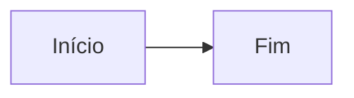

Este parágrafo abre o capítulo de teste. Ele existe só para o motor de PDF e não é conteúdo de estudo.

> [!objetivos]
> - Reconhecer um quadro de **atenção**.
> - Ler uma tabela simples.

## Primeira seção

Texto com **negrito** e *itálico*, seguido de uma lista:

- item um;
- item dois.

> [!atencao] Prazo fictício
> O prazo inventado é de **10 dias**.

> [!atencao]
> Segundo quadro de atenção na mesma seção: sem mascote.

> [!lei] Lei 0.000/2099, art. 1º
> Texto inventado para o teste.

A tabela a seguir compara dois itens.

| Item | Valor |
| --- | --- |
| A | 1 |
| B | 2 |

    x² + y² = r²

## Mapa do capítulo

Resumo do capítulo de teste.

### Para fixar

- Primeiro ponto.
- Segundo ponto.
